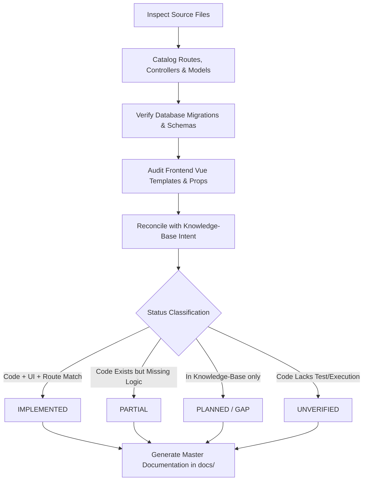

# Scope & Metodologi Audit Dokumentasi Sistem SuperApp Namira

## 1. Identitas Audit
- **Nama Sistem:** SuperApp Namira (v2 Enterprise)
- **Organisasi Pemilik:** Yayasan Namira School (Namira School Foundation)
- **Tanggal Audit:** 16 Oktober 2026
- **Baseline Git Commit:** `971a22b9` (Branch: `main`)
- **Auditor Independen:** Principal Software Architect & QA Documentation Specialist (Autonomous Reverse-Engineering Engine)
- **Status Operasional:** Production / Active Development (Vibe-Coded / AI-Assisted Architecture)

---

## 2. Latar Belakang & Tujuan Audit
Sistem **SuperApp Namira** telah dibangun secara iteratif menggunakan pendekatan *AI-assisted development* (*vibe coding*). Seiring pesatnya penambahan modul (mencapai 11 modul terintegrasi, 75 model Eloquent, 95 controller, dan 160 komponen antarmuka Vue 3), terjadi kesenjangan (*documentation drift*) antara dokumentasi awal pada direktori `knowledge-base/` dengan implementasi aktual pada *source code*.

Tujuan utama penugasan master otonom ini adalah:
1. **Reverse-engineering komprehensif:** Mengaudit seluruh kode sumber secara faktual tanpa asumsi atau fabrikasi.
2. **Rekonsiliasi Status Fitur:** Memilah secara tegas antara fitur yang berstatus `IMPLEMENTED`, `PARTIAL`, `PLANNED`, `UNVERIFIED`, dan `GAP`.
3. **Penyusunan Single Source of Truth:** Membangun dokumentasi teknis, produk, arsitektur, basis data, alur bisnis, keamanan, dan operasional berstandar enterprise dalam direktori `docs/`.
4. **Proteksi Integritas Source Code:** Menjalankan audit secara *read-only* murni terhadap kode aplikasi tanpa mengubah logika bisnis, file konfigurasi, dependensi, migrasi, maupun basis data produksi.

---

## 3. Ruang Lingkup Sistem yang Diaudit (Audit Scope)

### 3.1 Domain & Modul Aplikasi (11 Modul Fungsional)
Audit mencakup 11 modul aplikasi di bawah `app/Modules/` dan modul inti `app/`:

| No | Modul | Namespace | Tanggung Jawab Utama |
|---|---|---|---|
| 1 | **Yayasan (Core)** | `App\Modules\Yayasan` | Multi-tenancy unit sekolah, tahun akademik, manajemen user global, monitoring pulse, audit log, dan master setting. |
| 2 | **Academic** | `App\Modules\Academic` | Siswa, guru, mata pelajaran, rombel/kelas, jadwal mengajar, jurnal KBM, kenaikan kelas (promotion), dan gerbang presensi (gate scan). |
| 3 | **Employee** | `App\Modules\Employee` | Profil staf non-guru, absensi GPS radius & selfie geofence, approval izin/lembur/sakit, dan rekap log giat harian. |
| 4 | **Finance** | `App\Modules\Finance` | Pos bayar, akun rekening bank, tagihan siswa (SPP), pembayaran multi-kanal, verifikasi bukti transfer, dan laporan mutasi kas. |
| 5 | **Counseling (BK)** | `App\Modules\Counseling` | Konseling siswa individu/kelompok, master pelanggaran tata tertib, sanksi poin, dan sertifikat prestasi siswa. |
| 6 | **Sarana & Prasarana (Sarpar)** | `App\Modules\Sarpar` | Kategori aset, ruang, registrasi inventaris & label stiker QR, log pemeliharaan, peminjaman barang, dan log mutasi/disposal. |
| 7 | **LMS** | `App\Modules\LMS` | Kelas digital, publikasi pengumuman, modul materi berkas, penugasan berbatas waktu, upload tugas siswa, dan penilaian gradebook guru. |
| 8 | **Public Relations (Humas)** | `App\Modules\PublicRelations` | Berita sekolah, agenda kegiatan, galeri mitra industri, alumni PTN, testimoni, banner portal, dan lowongan karir yayasan. |
| 9 | **Daycare** | `App\Modules\Daycare` | Presensi balita, authorized pickup wali murid, log harian (makan, tidur, BAB), pemantauan tumbuh kembang, dan jurnal stimulasi. |
| 10 | **SPMB (PPDB)** | `App\Modules\SPMB` | Pendaftaran santri/siswa baru jalur online, verifikasi berkas, portal calon wali murid, seleksi gelombang, dan auto-approval unit. |
| 11 | **Extracurricular (Ekskul)** | `App\Modules\Extracurricular` | Master kegiatan ekstrakurikuler, pelatih/instruktur, pendaftaran anggota ekskul, jadwal sesi latihan, presensi kehadiran, dan nilai ekskul. |

### 3.2 Lapisan Teknis yang Diaudit
1. **Backend Framework & Runtime:** PHP 8.2+ / 8.4 Platform, Laravel 12.0, Composer dependencies.
2. **Database Engine & Persistence:** MySQL 8.x, 82 skema migrasi Laravel, indeks, unique constraints, dan foreign key constraints.
3. **Frontend SPA & PWA:** Vue 3.5 (Composition API `<script setup>`), Inertia.js 3.6, Tailwind CSS 4, Vite 8, Vite PWA Service Worker.
4. **Security & Access Control:** Spatie Permission 6.24 dengan Teams Multi-Tenancy (`team_id`), Laravel Sanctum 4.0, Middleware Authorization, Geofence Attendance Validator.
5. **Real-time & Background Processing:** Laravel Reverb (WebSockets Echo), Firebase Cloud Messaging (FCM Push Notifications), WhatsApp Queue Helper, Laravel Pulse.
6. **Testing & Quality Baseline:** Pest PHP v4, PHPUnit, Unit Tests, Feature Tests, Security Regression Wave scripts.

---

## 4. Area di Luar Cakupan (Out-of-Scope)
1. **Infrastruktur Fisik cPanel / Server Hosting:** Konfigurasi bare-metal hosting, server WHM, dan DNS provider tidak diakses langsung melainkan dievaluasi melalui artefak kode dan file deployment.
2. **Kredensial Rahasia & Data PII:** Nilai rahasia seperti `.env` production keys, private tokens, FCM private service accounts, password hash, dan nomor telepon wali murid aktual tidak diekspos ke dokumentasi publik.
3. **Penetration Testing Destruktif:** Audit tidak melakukan stress testing DDoS, payload injeksi berbahaya terhadap instance aktif, atau penghapusan data seeder/operasional.

---

## 5. Metodologi Reverse-Engineering & Verifikasi Faktual

Audit dijalankan dengan pendekatan **Evidence-Based Technical Discovery**:

### Standar Klasifikasi Status:
- **`IMPLEMENTED`**: Fitur memiliki rute aktif, controller fungsional, skema database yang mendukung, dan komponen antarmuka yang tersambung secara utuh.
- **`PARTIAL`**: Fitur telah memiliki antarmuka atau endpoint namun sebagian aksi bisnis belum tuntas (misal: tombol aksi belum terhubung atau validasi belum ketat).
- **`PLANNED`**: Fitur tercantum dalam rencana bisnis atau `knowledge-base/` tetapi belum memiliki implementasi rute/controller di `app/`.
- **`UNVERIFIED`**: Kode tersedia namun belum dapat diobservasi secara runtime atau memerlukan integrasi perangkat pihak ketiga (misalnya gateway WhatsApp fisik atau mesin scanner gerbang).
- **`GAP`**: Terdapat inkonsistensi antara ekspektasi bisnis yayasan dengan implementasi teknis saat ini.
- **`NOT_APPLICABLE`**: Modul/fitur standar Laravel bawaan yang dinonaktifkan atau digantikan oleh modul kustom Namira.
