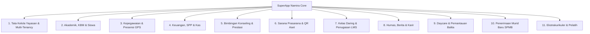

# Product Requirements Document (PRD) — AS-IS (Kondisi Terpasang)

## 1. Identitas Produk & Konteks Bisnis
- **Nama Produk:** SuperApp Namira (v2 Enterprise)
- **Pemilik Sistem:** Yayasan Namira School (Namira School Foundation)
- **Sektor:** Manajemen Operasional Lembaga Pendidikan Terpadu (Yayasan Pendidikan Multi-Unit)
- **Status Rilis:** Production / Active Feature Expansion
- **Baseline Kode Sumber:** Commit `971a22b9` (16 Oktober 2026)

### 1.1 Visi Produk
Mewujudkan platform digital terpusat (*SuperApp Single Source of Truth*) yang mengintegrasikan seluruh lini layanan pendidikan di bawah naungan Yayasan Namira School: mulai dari jenjang anak usia dini (Daycare, Kelompok Bermain, TK), pendidikan dasar & menengah (SD, SMP), hingga unit non-formal (Pavlov Center), mencakup pilar akademik, administrasi kepegawaian, keuangan, sarana prasarana, bimbingan konseling, dan hubungan masyarakat.

### 1.2 Masalah Bisnis yang Diselesaikan
Sebelum adanya SuperApp Namira:
1. **Fragmentasi Data Antar-Unit:** Setiap unit sekolah (KB, TK Kraksaan/Dringu, SD, SMP) memiliki pencatatan siswa, guru, dan inventaris yang terisolasi tanpa visibilitas terpusat bagi pimpinan yayasan.
2. **Kecurangan Presensi Pegawai:** Presensi manual rentan terhadap manipulasi waktu dan lokasi kedatangan.
3. **Ketidakteraturan Penagihan SPP:** Pembayaran SPP manual memicu keterlambatan rekonsiliasi kas dan tingginya tunggakan tanpa peringatan sistemik.
4. **Ketiadaan Pemantauan KBM Real-Time:** Yayasan dan kepala sekolah kesulitan memverifikasi apakah guru benar-benar mengajar sesuai jadwal dan capaian kurikulum.

---

## 2. Cakupan Fungsional Produk Aktual (11 Domain Terpasang)

### 2.1 Tata Kelola Multi-Tenancy Yayasan
- Kemampuan beralih unit aktif (*Unit Switching*) bagi peran global tanpa keluar masuk sesi (*seamless context switch*).
- Manajemen master unit sekolah, kalender libur tahunan, dan parameter konfigurasi global.
- Pemantauan telemetri performa sistem (*Laravel Pulse*) dan audit jejak aktivitas (*Activity Log*).

### 2.2 Akademik & Manajemen KBM
- Direktori master siswa, guru, mata pelajaran, dan rombongan belajar (rombel).
- Penyusunan jadwal pelajaran mingguan dengan dukungan sesi kelas gabungan (*multi-classroom joint session*).
- Jurnal mengajar harian guru yang mewajibkan input capaian Tujuan Pembelajaran (TP) dan presensi kelas.
- Pemindaian barcode di gerbang masuk (*Gate Scan Check-in*) yang menyiarkan status keterlambatan secara instan ke layar pos satpam dan guru piket.
- Mesin kenaikan kelas dan kelulusan massal (*Class Promotion Engine*) dengan validasi kelayakan dan fitur pembatalan (*rollback*).

### 2.3 Kepegawaian & Presensi Geofencing
- Presensi mobile PWA berbasis koordinat GPS HTML5 dan swafoto (*selfie*) real-time kamera.
- Validasi jarak radius otomatis menggunakan formula Haversine terhadap master `AttendanceLocation`.
- Pengisian log giat harian karyawan (*daily activity logbook*) dengan unggah foto bukti kerja.
- Alur persetujuan (*approval workflow*) izin, dinas luar, lembur, dan sakit oleh pimpinan unit.

### 2.4 Keuangan Sekolah & Kas
- Penagihan SPP bulanan otomatis per rombel dengan dukungan beasiswa/diskon khusus siswa.
- Pembayaran multi-kanal (tunai di kasir, transfer manual dengan unggah bukti transfer).
- Verifikasi bukti transfer oleh kasir dan pencetakan kuitansi resmi PDF.
- Laporan rekapitulasi tunggakan siswa (*arrears monitoring*) dan buku besar mutasi kas masuk/keluar.

### 2.5 Bimbingan Konseling & Tata Tertib
- Master kategori pelanggaran tata tertib sekolah dengan sistem bobot poin akumulatif.
- Pencatatan insiden pelanggaran siswa dengan notifikasi otomatis ke nomor WhatsApp orang tua.
- Registrasi prestasi dan piagam penghargaan kejuaraan siswa.
- Penjadwalan dan dokumentasi sesi bimbingan konseling individual dan kelompok.

### 2.6 Sarana & Prasarana (Sarpar)
- Master registrasi barang aset inventaris terikat ruang/gedung unit sekolah.
- Generator dan pencetakan massal label stiker QR code aset untuk pemindaian instan via kamera HP.
- Pengajuan dan sirkulasi peminjaman aset serta pemantauan tenggat pengembalian.
- Log pemeliharaan kerusakan barang, biaya reparasi, dan penunjukan vendor servis.
- Mutasi aset antar-ruang dan berita acara penghapusan (*disposal*) aset afkir.

### 2.7 LMS & Pembelajaran Digital
- Ruang kelas digital per rombel/mapel untuk pembagian materi dan pengumuman kelas.
- Unggah berkas dokumen modul ajar (PDF) dan tautan video pembelajaran.
- Pembuatan tugas terstruktur dengan batas waktu pengumpulan (*deadline*).
- Pengumpulan berkas tugas siswa dan buku nilai (*gradebook*) terpadu bagi guru.

### 2.8 Layanan Spesifik: Daycare, SPMB, & Ekskul
- **Daycare:** Presensi balita, otorisasi penjemput berfoto, log makan/tidur/BAB, grafik tumbuh kembang, dan jurnal stimulasi.
- **SPMB:** Formulir pendaftaran calon murid baru online, portal status calon wali santri, seleksi berkas panitia, dan penetapan nomor induk siswa.
- **Ekstrakurikuler:** Pendaftaran klub bakat/minat, master pelatih luar, presensi sesi latihan mingguan, dan penilaian rapor ekskul.

---

## 3. Profil Pengguna & Stakeholder
1. **Pembina & Pengawas Yayasan:** Memantau metrik eksekutif, rekap kehadiran seluruh unit, laporan keuangan global, dan integritas operasional.
2. **Super Admin & Admin Yayasan:** Konfigurasi teknis, manajemen akun, pembagian hak akses, dan master data multi-tenancy.
3. **Kepala Sekolah & Admin Unit:** Pengendali operasional unit sekolah, kenaikan kelas, persetujuan presensi guru, dan kalender KBM.
4. **Pendidik / Guru:** Mengisi jurnal mengajar, mencatat absensi siswa, mengelola kelas LMS, dan memeriksa tugas siswa.
5. **Karyawan / Staf:** Melakukan presensi GPS mobile, mengisi log giat harian, dan mengajukan cuti.
6. **Petugas Keuangan / Kasir:** Menerbitkan tagihan, memvalidasi bukti transfer, menerima uang kas, dan mengelola arus kas.
7. **Guru BK:** Menangani sesi konseling, mencatat pelanggaran tata tertib, dan merekap prestasi siswa.
8. **Koordinator Sarpar:** Menata aset barang, menempel stiker QR, mengelola perbaikan dan peminjaman inventaris.
9. **Siswa & Wali Santri:** Melihat jadwal KBM, mengecek tagihan SPP, mengunggah tugas LMS, dan memantau kehadiran gerbang.

---

## 4. Keunggulan & Batasan Operasional Saat Ini

### Keunggulan Terverifikasi:
- Antarmuka responsif PWA dengan dukungan instalasi ke homescreen HP Android/iOS.
- Desain visual konsisten mengusung identitas Namira Teal (`#0B7068`) dan tipografi modern.
- Siaran notifikasi instan real-time via WebSockets Laravel Reverb.
- Isolasi multi-tenancy yang aman berbasis Spatie Teams (`team_id`).

### Batasan Faktual Saat Ini:
- Pengiriman notifikasi WhatsApp mengandalkan vendor REST API eksternal yang belum memiliki fallback otomatis jika vendor down.
- Pembayaran online belum terhubung ke Payment Gateway otomatis (*Midtrans/Xendit*), masih mengandalkan verifikasi manual kasir terhadap bukti transfer.
