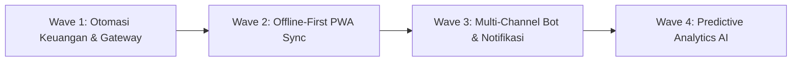

# Product Requirements Document (PRD) — TO-BE (Rekomendasi & Roadmap Masa Depan)

## 1. Visi Masa Depan (SuperApp Namira v3)
Mengembangkan SuperApp Namira dari sistem informasi operasional sekolah (*ERP-like school management*) menjadi **Ekosistem Pendidikan Cerdas & Otonom** (*Smart Educational Foundation Ecosystem*) yang berbasis data real-time, otomatisasi rekonsiliasi keuangan, dan kecerdasan buatan (*AI Analytics*) untuk memitigasi risiko putus sekolah dan mengoptimalkan kepuasan wali santri.

---

## 2. Inisiatif Strategis & Peta Jalan Penyempurnaan (Roadmap)

---

## 3. Rincian Kebutuhan Pengembangan (TO-BE Features)

### 3.1 Integrasi Payment Gateway Otomatis (Fintech Integration)
- **Status Saat Ini:** Wali murid mentransfer manual ke rekening bank sekolah lalu mengunggah foto bukti bayar; staf kasir memeriksa mutasi manual dan mengubah status tagihan.
- **Kebutuhan TO-BE:**
  - Integrasi dengan aggregator pembayaran berlisensi (misal: Midtrans, Xendit, atau BSI Virtual Account).
  - Setiap siswa otomatis memiliki nomor Virtual Account (VA) tetap dan QRIS Dinamis untuk setiap tagihan SPP.
  - Saat wali murid membayar di ATM/mobile banking, webhook otomatis mengubah status `StudentBill` menjadi `paid`, menerbitkan nomor kuitansi digital, dan mengirim kuitansi PDF via WhatsApp dalam hitungan detik.
  - Menghilangkan beban verifikasi manual kasir sebesar 90%.

### 3.2 Arsitektur Offline-First Presensi & PWA Background Sync
- **Status Saat Ini:** Jika sinyal internet perangkat guru/staf terputus saat berada di area sekolah, presensi gagal disubmit karena memerlukan koneksi langsung ke endpoint `/employee/attendance`.
- **Kebutuhan TO-BE:**
  - Memanfaatkan **IndexedDB** browser melalui Workbox untuk menyimpan rekaman presensi selfie dan koordinat GPS secara lokal saat offline.
  - Menerapkan **PWA Background Sync API**: Begitu perangkat mendeteksi koneksi internet pulih, antrean presensi otomatis terkirim ke server dengan cap waktu (*timestamp*) asli saat tombol ditekan.
  - Memvalidasi integritas waktu offline menggunakan enkripsi payload lokal untuk mencegah kecurangan pemalsuan jam perangkat.

### 3.3 Engine Notifikasi Multi-Vendor dengan Fallback Otomatis
- **Status Saat Ini:** Pengiriman pesan WhatsApp bergantung pada satu URL gateway pihak ketiga (`WA_GATEWAY_URL`). Jika gateway mengalami gangguan, pesan tertahan di `WhatsAppQueue`.
- **Kebutuhan TO-BE:**
  - Menerapkan pola *Circuit Breaker* dan multi-vendor provider (Vendor A utama, Vendor B cadangan, dan Fallback SMS/Email).
  - Jika Vendor A gagal merespons dalam 3 detik, pesan otomatis dialihkan ke antrean Vendor B tanpa intervensi manual pengembang.

### 3.4 Early Warning System & Predictive Analytics Kesiswaan
- **Status Saat Ini:** Rekap kehadiran dan tunggakan disajikan dalam bentuk tabel historis.
- **Kebutuhan TO-BE:**
  - Algoritma analitik prediktif yang menghitung skor risiko siswa (*Student at Risk Score*):
    - Siswa dengan tren absensi menurun > 3 kali dalam 2 minggu.
    - Siswa dengan akumulasi poin pelanggaran BK mendekati ambang pemanggilan orang tua.
    - Keterlambatan pembayaran SPP berturut-turut > 2 bulan.
  - Dashboard eksekutif pembina yayasan menyajikan rekomendasi preventif bagi kepala sekolah dan wali kelas sebelum masalah membesar.

### 3.5 Rapor Akademik Terstandarisasi Kemendikbudristek (e-Rapor Kurikulum Merdeka)
- **Status Saat Ini:** Modul akademik telah memiliki master CP/TP, jurnal KBM, dan absensi, namun cetak rapor akhir semester masih parsial.
- **Kebutuhan TO-BE:**
  - Modul pengolahan nilai sumatif lingkup materi dan nilai akhir rapor.
  - Template cetak buku rapor Kurikulum Merdeka resmi (Deskripsi Capaian Pembelajaran, Karakter Profil Pelajar Pancasila) berformat PDF siap cetak untuk SD dan SMP Namira.

---

## 4. Matriks Prioritas & Dampak Bisnis

| No | Inisiatif TO-BE | Dampak Bisnis | Kompleksitas Teknis | Estimasi Waktu | Prioritas |
|---|---|---|---|---|---|
| 1 | Automated Payment Gateway (VA & QRIS) | Sangat Tinggi (Efisiensi Kas & Zero Error) | Sedang | 3 - 4 Minggu | **P0 (Urgent)** |
| 2 | Rapor Lengkap Kurikulum Merdeka | Sangat Tinggi (Kepatuhan Regulasi & Akreditasi) | Sedang | 3 Minggu | **P0 (Urgent)** |
| 3 | Offline-First PWA Sync Presensi | Tinggi (Kepuasan Pengguna & Stabilitas) | Sedang | 2 Minggu | **P1 (High)** |
| 4 | Multi-Vendor WhatsApp Circuit Breaker | Tinggi (Keandalan Notifikasi) | Rendah | 1 Minggu | **P1 (High)** |
| 5 | Predictive Analytics Dashboard AI | Sedang (Dukungan Keputusan Strategis) | Tinggi | 4 Minggu | **P2 (Medium)** |
