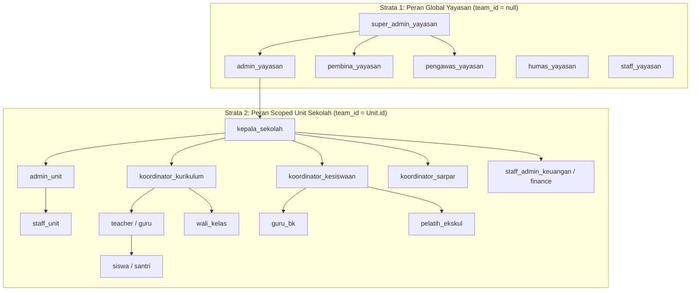

# User Personas & Role Matrix (Profil Pengguna & Struktur Hak Akses)

Dokumen ini mendefinisikan hierarki 20 peran (*roles*) dalam sistem SuperApp Namira beserta pemetaan persona pengguna nyata di lingkungan Yayasan Namira School.

---

## 1. Hierarki Peran Sistem (Role Taxonomy)

Sistem membedakan peran menjadi dua strata utama berbasis arsitektur multi-tenancy Spatie Permission dengan dukungan Spatie Teams (`team_id`):

---

## 2. Katalog 20 Peran & Tanggung Jawab Operasional

| No | Nama Role Sistem | Lingkup Wilayah | Tanggung Jawab & Wewenang Utama |
|---|---|---|---|
| 1 | `super_admin_yayasan` | Global Seluruh Unit | Akses tanpa batas ke seluruh modul, konfigurasi sistem, database, dan pemeliharaan server. |
| 2 | `admin_yayasan` | Global Seluruh Unit | Manajemen unit, kalender libur yayasan, direktori pengguna, lokasi absensi GPS, dan mutasi kas. |
| 3 | `pembina_yayasan` | Global Seluruh Unit | Pemantauan dashboard eksekutif, rekapitulasi kehadiran global, dan laporan keuangan yayasan. |
| 4 | `pengawas_yayasan` | Global Seluruh Unit | Supervisi mutu pembelajaran, audit jurnal mengajar guru, dan evaluasi kepatuhan SOP unit. |
| 5 | `humas_yayasan` | Global Seluruh Unit | Publikasi warta umum, agenda kegiatan yayasan, lowongan kerja, dan kemitraan eksternal. |
| 6 | `staff_yayasan` | Global Kantor Yayasan| Presensi GPS kantor yayasan, pengisian log giat harian, dan administrasi perkantoran yayasan. |
| 7 | `kepala_sekolah` | Scoped Unit Sekolah | Pimpinan unit: persetujuan absensi/cuti guru, eksekusi kenaikan kelas, dan laporan unit. |
| 8 | `admin_unit` | Scoped Unit Sekolah | Tata usaha unit: input siswa, guru, rombel kelas, jadwal KBM, dan administrasi surat-menyurat. |
| 9 | `koordinator_kurikulum`| Scoped Unit Sekolah | Perumusan jadwal KBM mingguan, kurikulum TP/bab merdeka, dan supervisi jurnal guru. |
| 10 | `koordinator_kesiswaan`| Scoped Unit Sekolah | Pembinaan kedisiplinan siswa, pengawasan pelanggaran tata tertib, dan ekstrakurikuler. |
| 11 | `koordinator_sarpar` | Scoped Unit Sekolah | Inventarisasi aset unit, pencetakan stiker QR, log pemeliharaan, dan peminjaman barang. |
| 12 | `staff_admin_keuangan` | Scoped Unit Sekolah | Penerbitan tagihan SPP, penerimaan kas pembayaran, verifikasi bukti transfer, cetak kuitansi. |
| 13 | `finance` | Scoped Unit / Global| Alias peran pengelola buku kas, rekonsiliasi bank, dan laporan tunggakan. |
| 14 | `teacher` / `guru` | Scoped Unit Sekolah | Mengajar KBM, mengisi jurnal mengajar, mencatat absensi siswa, materi dan tugas LMS. |
| 15 | `wali_kelas` | Scoped Kelas Unit | Pengawasan rombel binaan, koordinasi dengan wali santri, dan validasi kenaikan kelas. |
| 16 | `bk` (Guru BK) | Scoped Unit Sekolah | Bimbingan konseling siswa, penanganan pelanggaran tata tertib, dan sertifikasi prestasi. |
| 17 | `pelatih_ekskul` | Scoped Unit Sekolah | Pelatih bakat/minat: presensi sesi latihan mingguan dan penilaian akhir ekskul siswa. |
| 18 | `staff_unit` | Scoped Unit Sekolah | Staf pendukung unit (satpam gerbang, kebersihan, laboran, pustakawan). |
| 19 | `siswa` | Scoped Akun Pribadi | Portal siswa: jadwal KBM, unduh materi/tugas LMS, cek tagihan SPP, barcode gerbang. |
| 20 | Pengasuh Daycare | Scoped Unit Daycare | Presensi balita, log makan/tidur/BAB, pemantauan grafik fisik, dan jurnal stimulasi. |

---

## 3. Profil Persona Pengguna Representatif

### Persona 1: Ustadz Ahmad (Guru Pengampu & Wali Kelas SD Namira)
- **Karakteristik:** Pria, 32 tahun, mengajar Matematika kelas 4 dan menjadi wali kelas 4A.
- **Kebutuhan Harian:**
  - Melakukan presensi mobile selfie saat tiba di sekolah dalam radius 100 meter.
  - Membuka menu Jadwal Mengajar Saya di HP untuk melihat kelas berikutnya.
  - Mengisi jurnal KBM harian (materi, TP, catatan) dan mencentang absensi siswa langsung dari HP.
  - Mengunggah materi ajar dan kuis tugas ke kelas digital LMS.
- **Poin Friksi yang Teratasi:** Dulu harus membawa buku jurnal fisik tebal dan mengetik ulang absensi di Excel sore hari; kini selesai dalam 2 menit di ruang kelas melalui HP.

### Persona 2: Ibu Nurul (Staf Keuangan & Kasir Yayasan)
- **Karakteristik:** Wanita, 28 tahun, bertanggung jawab atas penagihan dan penerimaan kas SPP santri.
- **Kebutuhan Harian:**
  - Menerbitkan tagihan SPP bulanan untuk 500+ siswa dengan sekali klik (*generate bill*).
  - Memeriksa unggahan foto bukti transfer wali murid dari dashboard keuangan.
  - Mencetak kuitansi pembayaran resmi berlogo yayasan saat wali santri membayar tunai.
  - Mengunduh rekapitulasi siswa yang menunggak lebih dari 2 bulan untuk ditindaklanjuti.
- **Poin Friksi yang Teratasi:** Mengurangi selisih kas dan memangkas waktu pencarian bukti transfer fisik.

### Persona 3: Pak Hendra (Koordinator Sarana & Prasarana)
- **Karakteristik:** Pria, 40 tahun, mengelola 1.500+ unit aset barang di seluruh gedung sekolah.
- **Kebutuhan Harian:**
  - Menempelkan label stiker QR code tahan air pada setiap meja, laptop, proyektor, dan AC.
  - Memindai stiker aset menggunakan kamera HP saat audit stok opname rutin.
  - Mencatat laporan kerusakan barang (misal proyektor mati) dan melacak status perbaikan vendor.
- **Poin Friksi yang Teratasi:** Aset yang berpindah ruangan tanpa izin kini dapat langsung dilacak lokasinya.

### Persona 4: Bunda Salma (Wali Santri Siswa SD & Bayi Daycare)
- **Karakteristik:** Wanita pekerja, 34 tahun, memiliki anak di kelas 1 SD dan balita umur 2 tahun di Daycare Namira.
- **Kebutuhan Harian:**
  - Memantau notifikasi gerbang saat anaknya tiba di sekolah di pagi hari.
  - Mengecek log harian balita di daycare: jam berapa tidur siang, apa menu makannya, dan kondisi emosionalnya.
  - Membayar tagihan SPP dan mengunggah bukti bayar secara instan dari smartphone tanpa harus antre di bank.
- **Poin Friksi yang Teratasi:** Tenang bekerja di kantor karena seluruh perkembangan anak terpantau secara transparan.
