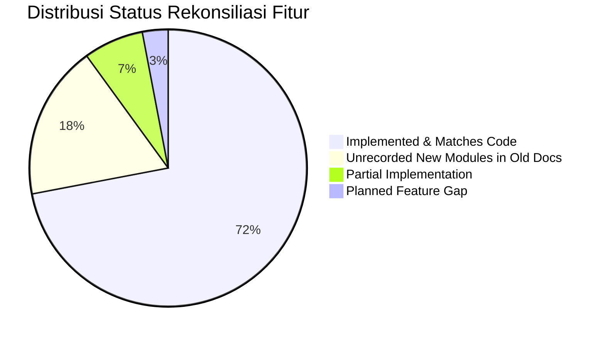

# Gap Analysis (Analisis Kesenjangan Dokumentasi vs Implementasi Riil)

Dokumen ini merekonsiliasi dokumen terdahulu yang terdapat pada direktori `knowledge-base/` dengan implementasi riil yang ditemukan di dalam kode sumber SuperApp Namira pada commit `971a22b9`.

---

## 1. Ringkasan Kesenjangan Utama (Executive Gap Summary)

Audit menemukan bahwa arsitektur sistem telah berkembang jauh melampaui apa yang dicatat di dalam dokumen `knowledge-base/`. Terdapat 3 modul fungsional penuh baru yang telah beroperasi di kode sumber tetapi belum pernah terdokumentasi, serta beberapa fitur kritis yang telah disempurnakan.

---

## 2. Rincian Temuan Kesenjangan (Gap Findings)

### GAP-01: Tiga Modul Lengkap Belum Terekam di Knowledge-Base
- **Temuan Dokumen Lama:** Dokumen `knowledge-base/03_DOMAIN_MASTER.md` hanya mencatat 8 domain (Academic, Counseling, Employee, Finance, LMS, PublicRelations, Sarpar, Yayasan).
- **Kenyataan Kode Sumber:** Terdapat **3 modul enterprise baru** yang telah diimplementasikan secara utuh lengkap dengan skema migrasi, model, controller, rute, dan halaman Vue:
  1. **Modul Daycare:** (`app/Modules/Daycare/` & `routes/daycare.php` & 7 tabel database).
  2. **Modul SPMB / PPDB:** (`app/Modules/SPMB/` & `routes/spmb.php` & portal pendaftaran online).
  3. **Modul Ekstrakurikuler:** (`app/Modules/Extracurricular/` & `routes/extracurricular.php` & 6 tabel database).
- **Status Tindak Lanjut:** `RESOLVED` — Seluruh modul baru telah diakomodasi dan diinventarisasi penuh dalam dokumen `docs/`.

---

### GAP-02: Fitur Sesi Kelas Gabungan (Multi-Class Joint Sessions)
- **Temuan Dokumen Lama:** Desain jadwal KBM di `13_ACADEMIC_WORKFLOW.md` mengasumsikan 1 jadwal hanya milik 1 `classroom_id`.
- **Kenyataan Kode Sumber:** Pada `app/Modules/Academic/Models/ClassSchedule.php` dan `ScheduleController.php`, sistem telah mendukung relasi multi-kelas (`classroom_ids` JSON / multi-records) di mana 1 guru mengajar beberapa kelas sekaligus pada jam yang sama (misal: pelajaran PJOK atau Pramuka).
- **Status Tindak Lanjut:** `RESOLVED` — Telah diperbarui dalam PRD dan arsitektur database.

---

### GAP-03: Sistem Gerbang Presensi Real-Time (Gate Scan Checkin)
- **Temuan Dokumen Lama:** Kehadiran siswa hanya dicatat oleh guru di dalam kelas via jurnal mengajar.
- **Kenyataan Kode Sumber:** Sistem telah memiliki modul pemindaian gerbang `StudentCheckinController.php`, event real-time `StudentScannedAtGate`, tabel `student_checkins`, dan antarmuka pemantauan kedatangan siswa secara instan di pos keamanan.
- **Status Tindak Lanjut:** `RESOLVED` — Dimasukkan ke dalam Functional Requirements dan User Stories.

---

### GAP-04: Mesin Kenaikan Kelas Massal dengan Rollback
- **Temuan Dokumen Lama:** Alur kenaikan kelas dicatat sebagai proses pemindahan manual sederhana.
- **Kenyataan Kode Sumber:** Terdapat service khusus `PromotionExecutionService.php` dan `PromotionValidationEngineTest.php` yang menjalankan transaksi database atomik, pembuatan log audit, pencatatan snapshot riwayat rombel, dan kemampuan rollback pemulihan kelas jika terjadi kesalahan eksekusi.
- **Status Tindak Lanjut:** `RESOLVED` — Didokumentasikan secara detail pada alur bisnis akademik.

---

### GAP-05: Otomasi Payment Gateway Keuangan (Planned vs As-Is)
- **Temuan Dokumen Lama:** Dokumen visi keuangan menyebutkan integrasi Virtual Account otomatis (*automatic reconciliation*).
- **Kenyataan Kode Sumber:** Pembayaran tagihan saat ini berjalan secara semi-otomatis melalui unggahan foto bukti transfer (`uploadPaymentProof`) oleh wali murid dan verifikasi manual kasir di dashboard keuangan (`StudentBillController::pay`). Belum ada integrasi webhook Midtrans/Xendit di kode sumber.
- **Klasifikasi Status:** `GAP (Planned Feature)` — Dimasukkan ke dalam PRD TO-BE sebagai inisiatif prioritas utama.

---

### GAP-06: Verifikasi Operasional Gateway WhatsApp
- **Temuan Dokumen Lama:** Notifikasi WhatsApp diasumsikan aktif secara universal.
- **Kenyataan Kode Sumber:** Helper `WhatsAppHelper.php` dan tabel `whatsapp_messages_queue` telah dibuat, namun endpoint pengiriman keluar (`WA_GATEWAY_URL`) bergantung pada API vendor eksternal yang belum terverifikasi ketersediaannya di lingkungan pengujian lokal.
- **Klasifikasi Status:** `UNVERIFIED` — Ditandai dengan jelas pada dokumen integrasi dan keamanan.
