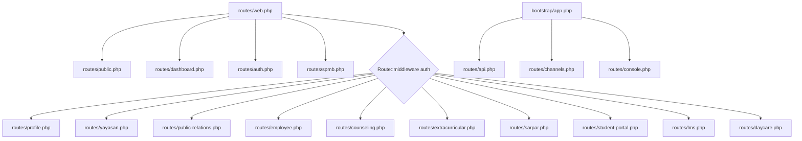

# Route Inventory (Katalog Lengkap Routing Sistem SuperApp Namira)

Dokumen ini memetakan arsitektur routing modular SuperApp Namira yang terdiri dari 18 berkas rute terpisah dan 481 endpoint terdaftar.

---

## 1. Arsitektur Pemisahan Berkas Rute (Route File Splitting)

Sistem mengadopsi pola pemisahan rute modular di dalam direktori `routes/`:

---

## 2. Katalog Rute per Kelompok Domain

### 2.1 Rute Publik, Beranda & Portal Informasi (`routes/public.php`, `routes/public-relations.php`)
- `GET /` : Landing page portal publik SuperApp Namira (`HomeController`).
- `GET /berita` : Galeri warta sekolah Namira (`PublicNewsController@index`).
- `GET /berita/{slug}` : Detail artikel berita sekolah.
- `GET /agenda` : Daftar agenda kegiatan yayasan dan unit.
- `GET /agenda/{id}` : Detail agenda kegiatan.
- `GET /karir` : Lowongan pekerjaan dan karir yayasan (`PublicCareerController@index`).
- `POST /karir/lamar` : Pengiriman lamaran kerja kandidat online.
- `GET /tentang-kami` : Profil yayasan, visi-misi, dan unit sekolah.

### 2.2 Rute Autentikasi & Profil (`routes/auth.php`, `routes/profile.php`)
- `GET /login` : Halaman login pengguna (`AuthenticatedSessionController@create`).
- `POST /login` : Otentikasi sesi kredensial (`AuthenticatedSessionController@store`).
- `POST /logout` : Penghancuran sesi login (`AuthenticatedSessionController@destroy`).
- `GET /forgot-password` & `POST /forgot-password` : Reset kata sandi melalui tautan email.
- `GET /reset-password/{token}` & `POST /reset-password` : Eksekusi reset kata sandi baru.
- `GET /profile` : Pengaturan profil pengguna, ubah foto, dan ganti sandi (`ProfileController@edit`).
- `PATCH /profile` & `DELETE /profile` : Pembaruan data profil dan penutupan akun.
- `POST /push-token` : Pendaftaran token FCM perangkat mobile untuk web push (`PushTokenController@store`).

### 2.3 Rute Tata Kelola Yayasan (`routes/yayasan.php`) — Prefix `/yayasan`
*Dilindungi middleware:* `auth`, `CheckUnitScope`, `role:super_admin_yayasan|admin_yayasan|pembina_yayasan|pengawas_yayasan|admin_unit|kepala_sekolah|...`
- **Dashboard:** `GET /yayasan/dashboard` (`PembinaDashboardController@index`).
- **Unit Sekolah:** `RESOURCE /yayasan/units` (`UnitController`).
- **Tahun Akademik:** `RESOURCE /yayasan/academic-years` (`AcademicYearController`).
- **Pengguna:** `RESOURCE /yayasan/users` (`UserController`).
- **Ganti Unit Aktif:** `POST /yayasan/switch-unit` (`UserController@switchUnit`).
- **Lokasi Absensi:** `RESOURCE /yayasan/attendance-locations` (`AttendanceLocationController`).
- **Hari Libur:** `RESOURCE /yayasan/holidays` (`HolidayController`).
- **Persetujuan Absensi:** `GET /yayasan/attendance-approvals` (`AttendanceApprovalController`).
- **Data Absensi Harian:** `GET /yayasan/attendance-data` (`AttendanceDataController`).
- **Pengaturan Global:** `GET/POST /yayasan/settings` (`SettingController`).
- **Monitoring Pulse:** `GET /yayasan/monitoring` (`MonitoringController`).

### 2.4 Rute Akademik & Kesiswaan (Di dalam `routes/yayasan.php`)
- **Siswa:** `RESOURCE /yayasan/students` (`StudentController`).
- **Guru:** `RESOURCE /yayasan/teachers` (`TeacherController`).
- **Kelas / Rombel:** `RESOURCE /yayasan/classrooms` (`ClassroomController`).
- **Mata Pelajaran:** `RESOURCE /yayasan/subjects` (`SubjectController`).
- **Tujuan Pembelajaran (TP):** `RESOURCE /yayasan/learning-objectives` (`LearningObjectiveController`).
- **Jadwal Pelajaran:** `RESOURCE /yayasan/schedules` (`ScheduleController`).
- **Clone Jadwal:** `POST /yayasan/schedules/clone`.
- **Cetak Jadwal PDF:** `GET /yayasan/schedules/export-pdf`.
- **Jurnal KBM:** `RESOURCE /yayasan/teaching-journals` (`TeachingJournalController`).
- **Presensi Siswa:** `RESOURCE /yayasan/student-attendances` (`StudentAttendanceController`).
- **Kenaikan Kelas:** `RESOURCE /yayasan/class-promotions` (`ClassPromotionController`).
- **Scan Gerbang:** `GET/POST /yayasan/student-checkin` (`StudentCheckinController`).

### 2.5 Rute Keuangan Sekolah (Di dalam `routes/yayasan.php`)
- **Dashboard Keuangan:** `GET /yayasan/finance-dashboard` (`FinanceDashboardController@index`).
- **Pos Bayar:** `RESOURCE /yayasan/finance-types` (`FinanceTypeController`).
- **Rekening Bank:** `RESOURCE /yayasan/finance-accounts` (`FinanceAccountController`).
- **Tagihan Siswa:** `RESOURCE /yayasan/student-bills` (`StudentBillController`).
- **Bayar Tagihan:** `POST /yayasan/student-bills/{id}/pay`.
- **Upload Bukti Transfer:** `POST /yayasan/student-bills/{id}/payment-proof`.
- **Mutasi Kas:** `RESOURCE /yayasan/finance-transactions` (`TransactionController`).
- **Rekap Tunggakan:** `GET /yayasan/finance-reports/arrears` (`FinanceReportController@arrears`).

### 2.6 Rute Kepegawaian & Giat (`routes/employee.php`) — Prefix `/employee`
- `GET /employee/attendance` : Halaman presensi mobile GPS selfie (`AttendanceController@index`).
- `POST /employee/attendance` : Submit rekaman absen masuk/pulang dengan validasi geofence (`AttendanceController@store`).
- `GET /employee/attendance/history` : Riwayat absensi bulanan karyawan.
- `RESOURCE /employee/activity-logs` : Log giat aktivitas harian karyawan (`EmployeeActivityLogController`).
- `RESOURCE /employee/staff` : Direktori data staf kepegawaian (`StaffController`).

### 2.7 Rute Bimbingan Konseling (`routes/counseling.php`) — Prefix `/counseling`
- `RESOURCE /counseling/categories` : Master kategori pelanggaran (`ViolationCategoryController`).
- `RESOURCE /counseling/violations` : Pencatatan pelanggaran siswa (`ViolationController`).
- `RESOURCE /counseling/sessions` : Sesi bimbingan konseling siswa (`CounselingSessionController`).
- `RESOURCE /counseling/achievements` : Rekap prestasi & sertifikat siswa (`AchievementController`).

### 2.8 Rute Sarana Prasarana (`routes/sarpar.php`) — Prefix `/sarpar`
- `GET /sarpar/dashboard` : Ringkasan aset sarpras (`DashboardController@index`).
- `RESOURCE /sarpar/categories` : Kategori aset (`CategoryController`).
- `RESOURCE /sarpar/rooms` : Data ruang/gedung unit (`RoomController`).
- `RESOURCE /sarpar/inventories` : Master data barang inventaris (`InventoryController`).
- `GET /sarpar/stickers/print` : Cetak lembar stiker QR Code inventaris (`StickerController@print`).
- `RESOURCE /sarpar/loans` : Peminjaman barang aset (`LoanController`).
- `RESOURCE /sarpar/maintenance` : Log pemeliharaan barang (`MaintenanceController`).
- `RESOURCE /sarpar/transfers` : Mutasi antar-ruang & disposal aset (`AssetActionController`).

### 2.9 Rute LMS (`routes/lms.php`) — Prefix `/lms`
- `RESOURCE /lms/classrooms` : Kelas digital LMS (`LmsClassroomController`).
- `POST /lms/classrooms/{id}/materials` : Unggah materi berkas modul ajar.
- `POST /lms/classrooms/{id}/assignments` : Buat penugasan siswa.
- `GET /lms/classrooms/{id}/gradebook` : Rekap buku nilai tugas guru.
- `POST /lms/assignments/{id}/submit` : Unggah pengumpulan tugas siswa (`LmsStudentController@submit`).

### 2.10 Rute Modul Khusus: Daycare, SPMB, & Ekskul
- **Daycare (`routes/daycare.php`):**
  - `GET /daycare/dashboard`
  - `RESOURCE /daycare/children`
  - `RESOURCE /daycare/daily-logs`
  - `RESOURCE /daycare/attendance`
  - `RESOURCE /daycare/growth`
- **SPMB (`routes/spmb.php`):**
  - `GET/POST /spmb/daftar` (`PublicSpmbController`)
  - `GET /spmb/portal` (`ApplicantPortalController`)
  - `RESOURCE /spmb/admin` (`AdminSpmbController`)
- **Ekstrakurikuler (`routes/extracurricular.php`):**
  - `RESOURCE /extracurricular` (`ExtracurricularController`)
  - `RESOURCE /extracurricular/{id}/members` (`ExtracurricularMemberController`)
  - `RESOURCE /extracurricular/{id}/sessions` (`ExtracurricularSessionController`)
  - `RESOURCE /extracurricular/{id}/attendance` (`ExtracurricularAttendanceController`)
  - `RESOURCE /extracurricular/{id}/grades` (`ExtracurricularGradeController`)

### 2.11 Rute RESTful API Mobile & PWA (`routes/api.php`) — Prefix `/api`
*Autentikasi Token:* `auth:sanctum`
- `POST /api/login`, `/api/forgot-password`, `/api/reset-password`
- `GET /api/user`, `GET /api/units`, `POST /api/switch-unit`
- `GET /api/dashboard` (Multi-role aggregat metrics)
- `/api/attendance/*` (Today, check-in, check-out, history, locations)
- `/api/academic/*` (Schedules, students, journals, attendance recap)
- `/api/finance/*` (Dashboard, bills, bill detail, transactions)
- `/api/counseling/*` (Violations, categories, sessions, achievements)
- `/api/sarpar/*` (Dashboard, inventories, rooms, loans, maintenance)
- `/api/lms/*` (Classrooms, materials, assignments, submit, grade, gradebook)
- `/api/student/*` (Dashboard siswa, tasks, pickup request, grades, schedule)
- `/api/notifications/*` (List, mark-read, mark-all-read)
