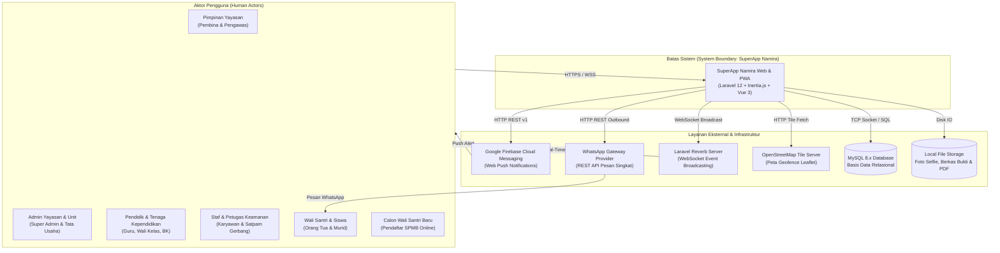

# System Context (Konteks Sistem & Ekosistem Lingkungan)

Dokumen ini memetakan arsitektur konteks sistem SuperApp Namira (C4 Model Level 1: System Context) yang menggambarkan interaksi antara aktor manusia, aplikasi inti, dan sistem eksternal pendukung.

---

## 1. Diagram Konteks Sistem (C4 System Context)

---

## 2. Aktor Pengguna & Interaksi Sistem

| Aktor Pengguna | Saluran Akses | Interaksi Utama dengan SuperApp Namira |
|---|---|---|
| **Pimpinan Yayasan** | Desktop Web Browser | Mengakses dashboard eksekutif, rekapitulasi kehadiran global seluruh unit, monitoring keuangan, dan audit mutasi kas. |
| **Admin Yayasan & Unit** | Desktop Web Browser | Mengonfigurasi master data unit, tahun akademik, manajemen user/role, rombel kelas, jadwal KBM, dan verifikasi berkas. |
| **Guru & Wali Kelas** | Mobile PWA & Desktop | Presensi selfie GPS, pengisian jurnal mengajar KBM, absensi siswa kelas, kelas digital LMS, dan penginputan nilai. |
| **Staf & Petugas Keamanan** | Smartphone PWA | Presensi mobile selfie GPS, pengisian log giat harian, dan pemindaian barcode kartu pelajar di pos gerbang kedatangan. |
| **Wali Santri & Siswa** | Smartphone PWA | Portal siswa: jadwal KBM, unduh materi/tugas LMS, cek tagihan SPP, upload bukti transfer, dan riwayat presensi. |
| **Calon Wali Santri (SPMB)** | Web Browser Publik | Mengisi formulir pendaftaran murid baru online, memilih unit sekolah tujuan, dan memantau status seleksi. |

---

## 3. Sistem Eksternal & Protokol Komunikasi

### 3.1 Basis Data Relasional (MySQL 8.x)
- **Tujuan:** Penyimpanan persisten seluruh entitas master data, relasi multi-tenancy, transaksi keuangan, absensi, dan log audit.
- **Protokol:** MySQL Native Driver via PDO Laravel (koneksi terenkripsi lokal/privat).
- **Integritas:** Menggunakan 82 skema migrasi terkelola dengan constraint foreign key dan transaksi atomik.

### 3.2 Server WebSocket (Laravel Reverb)
- **Tujuan:** Menyiarkan notifikasi instan secara *duplex* tanpa polling HTTP yang membebani server.
- **Protokol:** WSS (WebSocket Secure) melalui port 8080/443 dengan autentikasi channel privat bagi user berwenang.

### 3.3 Google Firebase Cloud Messaging (FCM)
- **Tujuan:** Mengirimkan notifikasi push ke perangkat browser smartphone guru/staf saat aplikasi sedang ditutup atau berada di latar belakang.
- **Protokol:** HTTPS REST API (Google API HTTP v1) menggunakan service account JSON terverifikasi.

### 3.4 Gateway Notifikasi WhatsApp
- **Tujuan:** Pengiriman pesan pemberitahuan tagihan SPP, pengingat jatuh tempo, dan laporan pelanggaran tata tertib siswa ke nomor handphone orang tua.
- **Protokol:** HTTP POST REST API asinkron melalui antrean database (`whatsapp_messages_queue`).

### 3.5 OpenStreetMap / Leaflet Tile Server
- **Tujuan:** Menyediakan peta visual interaktif untuk menentukan titik koordinat kantor unit dan menggambar lingkaran radius geofence.
- **Protokol:** HTTPS Tile Request standar (`https://{s}.tile.openstreetmap.org/{z}/{x}/{y}.png`).
