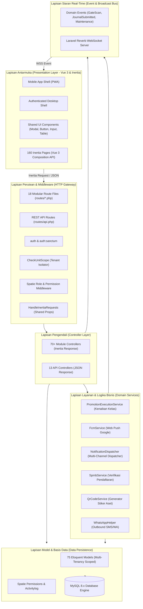

# Component Architecture (Arsitektur Komponen Internal Sistem)

Dokumen ini mendokumentasikan arsitektur komponen internal SuperApp Namira (C4 Model Level 2 & 3: Container & Component Architecture) yang menguraikan interaksi antar-lapisan kode dari antarmuka pengguna hingga persistensi data.

---

## 1. Diagram Arsitektur Komponen Sistem

---

## 2. Deskripsi Tanggung Jawab Antar-Lapisan

### 2.1 Lapisan Antarmuka (Presentation Layer)
- Dibangun menggunakan **Vue 3** dengan sintaks modern `<script setup>` dan TypeScript-compatible architecture.
- Komunikasi dengan server tidak memerlukan penulisan routing API manual untuk web app, melainkan dikelola oleh **Inertia.js** yang meneruskan props dari Laravel langsung ke komponen Vue secara mulus tanpa *full-page reload*.
- Menggunakan arsitektur dual-shell:
  1. `MobileAppShell.vue`: Khusus tampilan viewport smartphone (PWA) dengan header ringkas, unit selector pill, dan bottom navigation bar terpadu.
  2. `AuthenticatedLayout.vue`: Khusus tampilan desktop dengan glassmorphism sidebar, topbar profil, dan listener WebSocket Reverb real-time.

### 2.2 Lapisan Perutean & Middleware (HTTP & Security Pipeline)
Setiap permintaan HTTP yang masuk diproses melalui rantai middleware:
1. `CheckMaintenanceMode`: Memeriksa apakah sistem sedang dalam mode perawatan global yayasan.
2. `CheckUnitScope`: Mendeteksi header/cookie unit aktif, menyetel Spatie Teams `setPermissionsTeamId($unitId)`, dan memastikan user hanya dapat mengakses data dalam unit berwenang.
3. `HandleInertiaRequests`: Membagikan props global ke seluruh komponen Vue (informasi auth user, daftar unit sekolah, status notifikasi, dan pesan kilat flash message).
4. `Spatie Role/Permission Middleware`: Memverifikasi apakah peran pengguna memiliki otorisasi mengakses route target.

### 2.3 Lapisan Pengendali (Controller Layer)
- Terbagi menjadi dua kategori:
  1. **Inertia Web Controllers:** Mengembalikan `Inertia::render('Path/To/Page', $data)` untuk antarmuka browser.
  2. **Sanctum API Controllers:** Mengembalikan `response()->json(['status' => 'success', 'data' => $data])` untuk konsumsi mobile API atau scanner eksternal.

### 2.4 Lapisan Layanan Bisnis (Domain Services)
- Memisahkan logika bisnis yang kompleks dari controller untuk menjaga prinsip *Single Responsibility*:
  - `PromotionExecutionService`: Mengenkapsulasi algoritma kenaikan kelas massal dengan validasi kelulusan dan snapshot rollback.
  - `NotificationDispatcher`: Mengorkestrasi pengiriman notifikasi multi-kanal (in-app database, push FCM, dan WhatsApp).
  - `FcmService`: Menangani pembentukan payload HTTP v1 Google Firebase dan penanganan error token hangus (*stale tokens*).

### 2.5 Lapisan Persistensi & Model (Data Access Layer)
- Terdiri dari 75 Model Eloquent yang memanfaatkan fitur:
  - *Mass Assignment Protection* (`$guarded` atau `$fillable`).
  - *Casting*: Format tanggal (`datetime`), desimal (`decimal:2`), dan array JSON.
  - *Query Scopes*: Penapisan otomatis berdasarkan unit aktif dan tahun akademik aktif.
  - *Eager Loading*: Memitigasi masalah N+1 Query pada relasi bersarang.
