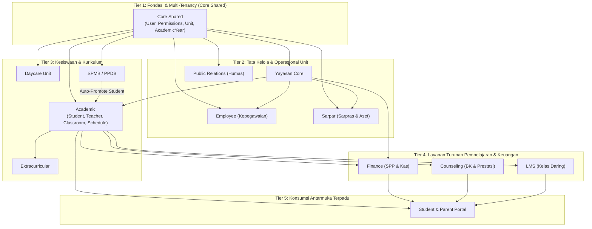

# Module Dependencies (Ketergantungan & Interaksi Antar-Modul)

Dokumen ini memetakan relasi ketergantungan (*dependency graph*) dan aliran data antar-modul di dalam arsitektur monolitik modular SuperApp Namira.

---

## 1. Graf Ketergantungan Antar-Modul (Module Dependency Graph)

---

## 2. Matriks Ketergantungan Domain (Domain Dependency Matrix)

| Modul Konsumen | Bergantung Pada (Dependencies) | Data / Model yang Dikonsumsi | Tingkat Kopling (Coupling) |
|---|---|---|---|
| **Yayasan** | Core | `User`, `AttendanceLocation` | Rendah (Fondasi) |
| **Employee** | Yayasan, Core | `User`, `Unit`, `AttendanceLocation` | Rendah |
| **Sarpar** | Yayasan, Core | `User`, `Unit`, `Room` | Rendah |
| **PublicRelations**| Yayasan, Core | `User`, `Unit` | Rendah |
| **Academic** | Yayasan, Core | `User`, `Unit`, `AcademicYear` | Sedang |
| **Daycare** | Yayasan, Core | `User`, `Unit` | Sedang |
| **SPMB** | Yayasan, Core, Academic | `Unit`, `AcademicYear`, konversi ke `Student` | Sedang |
| **Extracurricular** | Academic, Core | `Student`, `Teacher`, `User` | Sedang |
| **Finance** | Academic, Yayasan, Core | `Student`, `Unit`, `AcademicYear`, `User` | Tinggi (Shared Entity) |
| **Counseling** | Academic, Core | `Student`, `Teacher`, `User` | Sedang |
| **LMS** | Academic, Core | `Student`, `Teacher`, `Classroom`, `User` | Sedang |
| **Student Portal** | Academic, Finance, BK, LMS | Konsumsi agregat `Student`, `Bill`, `Task`, `Violation` | Tinggi (Facade) |

---

## 3. Analisis Kopling & Kohesi (Coupling & Cohesion Analysis)

### 3.1 Evaluasi Bebas Circular Dependency
- **Hasil Audit:** **0 Circular Dependency** terdeteksi pada lapisan modul Laravel.
- **Bukti:** Seluruh ketergantungan bersifat *unidirectional* (satu arah) dari lapisan atas (Portal & Layanan Turunan) menuju lapisan bawah (Academic & Core). Tidak ada modul dasar (seperti `AcademicYear` atau `Unit`) yang mengimpor model dari modul sekunder (seperti `StudentBill` atau `LmsAssignment`).

### 3.2 Pola Komunikasi Lintas Modul (Cross-Module Communication)
Interaksi antar-modul dalam sistem monolitik ini dilakukan melalui 3 saluran terstandarisasi:
1. **Direct Eloquent Relation:** Modul sekunder merelasikan foreign key secara eksplisit (contoh: `StudentBill` memiliki foreign key `student_id` yang merujuk pada `App\Modules\Academic\Models\Student`).
2. **Domain Event Bus (Laravel Events):** Komunikasi yang bersifat reaktif memicu event tanpa mengikat controller secara ketat (contoh: `StudentScannedAtGate` disiarkan oleh modul Akademik, lalu didengarkan oleh antarmuka live radar gerbang dan notifikasi).
3. **Shared Helper & Service Layer:** Logika bersama diakses melalui kelas helper sentral (`WhatsAppHelper`, `ImageHelper`, `NotificationDispatcher`).

---

## 4. Rekomendasi Decoupling Jangka Panjang
Untuk menjaga kemudahan pemeliharaan (*maintainability*) seiring membesarnya basis kode:
1. **Penerapan Interface Repository / Contract:** Mengganti ketergantungan impor model lintas modul secara langsung dengan Interface (misal: `StudentLookupInterface` untuk modul Keuangan) guna mengisolasi perubahan internal skema tabel akademik.
2. **Event-Driven Financial Generation:** Ketika siswa baru diterima di modul SPMB, sistem memicu event `StudentAdmitted` yang secara otomatis ditangkap oleh modul Akademik (pembuatan record siswa) dan modul Keuangan (pembuatan tagihan seragam/gedung pertama), tanpa controller SPMB memanggil model Finance secara langsung.
