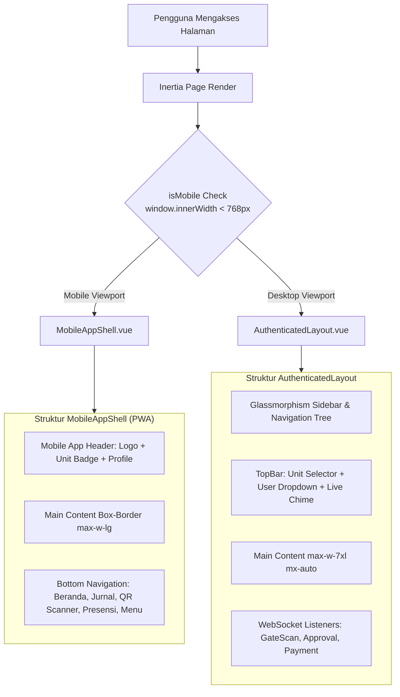

# Frontend Architecture (Arsitektur Antarmuka & PWA SuperApp Namira)

Dokumen ini mendokumentasikan arsitektur antarmuka pengguna (*frontend architecture*) SuperApp Namira yang dibangun di atas Vue.js 3, Inertia.js, Tailwind CSS v4, dan Progressive Web App (PWA).

---

## 1. Arsitektur Dual-Shell Layout (Mobile PWA & Desktop)

Sistem menerapkan strategi **Dual-Shell Dynamic Layout** yang secara otomatis menyesuaikan tampilan berdasarkan dimensi layar dan jenis perangkat pengguna:

### 1.1 MobileAppShell (`resources/js/Layouts/MobileAppShell.vue`)
- **Fokus Desain:** Dirancang khusus untuk pengalaman aplikasi native smartphone (Android & iOS).
- **Komponen Utama:**
  1. *Compact Sticky Header:* Menampilkan logo Namira App, unit aktif (`KB`, `TK`, `SD`, `SMP`, `Yayasan`), dan foto profil pengguna.
  2. *Unit Selector Modal:* Membuka dialog pergantian unit sekolah secara mulus dengan animasi slide-up.
  3. *Bottom Navigation Bar:* Navigasi jempol 5 menu: **Beranda**, **Jurnal**, Tombol Utama **Scan QR** (terangkat di tengah dengan aksen teal), **Presensi Saya**, dan **Menu Lainnya**.
  4. *Safe Area Inset Handling:* Memperhitungkan notch iPhone dan navigation pill Android (`pb-28` dan `box-border`).

### 1.2 AuthenticatedLayout (`resources/js/Layouts/AuthenticatedLayout.vue`)
- **Fokus Desain:** Dioptimalkan untuk layar laptop/desktop (resolusi 1280px ke atas) bagi pimpinan, staf TU, dan kasir.
- **Komponen Utama:**
  1. *Collapsible Glassmorphism Sidebar:* Navigasi bertingkat dengan menu terkelompok (Master Data, Akademik, Keuangan, Sarpar, Pengaturan).
  2. *Live Real-Time WebSocket Toast:* Mendengarkan channel Reverb (`student-gate-scan`, `attendance-approvals`, `teaching-journals`, `sarpras-maintenance`, `payment-transactions`) dan menampilkan pop-up toast SweetAlert2 beserta suara chime notifikasi.
  3. *Ambient Glow / Mesh Gradient:* Desain modern dengan aksen ambient gradient halus.

---

## 2. Paradigma State Management & Komunikasi Data

SuperApp Namira mengeliminasi kerumitan Vuex/Pinia dengan memanfaatkan paradigma **Inertia Protocol**:

1. **Server-Driven Shared Props (`$page.props`):**
   - Data global (status autentikasi, unit aktif, daftar unit yang dimiliki user, flash message, dan konfigurasi Firebase) dikirimkan langsung oleh middleware `HandleInertiaRequests.php` pada setiap response navigasi.
2. **Reaktif Komponen Lokal (`ref`, `reactive`, `computed`):**
   - State formulir dikelola menggunakan `useForm` bawaan `@inertiajs/vue3` yang memiliki proteksi otomatis terhadap double-submit, error handling, dan pelacakan status unggah berkas (*upload progress*).
3. **Persistensi State Client (`localStorage`):**
   - Digunakan untuk preferensi tampilan antarmuka (misalnya: status *sidebar collapse* dan riwayat filter kelas terakhir).

---

## 3. Sistem Desain & Token Visual (Tailwind CSS v4)

Menggunakan bundler resmi terbaru `@tailwindcss/vite` versi 4:

| Token Desain | Nilai Heksadesimal / Class | Penggunaan Utama |
|---|---|---|
| **Namira Teal (Primary)** | `#0B7068` (`text-[#0B7068]`, `bg-[#0B7068]`) | Identitas resmi Namira, tombol CTA utama, badge aktif, aksen border. |
| **Teal Hover / Dark** | `#095c55` (`hover:bg-[#095c55]`) | Status hover dan active state pada tombol utama. |
| **Navy Slate (Text & Dark)** | `#0f172a` (`text-slate-900`) | Judul halaman, teks dominan, dan gradien gelap kartu banner hero. |
| **Teal Light / Surface** | `#f0fdf4` / `#f0fdfa` (`bg-teal-50`) | Latar belakang pill badge, kotak jam pelajaran, dan highlight aktif. |
| **Border & Divider** | `border-slate-200` / `border-slate-100` | Garis pemisah kartu, tabel, dan input formulir. |
| **Card Radius** | `rounded-2xl` / `rounded-3xl` | Sudut membulat modern pada kartu jadwal, modal dialog, dan banner. |

---

## 4. Progressive Web App (PWA) & Offline Capabilities

Sistem dikonfigurasi penuh sebagai **PWA yang dapat diinstal (Installable Web App)**:

- **Konfigurasi Plugin:** `vite-plugin-pwa` versi `1.3.0` terintegrasi pada `vite.config.js`.
- **Web App Manifest (`public/build/manifest.webmanifest`):**
  - `name`: "SuperApp Namira"
  - `short_name`: "NamiraApp"
  - `display`: "standalone" (menghilangkan bilah navigasi browser saat dibuka dari homescreen)
  - `theme_color`: "#0B7068"
  - `background_color`: "#0f172a"
  - `icons`: Mendukung ikon adaptive Android dan Apple Touch Icon (192x192, 512x512, maskable).
- **Service Worker (`sw.js` & `workbox-*.js`):**
  - Mengompilasi strategi caching Workbox yang melakukan *precache* terhadap **188 entri aset** (CSS, font, JS chunk) sebesar **4,6 MB**.
  - Aplikasi dapat menampilkan antarmuka dan notifikasi offline (*OfflineStatusBanner.vue*) saat koneksi terputus.

---

## 5. Code Splitting & Chunking Strategy (Vite 8)

Untuk menjamin waktu pemuatan cepat pada perangkat seluler, aset frontend dipartisi secara cerdas (*dynamic chunking*):
1. **`vendor-charts` (239 kB):** Memisahkan `chart.js` dan `vue-chartjs`.
2. **`vendor-scanner` (1.104 kB):** Mengisolasi pustaka pemindai kamera (`html5-qrcode`, `zxing`, `quagga2`) sehingga hanya diunduh saat user membuka fitur scan QR/Barcode.
3. **`vendor-quill` (206 kB):** Mengisolasi rich text editor `@vueup/vue-quill`.
4. **`vendor-leaflet` (148 kB):** Mengisolasi modul peta interaktif Leaflet.
5. **Halaman Modul:** Seluruh 131 halaman Inertia diunduh secara lazy load (*on-demand*) saat rute diakses.
