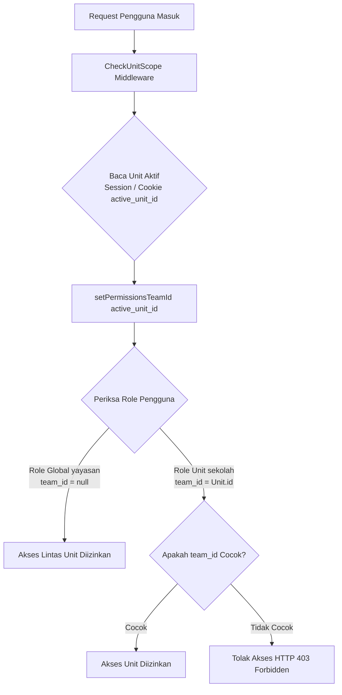
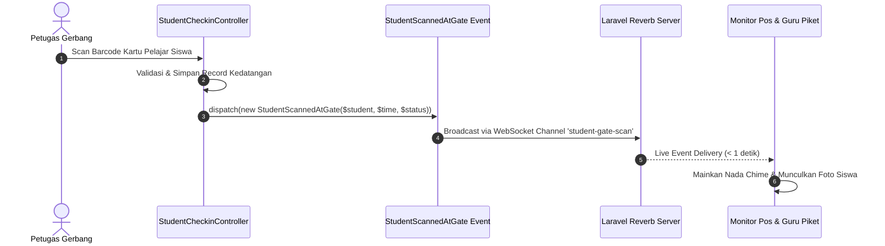

# Backend Architecture (Arsitektur Backend & Layanan Server)

Dokumen ini mendokumentasikan arsitektur backend SuperApp Namira yang dibangun di atas framework Laravel 12 dengan pola **Modular Monolith Enterprise**.

---

## 1. Pola Modular Monolith (Directory Organization)

Sistem mengadopsi pola pengelompokan domain di dalam `app/Modules/`, di mana setiap modul mengelola *domain models*, *controllers*, *services*, dan *business logic* miliknya sendiri:

```
app/Modules/{ModuleName}/
├── Controllers/       # HTTP request handlers (Inertia view rendering & REST APIs)
├── Models/            # Eloquent ORM entity definitions & domain relationships
├── Services/          # Complex business workflows (misal: PromotionExecutionService)
└── (Sub-domains)/     # Domain-specific helpers & calculators
```

Keuntungan pola ini:
1. **Pemisahan Tanggung Jawab Jelas:** Perubahan pada modul Sarpar tidak akan mengganggu logika modul Keuangan atau LMS.
2. **Kemudahan Skalabilitas Tim:** Memungkinkan pengembang bekerja secara paralel pada modul yang berbeda tanpa konflik merger tinggi.
3. **Pondasi Microservices Masa Depan:** Jika yayasan memutuskan mengekstrak modul Keuangan atau SPMB menjadi microservice mandiri, batas domain (*bounded context*) telah terisolasi rapi.

---

## 2. Arsitektur Multi-Tenancy Spatie Teams (`team_id`)

SuperApp Namira mengelola **9 unit sekolah** dalam satu basis data tunggal (*Shared Database Multi-Tenancy*). Mekanisme pembatasan wewenang menerapkan integrasi **Spatie Laravel Permission dengan Fitur Teams**:



### Implementasi Teknis:
1. **Pembedaan Strata Peran:**
   - Peran Global Yayasan (`super_admin_yayasan`, `admin_yayasan`, `pembina_yayasan`): Memiliki `team_id = null` pada tabel pivot `model_has_roles`, memberikan visibilitas penuh ke seluruh unit.
   - Peran Scoped Unit (`kepala_sekolah`, `teacher`, `staff_admin_keuangan`): Memiliki `team_id = Unit.id`, membatasi hak eksekusi dan query hanya di unit terkait.
2. **Resolusi Bug Multi-Tenancy:**
   - Pada `UserController.php`, penyaringan user unit menggunakan query `whereExists` pada tabel `model_has_roles` untuk memastikan guru yang memiliki `team_id` tidak tersaring hilang saat admin yayasan berpindah unit aktif.

---

## 3. Pola Lapisan Layanan (Service Layer Pattern)

Untuk menjaga controller tetap ramping (*skinny controllers*), logika bisnis yang kompleks dipindahkan ke lapisan layanan:

| Nama Service | Lokasi Berkas | Tanggung Jawab Utama |
|---|---|---|
| `PromotionExecutionService` | `app/Modules/Academic/Services/Promotion/` | Menjalankan algoritma pemindahan rombel kenaikan kelas, memvalidasi prasyarat, mencatat riwayat snapshot, dan rollback mutasi. |
| `NotificationDispatcher` | `app/Services/` | Menentukan kanal pengiriman notifikasi (in-app, FCM push, atau WhatsApp) berdasarkan prioritas pesan dan preferensi penerima. |
| `FcmService` | `app/Services/` | Mengonstruksi payload notifikasi web push Google Firebase HTTP v1 dan menangani pembersihan token perangkat yang kedaluwarsa. |
| `SpmbService` | `app/Modules/SPMB/Services/` | Mengelola alur pendaftaran siswa baru, verifikasi dokumen prasyarat, dan konversi calon siswa menjadi entitas `Student`. |
| `QrCodeService` | `app/Modules/Sarpar/Services/` | Mengenerate gambar kode QR resolusi tinggi untuk stiker inventaris aset. |

---

## 4. Arsitektur Berbasis Event (Event-Driven Architecture)

Backend mempublikasikan event domain untuk memicu aksi sekunder secara asinkron dan real-time:



### Event Domain yang Terpasang:
1. `StudentScannedAtGate`: Disiarkan saat siswa memindai kartu di gerbang kedatangan.
2. `TeachingJournalSubmitted`: Disiarkan saat guru menyelesaikan jurnal KBM di kelas.
3. `PaymentTransactionRecorded`: Disiarkan saat kasir menerima pelunasan tagihan SPP.
4. `SarprasMaintenanceReported`: Disiarkan saat inventaris barang rusak dilaporkan.
5. `EmployeeCheckedIn`: Disiarkan saat staf berhasil presensi selfie GPS.

---

## 5. Transaksi Basis Data & Penanganan Galat Atomik

Operasi mutasi data multi-tabel dibungkus di dalam transaksi atomik (`DB::transaction`) untuk mencegah anomali data:

```php
// Contoh implementasi transaksi atomik pada Kenaikan Kelas:
DB::transaction(function () use ($students, $targetClassroom, $promotion) {
    foreach ($students as $student) {
        $student->update(['classroom_id' => $targetClassroom->id]);
        $promotion->items()->create([
            'student_id' => $student->id,
            'previous_classroom_id' => $student->getOriginal('classroom_id'),
            'new_classroom_id' => $targetClassroom->id,
        ]);
    }
});
```

Jika terjadi interupsi jaringan atau kegagalan query di tengah iterasi, seluruh perubahan otomatis dibatalkan (*rollback*) sehingga tidak ada siswa yang tertinggal dalam status kelas menggantung.
