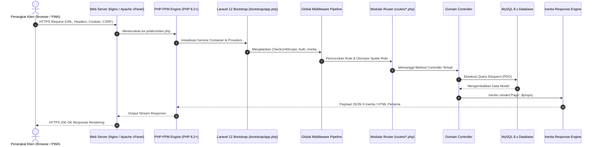
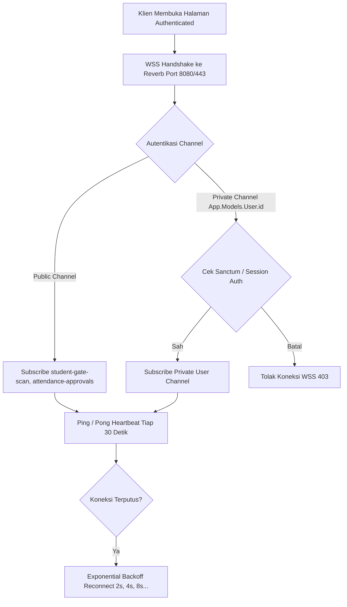

# Runtime Architecture (Arsitektur Eksekusi & Siklus Hidup Permintaan)

Dokumen ini mendokumentasikan arsitektur runtime (*execution lifecycle*), siklus hidup permintaan HTTP, pengelolaan sesi, strategi caching, dan komunikasi WebSocket real-time SuperApp Namira.

---

## 1. Siklus Hidup Permintaan HTTP (Request-Response Lifecycle)

---

## 2. Pengelolaan Sesi & Kuki (Session & Cookie Management)

Sistem menggunakan driver **Database Session** untuk ketahanan tinggi pada lingkungan multi-worker:

1. **Kuki Utama yang Diterbitkan:**
   - `superapp_namira_session`: Token pengenal sesi terenkripsi yang dicocokkan dengan tabel `sessions` di basis data. Memiliki atribut `HttpOnly`, `SameSite=Lax`, dan `Secure` (saat aktif di HTTPS).
   - `XSRF-TOKEN`: Token keamanan anti-CSRF yang dibaca oleh Axios/Inertia pada sisi frontend untuk disematkan dalam header setiap mutasi `X-XSRF-TOKEN`.
   - `active_unit_id`: Nilai unit aktif pilihan pengguna yang digunakan oleh middleware `CheckUnitScope` untuk mempertahankan konteks unit saat berpindah halaman.
   - `remember_web_*`: Token sesi persisten jika pengguna memilih opsi "Ingat Saya" saat login.
2. **Masa Berlaku Sesi:** Standar 120 menit (2 jam) waktu tidak aktif (*inactivity timeout*), dengan pembersihan berkala melalui scheduler `session:gc`.

---

## 3. Strategi Caching Sistem (Caching Strategy)

| Lapisan Cache | Driver / Mekanisme | Kunci / Target Cache | Strategi Invalidasi |
|---|---|---|---|
| **Spatie Permission Cache** | Database / File Cache | `spatie.permission.cache` | Di-reset otomatis saat role/permission diubah via `app(PermissionRegistrar::class)->forgetCachedPermissions()`. |
| **Config & Route Cache** | Production Compiled File | `bootstrap/cache/config.php` & `routes-v7.php` | Diperbarui saat rilis deployment melalui `php artisan optimize` atau `config:cache`. |
| **PWA Workbox Precache** | Browser Cache Storage | 188 file aset statis (`sw.js`) | Diperbarui saat versi hash nama file chunk Vite berubah pada build baru. |
| **Application Query Cache** | Laravel Cache Facade | Master data unit, tahun akademik, sistem libur | Invalidasi berbasis event saat data master diubah oleh admin. |

---

## 4. Siklus Hidup Koneksi WebSocket (Laravel Reverb)

Komunikasi duplex real-time ditangani oleh server **Laravel Reverb**:

1. **Inisialisasi:** Komponen `AuthenticatedLayout.vue` menginisialisasi `window.Echo` menggunakan konfigurasi Reverb (`pusher-js` compatible client).
2. **Kanal Publik:** Digunakan untuk notifikasi massal seluruh admin/guru yang bertugas (contoh: scanner gerbang kedatangan siswa).
3. **Kanal Privat:** Memerlukan token sesi dan verifikasi pada `routes/channels.php` untuk notifikasi khusus yang bersifat rahasia per user ID.
4. **Heartbeat:** Reverb mengirimkan paket ping setiap 30 detik untuk mendeteksi perangkat offline dan melepaskan socket yang menggantung (*stale sockets*).
