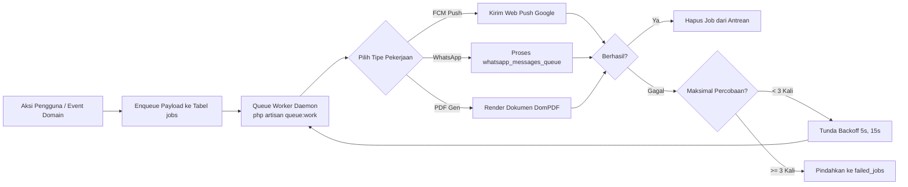

# Integrations & Background Processing (Arsitektur Integrasi & Pemrosesan Latar Belakang)

Dokumen ini mendokumentasikan arsitektur pemrosesan asinkron (*asynchronous background processing*), manajemen antrean (*queue management*), dan penjadwalan tugas rutin (*task scheduling*) di SuperApp Namira.

---

## 1. Arsitektur Antrean Sistem (Queue Processing Pipeline)

Untuk mencegah latensi tinggi pada antarmuka pengguna, seluruh tugas komputasi berat dan panggilan API pihak ketiga dialihkan ke antrean latar belakang:



---

## 2. Inventaris Tugas Asinkron (Asynchronous Tasks)

### 2.1 Pemrosesan Notifikasi Web Push (Firebase Cloud Messaging)
- **Komponen:** `app/Services/FcmService.php` & `NotificationDispatcher.php`
- **Tujuan:** Mengirimkan pesan push ke perangkat smartphone pengguna tanpa menahan respon HTTP saat guru mengabsen atau admin menyetujui izin.
- **Strategi Batching:** Jika pengumuman ditujukan ke seluruh guru satu unit (misal 50 orang), pengiriman dilakukan secara batching maksimal 100 token per request API Google untuk menghemat kuota koneksi.

### 2.2 Antrean Pesan WhatsApp (`whatsapp_messages_queue`)
- **Komponen:** Model `App\Modules\Yayasan\Models\WhatsAppQueue.php` & `WhatsAppHelper.php`
- **Tujuan:** Menampung antrean pengiriman pesan WA tagihan SPP dan laporan pelanggaran siswa.
- **Skema Antrean:**
  - `phone`: Nomor tujuan dalam format internasional standar (`62812XXXXXXXX`).
  - `message`: Isi teks pesan santun berformat resmi yayasan.
  - `status`: Status pengiriman (`pending`, `sent`, `failed`).
  - `attempts`: Jumlah percobaan pengiriman ulang.
  - `response_log`: Catatan respons kode status dari vendor gateway eksternal.

### 2.3 Kompresi & Penyimpanan Foto Bukti Absensi
- **Komponen:** `app/Helpers/ImageHelper.php`
- **Tujuan:** Menangani konversi data base64 foto selfie presensi kamera depan atau berkas bukti transfer menjadi berkas gambar terkompresi berformat `.jpg` di direktori `storage/app/public/` guna menghemat kapasitas penyimpanan server hosting.

---

## 3. Penjadwalan Tugas Otomatis (Cron Task Scheduler)

Sistem memanfaatkan **Laravel Task Scheduler** yang dipicu oleh satu entri Cron Job server:
```bash
* * * * * cd /path/to/superapp && php artisan schedule:run >> /dev/null 2>&1
```

### Jadwal Rutin Terdefinisi (`routes/console.php`):
1. **Penutupan Presensi Otomatis (Auto-Alpha Closing):**
   - *Jadwal:* Setiap hari kerja pukul 17.00 WIB.
   - *Aksi:* Memeriksa seluruh karyawan aktif pada unit yang tidak memiliki rekaman kehadiran hari tersebut dan tidak memiliki izin/cuti yang disetujui, lalu menetapkan status kehadiran menjadi `alpa` secara otomatis.
2. **Pembersihan Token Kedaluwarsa:**
   - *Jadwal:* Setiap minggu sekali pada hari Minggu pukul 02.00 WIB.
   - *Aksi:* Menghapus token perangkat FCM (`user_device_tokens`) yang tidak aktif selama lebih dari 60 hari atau menghasilkan kode error `UNREGISTERED` dari Firebase.
3. **Pembersihan Log Telemetri Pulse:**
   - *Jadwal:* Harian pukul 03.00 WIB (`php artisan pulse:clear`).
   - *Aksi:* Menjaga ukuran tabel metrik sistem agar tidak membebani kapasitas disk database.

---

## 4. Kebijakan Percobaan Ulang & Penanganan Galat (Retry & Failure Policy)

- **Jumlah Percobaan Maksimal:** `--tries=3` (Maksimal 3 kali percobaan sebelum dianggap gagal permanen).
- **Strategi Penundaan (Exponential Backoff):** `--backoff=5,15,60` (Percobaan ke-2 berjarak 5 detik, percobaan ke-3 berjarak 15 detik, percobaan ke-4 berjarak 60 detik).
- **Inspeksi Antrean Gagal:** Job yang gagal permanen tersimpan pada tabel `failed_jobs` lengkap dengan jejak stack trace error. Administrator dapat meninjau dan mengeksekusi ulang menggunakan perintah:
  ```bash
  php artisan queue:failed
  php artisan queue:retry all
  ```
