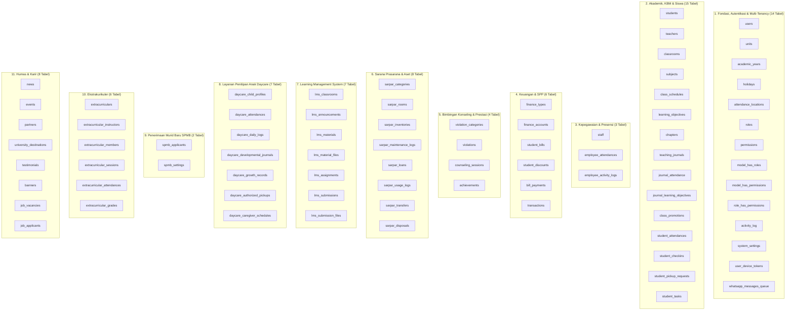

# Database Overview (Ikhtisar Arsitektur Basis Data SuperApp Namira)

Dokumen ini mendokumentasikan ikhtisar arsitektur basis data relasional SuperApp Namira yang dirancang di atas MySQL 8.x menggunakan 82 berkas migrasi terkelola Laravel.

---

## 1. Parameter Teknis Basis Data

| Parameter | Spesifikasi Faktual | Keterangan / Sumber Bukti |
|---|---|---|
| **Database Management System (DBMS)** | MySQL 8.x / MariaDB 10.4+ | Konfigurasi `config/database.php` |
| **Storage Engine** | InnoDB | Mendukung transaksi atomik (ACID) & Foreign Key Constraints |
| **Character Set & Collation** | `utf8mb4` / `utf8mb4_unicode_ci` | Mendukung karakter multibyte dan emoji |
| **Jumlah Tabel Utama** | **74 Tabel** | 82 berkas migrasi aktif per 16 Oktober 2026 |
| **Pola Multi-Tenancy** | Shared Database, Shared Schema (Tenant Column Scoped) | Seluruh tabel transaksional memuat kolom `unit_id` |
| **Manajemen Migrasi** | Laravel Migrations (`database/migrations/`) | Version control skema database secara berurutan |

---

## 2. Pengelompokan Kluster Data (Domain Table Clusters)

Basis data terbagi menjadi 10 kluster logis:

---

## 3. Strategi Integritas & Keamanan Data

1. **Foreign Key Cascading & Restrict:**
   - Relasi master yang kritikal (seperti `unit_id` atau `student_id` pada transaksi keuangan) menerapkan aturan `ON DELETE RESTRICT` untuk mencegah terhapusnya data riwayat keuangan secara tidak sengaja saat data master dibersihkan.
   - Relasi berkas turunan (seperti `lms_material_files` atau `lms_submission_files`) menerapkan `ON DELETE CASCADE` sehingga berkas otomatis terhapus bersama entitas induknya.
2. **Penggunaan Soft Deletes (`deleted_at`):**
   - Diterapkan pada master data penting: `students`, `teachers`, `classrooms`, `inventories`, dan `users` untuk memungkinkan pemulihan data (*restore*) jika terjadi kesalahan penghapusan oleh pengguna.
3. **Pemberian Indeks Performa:**
   - Seluruh foreign key (`unit_id`, `academic_year_id`, `classroom_id`, `student_id`, `teacher_id`) memiliki indeks B-Tree.
   - Indeks gabungan (*composite index*) diterapkan pada tabel berbobot transaksi tinggi: contoh pada `employee_attendances` (`user_id`, `date`) dan `student_bills` (`student_id`, `academic_year_id`, `status`).
