# SuperApp Namira — Entity Relationship Diagram (ERD)

**Dokumen Kontrak Teknis Basis Data**  
**ID Dokumen:** `DOC-DB-02-ERD`  
**Status Audit:** `IMPLEMENTED`  
**Total Tabel:** 74 Tabel Fisik (11 Domain Bisnis)  
**Terkait:** [`01-database-overview.md`](file:///E:/Rian%20hidayad/SuperApp_Namira/docs/04-database/01-database-overview.md), [`03-data-dictionary.md`](file:///E:/Rian%20hidayad/SuperApp_Namira/docs/04-database/03-data-dictionary.md), [`04-relationship-catalog.md`](file:///E:/Rian%20hidayad/SuperApp_Namira/docs/04-database/04-relationship-catalog.md)

---

## 1. Ringkasan Eksekutif & Struktur Domain

Arsitektur basis data SuperApp Namira v2 Enterprise dirancang sebagai *multi-tenant shared schema* berbasis `unit_id` (*school unit / foundation unit*) dan perpanjangan Spatie Teams `team_id`. Sebanyak 74 tabel dikelompokkan ke dalam 11 domain logis untuk memisahkan bounded context tanpa mengorbankan integritas relasional antar-modul.

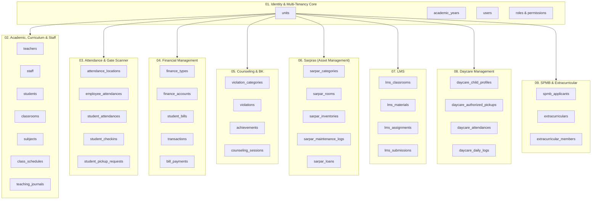

---

## 2. Diagram ER Domain 1: Identity, Multi-Tenancy & Access Control

Domain ini mengatur autentikasi terpadu pengguna, asosiasi unit organisasi (Yayasan, SMA, SMP, SD, TK, Daycare), tahun ajaran aktif, dan kontrol akses berbasis peran (RBAC) dengan pemisahan konteks `team_id`.

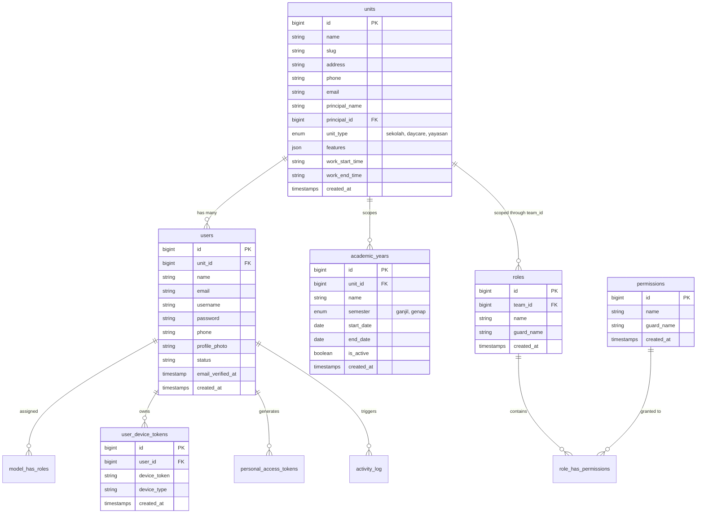

---

## 3. Diagram ER Domain 2: Academic, Curriculum & Teaching Journals

Mengelola struktur kelas, registrasi santri/siswa, dewan guru, mata pelajaran, target capaian (CP/TP), bab ajar, jadwal sesi, serta jurnal kegiatan belajar mengajar harian.

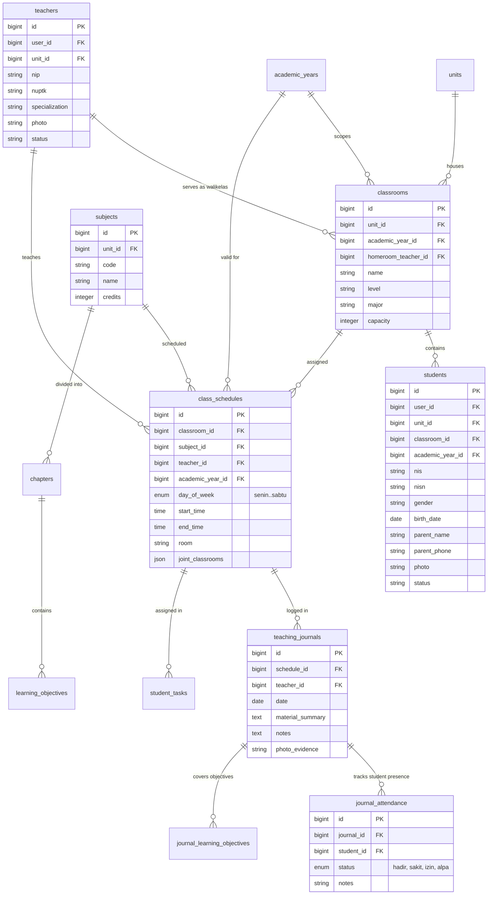

---

## 4. Diagram ER Domain 3: Attendance, Tracking & Gate Scanner

Menangani geofencing presensi staf dan siswa, verifikasi barcode/QR scanner gerbang sekolah, sinkronisasi kehadiran penjemputan, dan antrean pesan WhatsApp notifikasi wali.

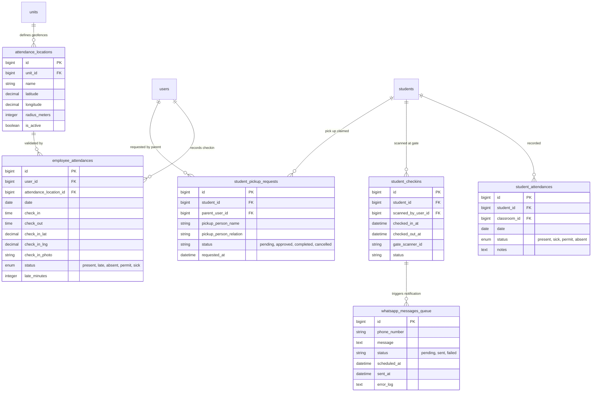

---

## 5. Diagram ER Domain 4: Financial Management & Student Billing

Mendukung tata kelola akun buku besar (COA), tagihan santri (SPP/Infaq), diskon afirmasi/saudara kandung, pencatatan transaksi kas/bank, dan rekonsiliasi pembayaran.

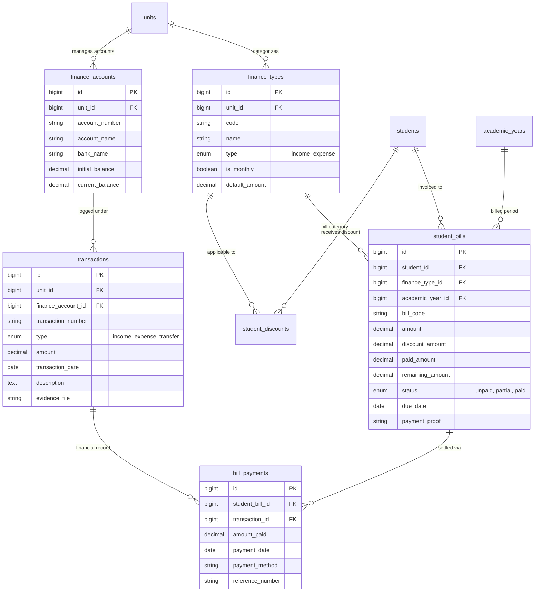

---

## 6. Diagram ER Domain 5: Counseling, Discipline & Student Achievements (BK)

Mengelola buku catatan pelanggaran siswa, skema poin tata tertib, catatan prestasi akademik/non-akademik, serta sesi konseling bimbingan konseling.

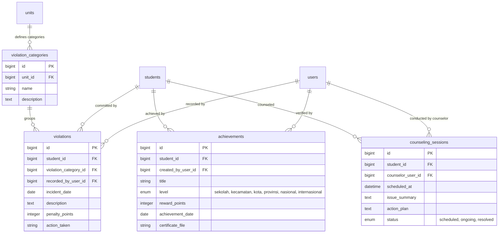

---

## 7. Diagram ER Domain 6: Facilities & Asset Management (Sarpras)

Menangani inventarisasi aset, kodifikasi barang, penempatan ruangan, siklus pemeliharaan berkala, peminjaman aset, mutasi antar-unit, dan penghapusan aset afkir.

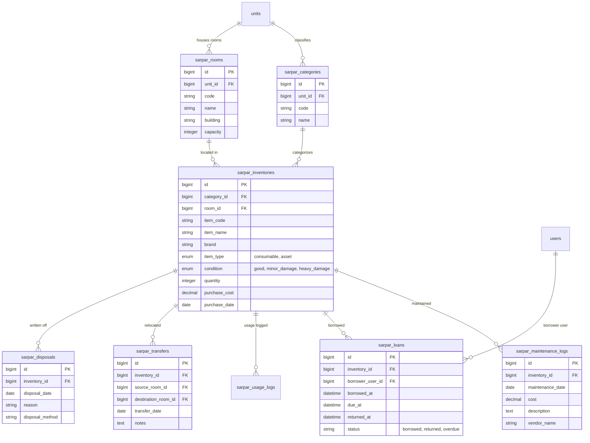

---

## 8. Diagram ER Domain 7: Learning Management System (LMS)

Mengelola kelas virtual terintegrasi, materi belajar daring berkas multimedia, tugas interaktif, submisi file siswa, dan pengumuman forum kelas.

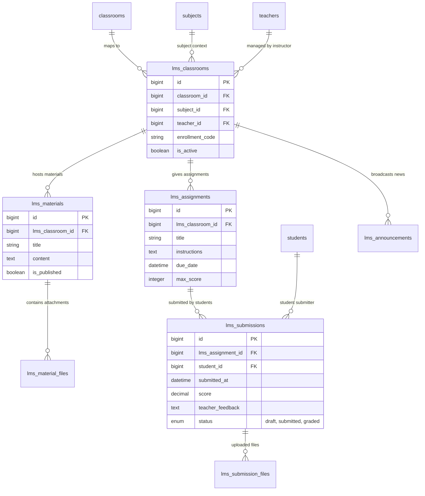

---

## 9. Diagram ER Domain 8: Daycare & Early Childhood Care

Dirancang khusus untuk unit Daycare, mengelola profil anak asuh lengkap, otoritas penjemput resmi (dengan foto/KTP), log kegiatan harian (makan, tidur, BAB/BAK, stimulasi), rekaman tumbuh kembang antropometri, dan jurnal perkembangan.

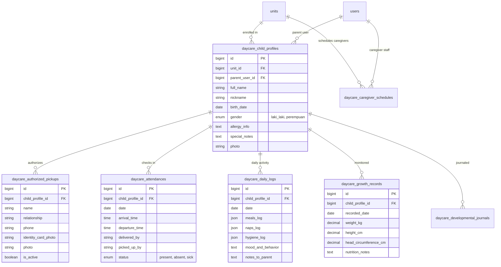

---

## 10. Diagram ER Domain 9 & 10: SPMB & Extracurricular Activities

Mengatur penerimaan santri/siswa baru secara mandiri per unit sekolah dan pendaftaran serta penilaian kegiatan ekstrakurikuler.

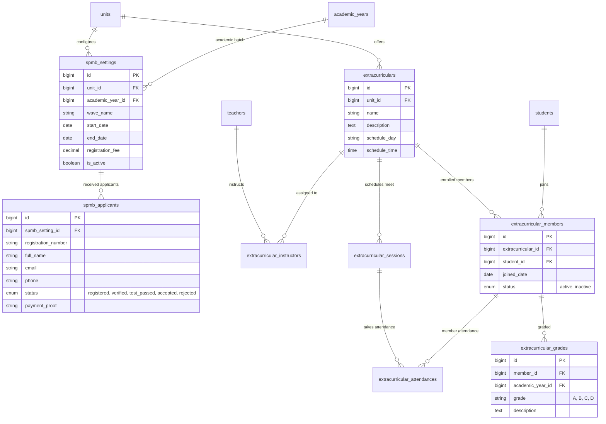

---

## 11. Diagram Relasi Lintas-Domain Komprehensif (Composite Cross-Domain)

Merangkum simpul-simpul integrasi utama (*nexus tables*) yang menghubungkan seluruh subsistem aplikasi:

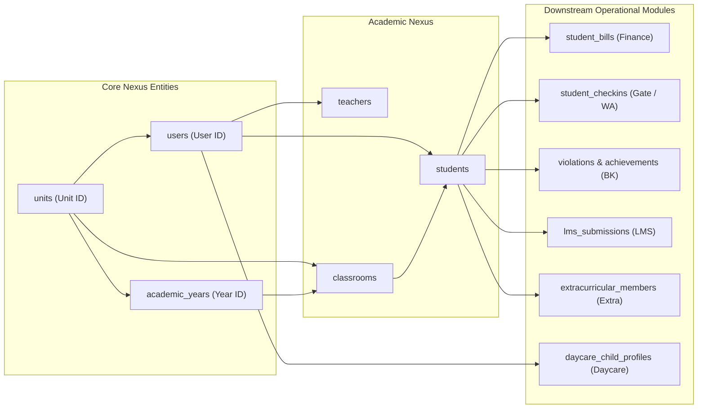

---

## 12. Rekapitulasi Integritas Relasional

1. **Foreign Key Enforcement**: Mayoritas foreign key menggunakan `ON DELETE CASCADE` untuk data hierarkis anak (seperti `journal_attendance` ke `teaching_journals`), dan `ON DELETE RESTRICT` atau `SET NULL` pada entitas utama (seperti `unit_id`, `classroom_id`).
2. **Soft Deletes**: Tabel utama seperti `users`, `students`, `teachers`, `sarpar_inventories` menggunakan soft deletes (`deleted_at`) guna melindungi riwayat audit keuangan dan legal akademik.
3. **Multi-tenancy Scoping**: Semua query kritis wajib membatasi relasi berbasis `unit_id` atau `team_id` melalui global scope atau Eloquent service layer.
