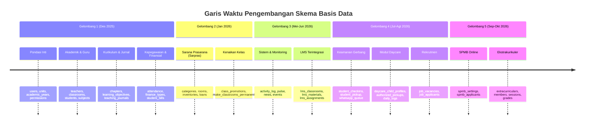

# SuperApp Namira — Kronologi & Riwayat Migrasi Basis Data

**Dokumen Spesifikasi Teknis Basis Data**  
**ID Dokumen:** `DOC-DB-05-MIGRATIONS`  
**Status Audit:** `IMPLEMENTED`  
**Total Berkas Migrasi:** 82 Migrasi (Desember 2025 – Oktober 2026)  
**Terkait:** [`01-database-overview.md`](file:///E:/Rian%20hidayad/SuperApp_Namira/docs/04-database/01-database-overview.md), [`03-data-dictionary.md`](file:///E:/Rian%20hidayad/SuperApp_Namira/docs/04-database/03-data-dictionary.md), [`08-schema-drift.md`](file:///E:/Rian%20hidayad/SuperApp_Namira/docs/04-database/08-schema-drift.md)

---

## 1. Peta Waktu Evolusi Skema Basis Data

Evolusi skema SuperApp Namira terbagi dalam 5 gelombang rilis utama:

---

## 2. Katalog Rinci 82 Migrasi Terurut Waktu

| No | Nama Berkas Migrasi | Aksi Utama Skema | Entitas Tabel / Modifikasi | Deskripsi Perubahan Bisnis |
| :--- | :--- | :--- | :--- | :--- |
| 1 | `0001_01_01_000000_create_users_table.php` | `CREATE` | `users`, `password_reset_tokens`, `sessions` | Fondasi akun pengguna Laravel default. |
| 2 | `0001_01_01_000001_create_cache_table.php` | `CREATE` | `cache`, `cache_locks` | Driver cache session berbasis basis data. |
| 3 | `0001_01_01_000002_create_jobs_table.php` | `CREATE` | `jobs`, `job_batches`, `failed_jobs` | Driver worker antrean background jobs. |
| 4 | `2025_12_15_025652_create_permission_tables.php` | `CREATE` | `roles`, `permissions`, `model_has_*` | RBAC Spatie dengan konfigurasi Spatie Teams. |
| 5 | `2025_12_15_030050_create_units_table.php` | `CREATE` | `units` | Master data unit sekolah dan yayasan. |
| 6 | `2025_12_15_054831_create_academic_years_table.php`| `CREATE` | `academic_years` | Master tahun ajaran dan semester. |
| 7 | `2025_12_17_003441_create_academic_tables.php` | `CREATE` | `teachers`, `classrooms`, `students` | Master civitas akademika sekolah. |
| 8 | `2025_12_17_005428_add_photo_to_teachers_...php` | `ALTER` | `teachers`, `students` | Menambahkan kolom `photo` avatar berkas. |
| 9 | `2025_12_17_101048_add_details_to_students_table.php`| `ALTER` | `students` | Menambahkan data detail NISN, ortu, telepon. |
| 10 | `2025_12_18_032252_create_subjects_table.php` | `CREATE` | `subjects` | Master katalog mata pelajaran. |
| 11 | `2025_12_19_081737_create_class_schedules_table.php` | `CREATE` | `class_schedules` | Jadwal pelajaran mingguan rombel. |
| 12 | `2025_12_20_013500_create_learning_objectives...php`| `CREATE` | `learning_objectives` | Tujuan Pembelajaran (TP) Kurikulum Merdeka. |
| 13 | `2025_12_20_020147_add_chapter_to_learning...php` | `ALTER` | `learning_objectives` | Penambahan atribut chapter/bab ajar. |
| 14 | `2025_12_20_021716_create_chapters_table.php` | `CREATE` | `chapters` | Pemisahan tabel master bab mata pelajaran. |
| 15 | `2025_12_20_021728_refactor_learning_objectives...` | `ALTER` | `learning_objectives` | Refactor FK `learning_objectives` ke `chapters.id`. |
| 16 | `2025_12_20_030825_create_teaching_journal_tables.php`| `CREATE` | `teaching_journals`, `journal_*` | Jurnal ajar harian dan presensi sesi mapel. |
| 17 | `2025_12_21_011523_add_grade_level_to_chapters...php`| `ALTER` | `chapters` | Penambahan jenjang kelas (`grade_level`). |
| 18 | `2025_12_21_095301_create_attendance_tables.php` | `CREATE` | `attendance_locations`, `employee_attendances`, `student_attendances` | Modul presensi geofence pegawai & siswa. |
| 19 | `2025_12_22_124743_add_is_active_to_attendance...php`| `ALTER` | `attendance_locations` | Status keaktifan geofence presensi. |
| 20 | `2025_12_22_152941_add_work_hours_to_units_table.php`| `ALTER` | `units` | Jam dinas masuk dan pulang per unit. |
| 21 | `2025_12_23_131306_modify_unit_columns.php` | `ALTER` | `units` | Penyempurnaan kolom profil sekolah. |
| 22 | `2025_12_24_045000_create_finance_module_tables.php`| `CREATE` | `finance_types`, `finance_accounts`, `student_bills`, `transactions`, `bill_payments`, `student_discounts` | Paket lengkap sistem keuangan dan SPP. |
| 23 | `2025_12_26_000000_create_staff_table.php` | `CREATE` | `staff` | Data tenaga kependidikan non-guru. |
| 24 | `2025_12_26_115658_add_details_to_employee...php` | `ALTER` | `employee_attendances` | Detail selfie foto presensi dan koordinat. |
| 25 | `2025_12_26_132528_add_late_minutes_to_employee...php`| `ALTER` | `employee_attendances` | Kalkulasi menit keterlambatan pegawai. |
| 26 | `2025_12_27_000000_create_holidays_table.php` | `CREATE` | `holidays` | Kalender libur nasional dan cuti bersama. |
| 27 | `2025_12_28_042558_fix_teacher_fk_on_schedules...php`| `ALTER` | `class_schedules` | Koreksi constraint FK relasi pengajar. |
| 28 | `2025_12_28_140000_create_counseling_tables.php` | `CREATE` | `violation_categories`, `violations`, `achievements`, `counseling_sessions` | Sistem Bimbingan Konseling dan Prestasi. |
| 29 | `2025_12_29_000154_add_created_by_to_achievements...`| `ALTER` | `achievements` | Audit pencatat prestasi santri. |
| 30 | `2025_12_29_005214_create_counseling_sessions_table`| `CREATE` | `counseling_sessions` | Penyesuaian skema sesi bimbingan konseling. |
| 31 | `2025_12_29_021719_create_student_tasks_table.php` | `CREATE` | `student_tasks` | Manajemen penugasan kurikuler siswa. |
| 32 | `2026_01_02_164858_add_profile_fields_to_units...php`| `ALTER` | `units` | Penambahan NPSN, akreditasi, info profil. |
| 33 | `2026_01_05_010001_create_sarpar_categories...php` | `CREATE` | `sarpar_categories` | Kategori barang sarana prasarana. |
| 34 | `2026_01_05_010002_create_sarpar_rooms_table.php` | `CREATE` | `sarpar_rooms` | Master ruangan dan gedung sekolah. |
| 35 | `2026_01_05_010003_create_sarpar_inventories...php` | `CREATE` | `sarpar_inventories` | Master inventaris sarana dan aset fisik. |
| 36 | `2026_01_05_010004_create_sarpar_maintenance...php`| `CREATE` | `sarpar_maintenance_logs` | Buku servis pemeliharaan barang sarpras. |
| 37 | `2026_01_05_010005_create_sarpar_loans_table.php` | `CREATE` | `sarpar_loans` | Sirkulasi peminjaman barang sarpras. |
| 38 | `2026_01_05_020001_add_item_type_to_sarpar...php` | `ALTER` | `sarpar_inventories` | Penambahan tipe aset vs barang habis pakai. |
| 39 | `2026_01_05_020002_create_sarpar_usage_logs...php` | `CREATE` | `sarpar_usage_logs` | Log pemakaian barang habis pakai. |
| 40 | `2026_01_05_220000_extend_holidays_table.php` | `ALTER` | `holidays` | Ekstensi jenis libur khusus unit. |
| 41 | `2026_01_05_220100_create_class_promotions_table.php`| `CREATE` | `class_promotions` | Riwayat kenaikan kelas & kelulusan siswa. |
| 42 | `2026_01_06_010000_make_classrooms_permanent.php` | `ALTER` | `classrooms` | Perubahan desain rombel menjadi permanen. |
| 43 | `2026_01_06_060000_add_profile_photo_to_users...php`| `ALTER` | `users` | Penambahan avatar pengguna pada tabel users. |
| 44 | `2026_05_12_082741_create_system_settings_table.php`| `CREATE` | `system_settings` | Pengaturan konfigurasi dinamis aplikasi. |
| 45 | `2026_05_12_101811_create_activity_log_table.php` | `CREATE` | `activity_log` | Audit trail aktivitas sistem Spatie. |
| 46 | `2026_05_12_102222_create_pulse_tables.php` | `CREATE` | `pulse_values`, `pulse_entries`, `pulse_aggregates` | Telemetri performa runtime Laravel Pulse. |
| 47 | `2026_05_12_130407_create_news_table.php` | `CREATE` | `news` | Master portal berita dan artikel publik. |
| 48 | `2026_05_12_130448_create_events_table.php` | `CREATE` | `events` | Master kalender kegiatan dan agenda. |
| 49 | `2026_06_16_000001_add_views_to_news_table.php` | `ALTER` | `news` | Counter pembaca warta/berita. |
| 50 | `2026_06_16_223553_add_views_to_news_table.php` | `ALTER` | `news` | Penyesuaian indeks kolom views. |
| 51 | `2026_06_17_000001_add_fields_to_events_table.php` | `ALTER` | `events` | Penambahan koordinat dan kuota event. |
| 52 | `2026_06_28_121852_create_partners_table.php` | `CREATE` | `partners` | Master lembaga mitra kerja sama. |
| 53 | `2026_06_28_204705_create_lms_tables.php` | `CREATE` | `lms_classrooms`, `lms_materials`, `lms_material_files`, `lms_assignments`, `lms_submissions`, `lms_submission_files`, `lms_announcements` | Fondasi lengkap E-Learning LMS. |
| 54 | `2026_07_06_090837_add_rollback_and_summary...php` | `ALTER` | `class_promotions` | Fitur rollback kenaikan kelas & summary. |
| 55 | `2026_07_06_191912_create_user_device_tokens...php`| `CREATE` | `user_device_tokens` | Registrasi token FCM notifikasi HP. |
| 56 | `2026_07_07_091951_add_principal_id_to_units...php`| `ALTER` | `units` | Relasi FK pimpinan unit ke users.id. |
| 57 | `2026_07_08_000001_create_student_checkins...php` | `CREATE` | `student_checkins` | Presensi scan barcode gerbang sekolah. |
| 58 | `2026_07_08_000002_create_student_pickup...php` | `CREATE` | `student_pickup_requests` | Modul penjemputan santri oleh wali murid. |
| 59 | `2026_07_08_185738_create_whatsapp_messages...php` | `CREATE` | `whatsapp_messages_queue` | Antrean pesan WhatsApp gateway otomatis. |
| 60 | `2026_07_10_000001_create_university_dest...php` | `CREATE` | `university_destinations` | Jejak alumni perguruan tinggi. |
| 61 | `2026_07_10_000002_create_testimonials_table.php` | `CREATE` | `testimonials` | Ulasan publik dan testimoni tokoh. |
| 62 | `2026_07_10_000003_create_banners_table.php` | `CREATE` | `banners` | Slider gambar promo beranda aplikasi. |
| 63 | `2026_07_16_000001_create_personal_access...php` | `CREATE` | `personal_access_tokens` | Token REST API Laravel Sanctum. |
| 64 | `2026_07_20_000001_create_notifications_app...php`| `CREATE` | `notifications_app` | Notifikasi in-app feed pengguna. |
| 65 | `2026_07_20_102809_add_graded_status_to_lms...php`| `ALTER` | `lms_submissions` | Penambahan status `graded` pada tugas LMS. |
| 66 | `2026_07_30_000001_add_approval_fields_to_news...` | `ALTER` | `news`, `events` | Alur persetujuan publikasi Humas. |
| 67 | `2026_07_30_000002_add_approval_fields_to_pr...php`| `ALTER` | `partners`, `testimonials` | Alur persetujuan konten profil publik. |
| 68 | `2026_07_30_000003_fix_global_roles_team_id.php` | `DATA` | `roles`, `model_has_roles` | Perbaikan `team_id=NULL` untuk peran yayasan. |
| 69 | `2026_07_30_000004_create_employee_activity...php`| `CREATE` | `employee_activity_logs` | Log aktivitas harian kinerja staf. |
| 70 | `2026_08_01_075200_add_payment_proof_to_student...`| `ALTER` | `student_bills` | Unggah bukti transfer pembayaran siswa. |
| 71 | `2026_08_05_190000_create_job_vacancies_table.php` | `CREATE` | `job_vacancies` | Lowongan karir dan rekrutmen SDM. |
| 72 | `2026_08_05_190001_create_job_applicants_table.php`| `CREATE` | `job_applicants` | Berkas lamaran kerja pelamar online. |
| 73 | `2026_08_10_111818_add_unit_type_and_features...` | `ALTER` | `units` | Pemisahan jenis unit (`daycare`) & fitur JSON. |
| 74 | `2026_08_10_123439_create_daycare_module_tables...`| `CREATE` | `daycare_child_profiles`, `daycare_authorized_pickups`, `daycare_attendances`, `daycare_daily_logs`, `daycare_growth_records`, `daycare_developmental_journals`, `daycare_caregiver_schedules` | Paket komprehensif sistem manajemen Daycare. |
| 75 | `2026_08_10_133000_auto_set_daycare_unit_type.php` | `DATA` | `units` | Penetapan otomatis tipe daycare pada unit terkait. |
| 76 | `2026_08_12_200000_create_sarpar_transfers...php` | `CREATE` | `sarpar_transfers`, `sarpar_disposals` | Mutasi ruangan dan penghapusan aset sarpras. |
| 77 | `2026_09_16_100000_create_spmb_module_tables.php` | `CREATE` | `spmb_settings`, `spmb_applicants` | Modul Penerimaan Santri Baru mandiri unit. |
| 78 | `2026_09_16_100001_add_phone_to_users_table.php` | `ALTER` | `users` | Penambahan kontak telepon utama pengguna. |
| 79 | `2026_10_09_000001_sync_student_academic_years.php`| `DATA` | `students` | Migrasi penyelarasan data tahun ajaran santri. |
| 80 | `2026_10_10_000001_change_level_column_in...php` | `ALTER` | `achievements` | Perluasan opsi tingkatan prestasi kejuaraan. |
| 81 | `2026_10_10_000002_add_koordinator_kesiswaan...php`| `DATA` | `roles`, `permissions` | Registrasi peran baru Koordinator Kesiswaan. |
| 82 | `2026_10_10_220000_create_extracurricular...php` | `CREATE` | `extracurriculars`, `extracurricular_instructors`, `extracurricular_members`, `extracurricular_sessions`, `extracurricular_attendances`, `extracurricular_grades` | Paket lengkap sistem manajemen Ekstrakurikuler. |

---

## 3. Catatan Integritas Eksekusi Migrasi

1. **Idempotensi & Reversibilitas**: Semua migrasi menyediakan blok implementasi `down()` yang simetris (kecuali migrasi sinkronisasi data murni seperti data patching peran atau tahun ajaran).
2. **Ketergantungan Foreign Key**: Urutan migrasi terbukti mengikuti aturan dependensi hierarki, di mana tabel master unit (`units`) dan pengguna (`users`) dieksekusi terlebih dahulu sebelum tabel anak.
3. **Data Patching Migrations**: 4 migrasi berjenis *data mutation* (`2026_07_30_000003`, `2026_08_10_133000`, `2026_10_09_000001`, `2026_10_10_000002`) memastikan konsistensi data riil saat update fitur diterapkan ke lingkungan produksi.
