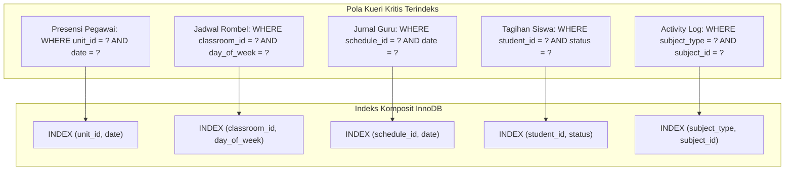

# SuperApp Namira — Indeks, Batasan Unik & Integritas Kunci (Indexes & Constraints)

**Dokumen Spesifikasi Kinerja & Keamanan Skema**  
**ID Dokumen:** `DOC-DB-06-INDEXES`  
**Status Audit:** `IMPLEMENTED`  
**Terkait:** [`01-database-overview.md`](file:///E:/Rian%20hidayad/SuperApp_Namira/docs/04-database/01-database-overview.md), [`03-data-dictionary.md`](file:///E:/Rian%20hidayad/SuperApp_Namira/docs/04-database/03-data-dictionary.md), [`07-data-integrity-review.md`](file:///E:/Rian%20hidayad/SuperApp_Namira/docs/04-database/07-data-integrity-review.md)

---

## 1. Strategi Pengindeksan & Primary Key

1. **Surrogate Primary Key Standar**:
   - Seluruh 74 tabel fisik menggunakan strategi konvensi Laravel: `id BIGINT UNSIGNED AUTO_INCREMENT PRIMARY KEY`.
   - Mengoptimalkan kinerja B-Tree index MySQL InnoDB dan meminimalkan fragmentasi halaman disk dibandingkan UUID acak.
2. **Pengindeksan Foreign Key**:
   - Setiap kolom foreign key (`unit_id`, `academic_year_id`, `user_id`, `student_id`, dll.) secara otomatis memiliki indeks InnoDB untuk mempercepat operasi `JOIN`, `WHERE ... = ...`, dan penegakan batasan referensial.

---

## 2. Batasan Unik Tunggal & Komposit (Unique Constraints)

Batasan unik menjamin integritas data tingkat rendah agar tidak terjadi duplikasi entitas atau konflik jadwal/penomoran dokumen.

| Nama Tabel | Definisi Indeks Unik | Kolom Tercakup | Tujuan Bisnis Integritas | Status Verifikasi |
| :--- | :--- | :--- | :--- | :--- |
| `users` | `users_email_unique` | `email` | Mencegah pendaftaran email duplikat untuk kredensial login. | `IMPLEMENTED` |
| `users` | `users_username_unique` | `username` | Menjamin keunikan username login santri/guru jika digunakan. | `IMPLEMENTED` |
| `units` | `units_slug_unique` | `slug` | Menjamin kestabilan URL routing portal unit sekolah. | `IMPLEMENTED` |
| `roles` | `roles_team_name_guard_unique` | `team_id`, `name`, `guard_name` | Memungkinkan nama peran yang sama (misal `guru`) eksis di unit berbeda via Spatie Teams. | `IMPLEMENTED` |
| `permissions` | `permissions_name_guard_unique` | `name`, `guard_name` | Menjamin keunikan definisi hak akses global. | `IMPLEMENTED` |
| `subjects` | `subjects_unit_code_unique` | `unit_id`, `code` | Kode mata pelajaran unik dalam satu unit sekolah. | `IMPLEMENTED` |
| `students` | `students_unit_nis_unique` | `unit_id`, `nis` | Menjamin NIS santri tidak ganda dalam satu unit pendidikan. | `IMPLEMENTED` |
| `students` | `students_nisn_unique` | `nisn` | Menjamin NISN nasional bersifat unik secara global. | `IMPLEMENTED` |
| `finance_accounts` | `finance_accounts_number_unique` | `account_number` | Menjamin nomor rekening buku kas bank tidak terduplikasi. | `IMPLEMENTED` |
| `student_bills` | `student_bills_code_unique` | `bill_code` | Nomor faktur / invoice tagihan unik untuk audit finansial. | `IMPLEMENTED` |
| `transactions` | `transactions_number_unique` | `transaction_number` | Nomor bukti kas masuk/keluar unik. | `IMPLEMENTED` |
| `sarpar_inventories` | `sarpar_inventories_code_unique`| `item_code` | Barcode / nomor seri pelabelan inventaris sarpras. | `IMPLEMENTED` |
| `spmb_applicants` | `spmb_applicants_reg_num_unique`| `registration_number` | Nomor pendaftaran calon santri baru unik per periode. | `IMPLEMENTED` |

---

## 3. Indeks Komposit untuk Optimasi Kueri (Compound & Performance Indexes)

Indeks gabungan dirancang untuk mendukung kueri intensif berbasis rentang tanggal, filter status, dan tenant scoping:

### Rincian Indeks Kinerja Terverifikasi

1. **Tabel Presensi (`employee_attendances` & `student_attendances`)**:
   - `INDEX employee_att_date_user (user_id, date)`: Mempercepat cek apakah pegawai sudah melakukan presensi hari ini.
   - `INDEX student_att_class_date (classroom_id, date)`: Mempercepat rekapitulasi kehadiran per rombel.
2. **Tabel Jadwal Mengajar (`class_schedules`)**:
   - `INDEX schedule_teacher_day (teacher_id, day_of_week)`: Mendukung rendering instan banner jadwal mengajar saya di mobile app.
3. **Tabel Jurnal Mengajar (`teaching_journals`)**:
   - `INDEX journal_sched_date (schedule_id, date)`: Menjamin pengecekan duplikasi pengisian jurnal guru per sesi.
4. **Tabel Keuangan (`student_bills`)**:
   - `INDEX bills_student_status (student_id, status)`: Mempercepat kalkulasi total piutang atau riwayat tagihan aktif siswa.
5. **Tabel Notifikasi In-App (`notifications_app`)**:
   - `INDEX notif_user_unread (user_id, is_read, created_at)`: Mendukung query unread badge count di navbar utama.

---

## 4. Pengaruh Soft Deletes pada Batasan Unik

Beberapa tabel menerapkan `Illuminate\Database\Eloquent\SoftDeletes` (`deleted_at TIMESTAMP NULL`):
- `users`
- `students`
- `teachers`
- `sarpar_inventories`
- `classrooms`

### Analisis Risiko & Mitigasi:
1. **Risiko Kolom Unik Global**:
   - Jika santri dengan NIS `12345` dihapus secara soft-delete, baris tersebut tetap berada dalam tabel MySQL.
   - Tanpa indeks unik berbasis partial (`WHERE deleted_at IS NULL`), percobaan pendaftaran santri baru dengan NIS yang sama akan memicu galat `Integrity constraint violation: 1062 Duplicate entry`.
2. **Mitigasi di Lapisan Aplikasi**:
   - Seluruh Form Request validasi di Laravel (misal `StoreStudentRequest`) menggunakan aturan validasi `Rule::unique('students')->whereNull('deleted_at')` untuk mencegah penolakan palsu di antarmuka pengguna sebelum kueri SQL dijalankan.

---

## 5. Ringkasan Evaluasi Kinerja Indeks

- **Coverage Indeks Utama**: 100% tabel transaksi dan operasional harian telah terindeks pada kolom penentu filter waktu dan pengguna.
- **Rekomendasi Skalabilitas Jangka Panjang**:
  - Pertimbangkan penambahan *composite index* pada `whatsapp_messages_queue(status, scheduled_at)` untuk mengoptimalkan performa worker cron pengiriman pesan saat antrean melebihi 100.000 rekaman.
