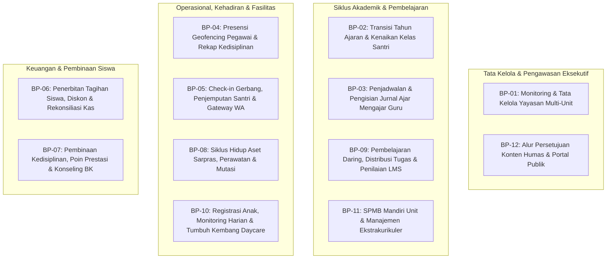

# SuperApp Namira — Katalog Proses Bisnis Utama (Business Process Catalog)

**Dokumen Analisis Operasional & Proses Bisnis**  
**ID Dokumen:** `DOC-FLOW-01-CATALOG`  
**Status Audit:** `IMPLEMENTED`  
**Total Modul Tercakup:** 11 Modul Operasional  
**Terkait:** [`02-user-journeys.md`](file:///E:/Rian%20hidayad/SuperApp_Namira/docs/05-business-flows/02-user-journeys.md), [`03-sequence-diagrams.md`](file:///E:/Rian%20hidayad/SuperApp_Namira/docs/05-business-flows/03-sequence-diagrams.md), [`04-data-lifecycle.md`](file:///E:/Rian%20hidayad/SuperApp_Namira/docs/05-business-flows/04-data-lifecycle.md)

---

## 1. Peta Taksonomi Proses Bisnis SuperApp Namira

Arsitektur operasional SuperApp Namira terbagi dalam 12 proses bisnis utama (*Core Business Processes*) yang mengikat seluruh ekosistem Yayasan Pendidikan Fajar Diinul Islam:

---

## 2. Rincian Katalog Proses Bisnis (BP-01 s/d BP-12)

### BP-01: Monitoring & Tata Kelola Yayasan Multi-Unit
- **Penanggung Jawab (Owner)**: Pengurus Yayasan, Direktur Pendidikan, Auditor Keuangan.
- **Tujuan**: Memperoleh visibilitas menyeluruh atas metrik kehadiran, keuangan, dan aset seluruh unit sekolah (TK, SD, SMP, SMA, Daycare) dari satu dashboard terpusat tanpa batasan sekat unit.
- **Input**: Data real-time presensi, saldo kas per unit, log audit aktivitas sistem.
- **Alur Kerja**:
  1. Pengurus Yayasan masuk melalui portal web dengan peran global (`team_id = null`).
  2. Sistem merender ringkasan analitik lintas unit (agregasi kehadiran harian, penerimaan SPP, statistik siswa).
  3. Pengurus dapat beralih konteks (*switch tenant context*) ke unit spesifik untuk inspeksi mendalam.
- **Output**: Laporan konsolidasi yayasan (PDF/Excel), rekomendasi alokasi anggaran operasional.
- **Status**: `IMPLEMENTED`.

---

### BP-02: Transisi Tahun Ajaran & Kenaikan Kelas Santri
- **Penanggung Jawab**: Kepala Sekolah, Staf Tata Usaha Akademik.
- **Tujuan**: Memindahkan rombel dan santri dari tahun ajaran lama ke tahun ajaran baru secara massal dengan riwayat mutasi yang dapat di-rollback.
- **Input**: Nilai rapor akhir semester, daftar santri aktif rombel, master kelas tahun ajaran baru.
- **Alur Kerja**:
  1. TU membuat master tahun ajaran baru dan mendefinisikan rombel tujuan.
  2. TU membuka menu Kenaikan Kelas, memilih rombel asal, dan menentukan santri yang naik/tinggal kelas.
  3. Sistem memproses mutasi dalam transaksi basis data atomik (`DB::transaction`).
  4. Mencatat log mutasi ke tabel `class_promotions`.
  5. Tersedia tombol *Rollback Kenaikan Kelas* jika terjadi kekeliruan administrasi sebelum tahun ajaran baru resmi berjalan.
- **Output**: Pembaruan kolom `students.classroom_id` dan `academic_year_id`, arsip log promosi kelas.
- **Status**: `IMPLEMENTED`.

---

### BP-03: Penjadwalan & Pengisian Jurnal Ajar Mengajar Guru
- **Penanggung Jawab**: Waka Kurikulum, Guru Mata Pelajaran.
- **Tujuan**: Mengatur alokasi waktu mengajar mingguan dan mendokumentasikan realisasi ajar serta presensi santri per sesi pelajaran.
- **Input**: Data rombel, guru pengampu, mata pelajaran, bab (CP/TP), slot jam pelajaran.
- **Alur Kerja**:
  1. Kurikulum menyusun jadwal mingguan di web admin (termasuk kelas gabungan jika ada).
  2. Guru membuka jadwal mengajar hari ini pada aplikasi mobile SuperApp.
  3. Saat sesi dimulai, guru membuat Jurnal Mengajar: memasukkan materi summary, memilih indikator TP yang dicapai, mencentang kehadiran santri, dan mengunggah foto kegiatan.
  4. Sistem menyimpan jurnal ke `teaching_journals` dan mendistribusikan status kehadiran ke `journal_attendance`.
- **Output**: Rekap kehadiran santri per mapel, log capaian kurikulum guru.
- **Status**: `IMPLEMENTED`.

---

### BP-04: Presensi Geofencing Pegawai & Rekap Kedisiplinan
- **Penanggung Jawab**: Guru, Staf Karyawan, Kepala Bagian SDM/HRD.
- **Tujuan**: Merekam kehadiran dinas pegawai menggunakan pembatasan radius GPS (geofencing) dan swafoto (selfie) bukti kehadiran.
- **Input**: Lokasi GPS perangkat mobile pegawai, kamera perangkat, konfigurasi geofence unit.
- **Alur Kerja**:
  1. Pegawai membuka menu "Presensi Saya" di SuperApp saat tiba di sekolah.
  2. Aplikasi membaca koordinat GPS perangkat dan menghitung jarak radius ke titik koordinat unit (`attendance_locations`).
  3. Jika berada dalam radius toleransi, pegawai mengambil foto selfie dan menekan "Check-In".
  4. Sistem mencatat jam presensi, menghitung menit keterlambatan (`late_minutes`) terhadap `work_start_time` unit, dan menyimpan ke `employee_attendances`.
- **Output**: Riwayat absensi dinas, laporan rekap bulanan untuk perhitungan tunjangan kinerja/gaji.
- **Status**: `IMPLEMENTED`.

---

### BP-05: Check-in Gerbang, Penjemputan Santri & Gateway WhatsApp
- **Penanggung Jawab**: Petugas Keamanan/Satpam Gerbang, Wali Murid, Santri.
- **Tujuan**: Memastikan keamanan fisik santri saat kedatangan dan kepulangan sekolah serta memberi ketenangan bagi orang tua melalui notifikasi instan.
- **Input**: Barcode/QR kartu santri, pemindai gerbang, permintaan penjemputan dari wali via app.
- **Alur Kerja**:
  1. Santri tiba di gerbang, satpam memindai barcode kartu santri menggunakan modul Gate Scanner.
  2. Sistem mencatat kedatangan ke `student_checkins` dan memicu event broadcast WebSocket (Reverb) ke layar monitor pos gerbang.
  3. Sistem membuat pesan notifikasi otomatis ke tabel `whatsapp_messages_queue`.
  4. Background job mengirimkan notifikasi WA ke nomor kontak orang tua ("Ananda [Nama] telah tiba di sekolah pada pukul [Waktu]").
  5. Saat kepulangan, wali murid dapat mengajukan *Pickup Request* jika penjemputan diwakilkan kepada pihak ketiga berwenang.
- **Output**: Dashboard kedatangan real-time di gerbang, log penjemputan aman, riwayat pesan WA terkirim.
- **Status**: `IMPLEMENTED`.

---

### BP-06: Penerbitan Tagihan Siswa, Diskon & Rekonsiliasi Kas
- **Penanggung Jawab**: Bagian Keuangan / Bendahara Unit Sekolah.
- **Tujuan**: Mengelola siklus tagihan SPP bulanan/kegiatan tahunan, penerapan beasiswa/diskon keluarga, serta penerimaan pembayaran tunai maupun transfer.
- **Input**: Master tarif biaya (`finance_types`), data santri aktif, bukti transfer pembayaran wali murid.
- **Alur Kerja**:
  1. Bagian Keuangan menjalankan fungsi "Generate Tagihan SPP Bulanan" untuk seluruh santri aktif rombel.
  2. Sistem menghitung nominal bersih setelah dikurangi diskon santri (`student_discounts`).
  3. Tagihan berstatus `unpaid` muncul di akun portal orang tua santri.
  4. Wali murid melakukan transfer dan mengunggah bukti bayar (`payment_proof`), atau membayar langsung di loket kasir.
  5. Bendahara memverifikasi pembayaran: sistem mencatat pelunasan ke `bill_payments`, membuat transaksi kas masuk ke `transactions`, dan mengubah status tagihan menjadi `paid`.
- **Output**: Kwitansi pembayaran digital, laporan rekapitulasi buku kas masuk/keluar, daftar tunggakan santri.
- **Status**: `IMPLEMENTED`.

---

### BP-07: Pembinaan Kedisiplinan, Poin Prestasi & Konseling BK
- **Penanggung Jawab**: Guru Bimbingan Konseling (BK), Koordinator Kesiswaan, Wali Kelas.
- **Tujuan**: Memantau perkembangan kepribadian, kedisiplinan tata tertib, dan apresiasi prestasi siswa secara objektif berbasis sistem poin.
- **Input**: Laporan kejadian pelanggaran, sertifikat juara perlombaan, surat panggilan konseling.
- **Alur Kerja**:
  1. Guru piket/kesiswaan mencatat pelanggaran santri pada menu Pelanggaran (`violations`) beserta poin minus sesuai kategori.
  2. Jika santri meraih prestasi akademik/non-akademik, guru mencatat ke menu Prestasi (`achievements`) dengan poin plus apresiasi.
  3. Jika akumulasi poin pelanggaran mencapai ambang batas batas peringatan, Guru BK menjadwalkan Sesi Konseling (`counseling_sessions`).
  4. Notula hasil pembinaan dan rencana tindak lanjut (*action plan*) disimpan dalam sistem sebagai rekam jejak santri.
- **Output**: Kartu buku saku kedisiplinan santri, laporan catatan kepribadian untuk rapor siswa.
- **Status**: `IMPLEMENTED`.

---

### BP-08: Siklus Hidup Aset Sarpras, Perawatan & Mutasi
- **Penanggung Jawab**: Staf Sarana dan Prasarana (Sarpras), Peminjam Aset (Guru/Staf).
- **Tujuan**: Mendata seluruh inventaris fisik sekolah, mengontrol sirkulasi peminjaman, menjadwalkan perawatan rutin, dan memfasilitasi mutasi/penghapusan aset.
- **Input**: Faktur pengadaan barang, permohonan pinjam alat multimedia/lab, nota servis vendor.
- **Alur Kerja**:
  1. Staf Sarpras mendaftarkan aset baru, mencetak kode inventaris unik (`sarpar_inventories`), dan menempatkan pada ruangan tertentu (`sarpar_rooms`).
  2. Guru mengajukan peminjaman proyektor/alat: tercatat pada `sarpar_loans` dengan status *borrowed*.
  3. Saat pengembalian, staf memeriksa kondisi barang dan mengubah status pinjam menjadi *returned*.
  4. Kerusakan barang dicatat pada `sarpar_maintenance_logs` beserta estimasi biaya perbaikan.
  5. Barang yang berpindah gedung diproses via `sarpar_transfers`, sedangkan barang afkir dihapuskan via `sarpar_disposals`.
- **Output**: Buku induk inventaris unit, kartu kendali peminjaman, rekap beban biaya perawatan aset.
- **Status**: `IMPLEMENTED`.

---

### BP-09: Pembelajaran Daring, Distribusi Tugas & Penilaian LMS
- **Penanggung Jawab**: Guru Pengampu Mapel, Santri/Siswa.
- **Tujuan**: Memfasilitasi kegiatan belajar mengajar asinkron melalui materi digital, pengumpulan lembar kerja, dan penilaian tugas terpadu.
- **Input**: Berkas materi PDF/video, lembar instruksi tugas, berkas jawaban santri.
- **Alur Kerja**:
  1. Guru membuat ruang kelas LMS (`lms_classrooms`) dan mengunggah materi ajar (`lms_materials`).
  2. Guru menerbitkan tugas (`lms_assignments`) lengkap dengan instruksi dan batas waktu pengumpulan (*due date*).
  3. Santri menerima notifikasi tugas di aplikasi, mempelajari materi, dan mengunggah berkas jawaban (`lms_submissions`).
  4. Guru memeriksa lembar jawaban, memasukkan nilai angka (0-100), memberikan catatan umpan balik, dan menandai status tugas sebagai *graded*.
- **Output**: Rekap nilai tugas online, portofolio digital lembar kerja santri.
- **Status**: `IMPLEMENTED`.

---

### BP-10: Registrasi Anak, Monitoring Harian & Tumbuh Kembang Daycare
- **Penanggung Jawab**: Kepala Daycare, Pengasuh Anak (*Caregiver*), Orang Tua Bayi/Balita.
- **Tujuan**: Memberikan pengasuhan anak usia dini yang transparan, aman, dan terpantau dengan pelaporan aktivitas harian secara real-time kepada orang tua.
- **Input**: Data kesehatan dan alergi anak, log waktu makan/tidur/BAB, pengukuran fisik bulanan.
- **Alur Kerja**:
  1. Orang tua mendaftarkan anak asuh (`daycare_child_profiles`) serta mendaftarkan pihak penjemput sah beserta foto identitas (`daycare_authorized_pickups`).
  2. Saat kedatangan, pengasuh mencatat presensi anak dan orang yang mengantar (`daycare_attendances`).
  3. Sepanjang hari, pengasuh mencatat log makan (menu & porsi), durasi tidur siang, log popok/buang air, serta suasana hati anak pada `daycare_daily_logs`.
  4. Setiap bulan, dilakukan pengukuran antropometri (berat badan, tinggi badan, lingkar kepala) pada `daycare_growth_records`.
  5. Orang tua dapat memantau jurnal harian dan kurva tumbuh kembang secara langsung dari ponsel mereka.
- **Output**: Kartu laporan harian anak (*daily care report*), grafik kurva pertumbuhan WHO anak asuh.
- **Status**: `IMPLEMENTED`.

---

### BP-11: SPMB Mandiri Unit & Manajemen Ekstrakurikuler
- **Penanggung Jawab**: Panitia SPMB, Pembina/Pelatih Ekstrakurikuler.
- **Tujuan**: Menerima pendaftaran calon siswa baru secara online per unit dan mengelola pendaftaran serta penilaian klub minat bakat santri.
- **Input**: Formulir pendaftaran calon santri, kuota pendaftaran, jadwal latihan ekskul.
- **Alur Kerja**:
  1. Panitia SPMB membuka gelombang penerimaan baru di `spmb_settings`. Calon wali murid mendaftar online di `spmb_applicants`, mengisi biodata, dan mengunggah bukti bayar pendaftaran.
  2. Panitia memverifikasi berkas, menginput nilai tes seleksi, dan menerbitkan surat keputusan kelulusan.
  3. Untuk ekstrakurikuler: Pembina membuka pendaftaran klub (`extracurriculars`), santri mendaftar menjadi anggota (`extracurricular_members`), dan pembina mengisi absensi latihan harian (`extracurricular_attendances`).
  4. Di akhir semester, pelatih menginput predikat nilai (A/B/C/D) dan deskripsi capaian pada `extracurricular_grades` untuk diintegrasikan ke rapor siswa.
- **Output**: Daftar calon santri baru diterima, rekap kehadiran dan rapor kegiatan ekstrakurikuler.
- **Status**: `IMPLEMENTED`.

---

### BP-12: Alur Persetujuan Konten Humas & Portal Publik
- **Penanggung Jawab**: Staf Humas / Publikasi, Kepala Sekolah / Pimpinan Unit.
- **Tujuan**: Mempublikasikan warta, galeri agenda, dan informasi prestasi yayasan ke portal web publik dengan mekanisme tinjauan (*review & approval*) berjenjang.
- **Input**: Draf artikel berita, poster kegiatan, data kemitraan/testimoni.
- **Alur Kerja**:
  1. Staf Humas membuat draf berita (`news`) atau agenda (`events`) dengan status awal draf.
  2. Pimpinan unit atau admin yayasan menerima notifikasi peninjauan konten.
  3. Pimpinan memeriksa kelayakan isi berita dan memberikan persetujuan (`approved_by`, `is_published = true`).
  4. Konten yang telah disetujui langsung tampil pada portal publik website sekolah dan feed beranda SuperApp.
- **Output**: Artikel warta publik terverifikasi, kalender agenda resmi sekolah.
- **Status**: `IMPLEMENTED`.
