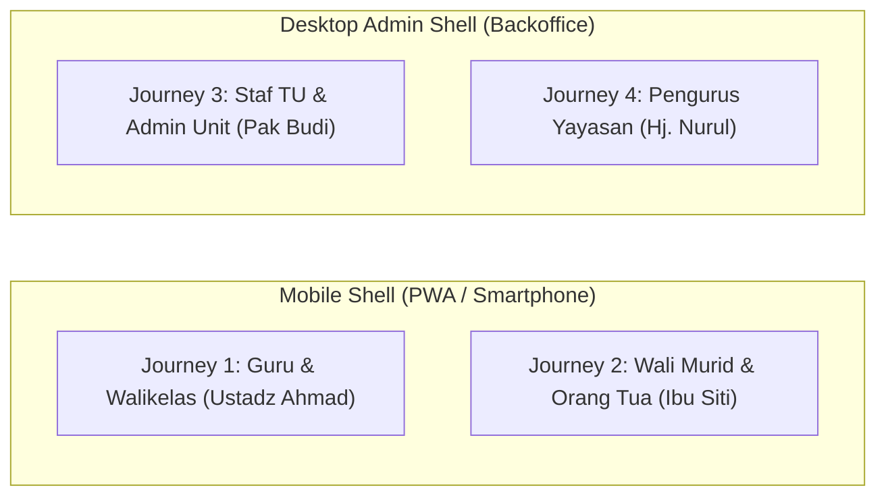
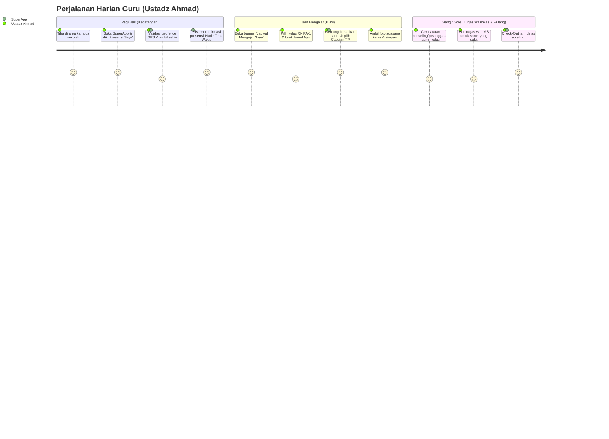
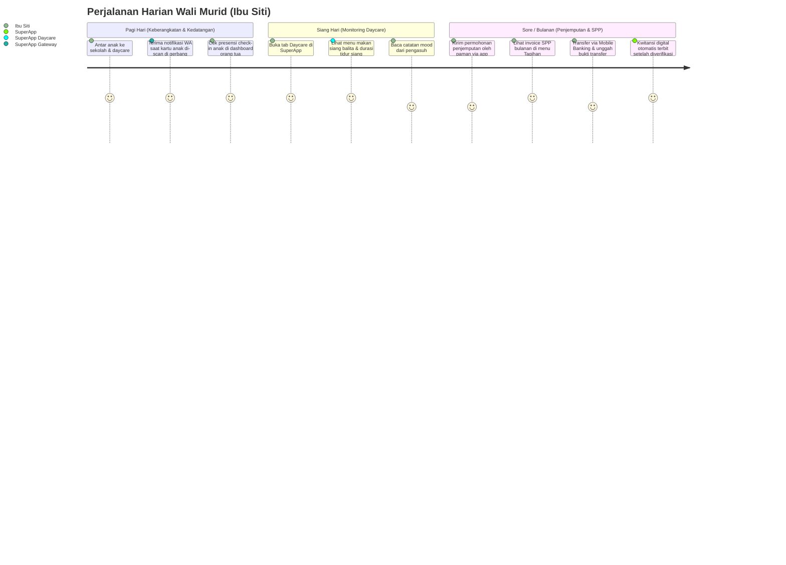
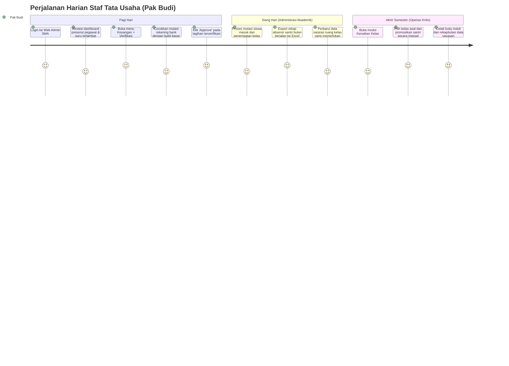

# SuperApp Namira — Perjalanan Pengguna (User Journeys)

**Dokumen Desain Pengalaman Pengguna & Analisis Perilaku**  
**ID Dokumen:** `DOC-FLOW-02-JOURNEYS`  
**Status Audit:** `IMPLEMENTED`  
**Persona Sasaran:** 4 Persona Kunci  
**Terkait:** [`01-business-process-catalog.md`](file:///E:/Rian%20hidayad/SuperApp_Namira/docs/05-business-flows/01-business-process-catalog.md), [`03-sequence-diagrams.md`](file:///E:/Rian%20hidayad/SuperApp_Namira/docs/05-business-flows/03-sequence-diagrams.md), [`03-user-personas-and-roles.md`](file:///E:/Rian%20hidayad/SuperApp_Namira/docs/01-product/03-user-personas-and-roles.md)

---

## 1. Peta Matriks Perjalanan Pengguna (User Journey Matrix)

SuperApp Namira menyatukan pengalaman pengguna dengan antarmuka ganda (*dual-shell architecture*): aplikasi mobile responsive/PWA untuk mobilitas lapangan dan dashboard desktop web untuk administrasi intensif.

---

## 2. Journey 1: Ustadz Ahmad, S.Pd. (Guru Mapel & Wali Kelas)

### Profil Singkat & Konteks Perangkat
- **Peran**: Guru Matematika SMA Namira & Wali Kelas XI-IPA-1.
- **Perangkat**: Ponsel Pintar Android (Mobile PWA) saat di sekolah, Laptop saat menginput nilai rapor.
- **Tujuan Utama**: Melakukan presensi dinas harian tepat waktu, mengajar sesuai jadwal, mengisi jurnal KBM dan absensi siswa tanpa repot membawa buku fisik.

### Tahapan Perjalanan Harian:

### Analisis Titik Masalah & Solusi Sistem:
- **Sebelumnya**: Mengantre di mesin fingerprint lorong sekolah yang sering error, menulis rekap jurnal kertas yang menumpuk di meja kurikulum.
- **Dengan SuperApp Namira**: Presensi instan dari halaman parkir atau meja kantor; jurnal tersimpan di cloud dan terhubung otomatis dengan rekapitulasi kehadiran kurikulum dan wali murid.

---

## 3. Journey 2: Ibu Siti Rahmah (Wali Murid Santri & Daycare)

### Profil Singkat & Konteks Perangkat
- **Peran**: Ibu rumah tangga / profesional yang memiliki 1 anak di SMP Namira dan 1 balita di Daycare Namira.
- **Perangkat**: Ponsel Pintar iOS / Android (SuperApp PWA & WhatsApp).
- **Tujuan Utama**: Memastikan keselamatan anak saat tiba di sekolah, memantau makan dan tidur balita di Daycare, serta membayar SPP tanpa harus datang ke bank.

### Tahapan Perjalanan Harian:

### Analisis Titik Masalah & Solusi Sistem:
- **Sebelumnya**: Khawatir apakah anak sudah sampai di kelas atau belum, sering bertanya ke grup WhatsApp wali murid, harus meminta izin kerja untuk mengantre bayar SPP di TU.
- **Dengan SuperApp Namira**: Notifikasi gerbang otomatis lewat WhatsApp; laporan harian daycare transparan; pembayaran tagihan sekolah dapat diselesaikan dari genggaman.

---

## 4. Journey 3: Pak Budi Santoso (Staf Tata Usaha & Admin Unit)

### Profil Singkat & Konteks Perangkat
- **Peran**: Kepala Tata Usaha SMA Namira.
- **Perangkat**: PC Desktop Kantor (AuthenticatedLayout Web Admin).
- **Tujuan Utama**: Memverifikasi pembayaran SPP santri, mengelola database siswa dan rombel, menyiapkan kenaikan kelas, serta mencetak laporan rekapitulasi dinas.

### Tahapan Perjalanan Harian:

### Analisis Titik Masalah & Solusi Sistem:
- **Sebelumnya**: Rekonsiliasi manual slip setoran bank memakan waktu 3-4 hari setiap awal bulan; proses kenaikan kelas rentan salah ketik di lembar Excel yang berbeda-beda.
- **Dengan SuperApp Namira**: Verifikasi pembayaran satu klik menghasilkan entri buku kas otomatis; kenaikan kelas massal memiliki fitur rollback aman.

---

## 5. Journey 4: Hj. Nurul Hidayah, SE (Pengurus Yayasan / Auditor)

### Profil Singkat & Konteks Perangkat
- **Peran**: Bendahara Yayasan & Anggota Badan Pengawas Pendidikan.
- **Perangkat**: Laptop / iPad Tablet (Dashboard Eksekutif Yayasan).
- **Tujuan Utama**: Mengawasi stabilitas operasional dan kepatuhan finansial di 5 unit pendidikan tanpa harus melakukan inspeksi manual satu per satu.

### Tahapan Perjalanan:
1. **Login Eksekutif**: Membuka dashboard yayasan dengan hak akses global lintas unit.
2. **Inspeksi Metrik Konsolidasi**:
   - Melihat grafik agregat penerimaan SPP bulan ini across units (TK, SD, SMP, SMA, Daycare).
   - Memeriksa persentase kepatuhan presensi guru dan pegawai di masing-masing unit.
3. **Penyelaman Data (Drill-Down)**:
   - Memilih unit SMP untuk menginspeksi lonjakan pengeluaran pada pos pemeliharaan sarpras.
   - Mengaudit log aktivitas sistem (`activity_log`) guna memastikan tidak ada transaksi yang dihapus atau diedit di luar prosedur.
4. **Pengambilan Keputusan Strategis**: Mengunduh laporan performa konsolidasi semesteran untuk bahan Rapat Pleno Dewan Pembina Yayasan.

---

## 6. Kesimpulan Nilai Pengalaman Pengguna

Perjalanan pengguna yang dirancang dalam SuperApp Namira berhasil menghapus silo informasi (*information silos*) antar unit dan menjembatani komunikasi tiga pihak: **Sekolah (Guru & Manajemen)**, **Wali Murid**, dan **Yayasan Penyelenggara**, dengan beban operasional yang jauh lebih ringan dan transparan.
