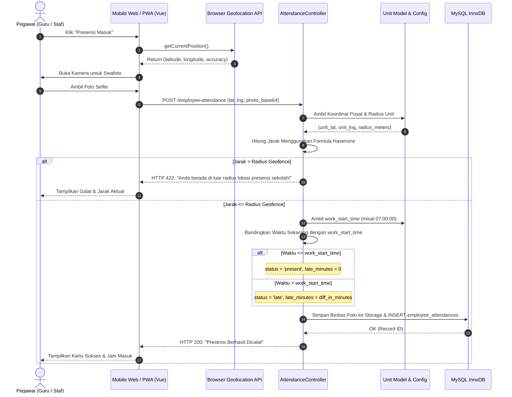
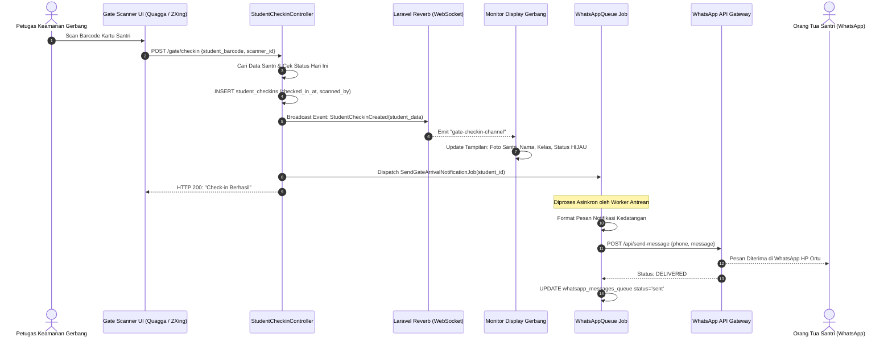
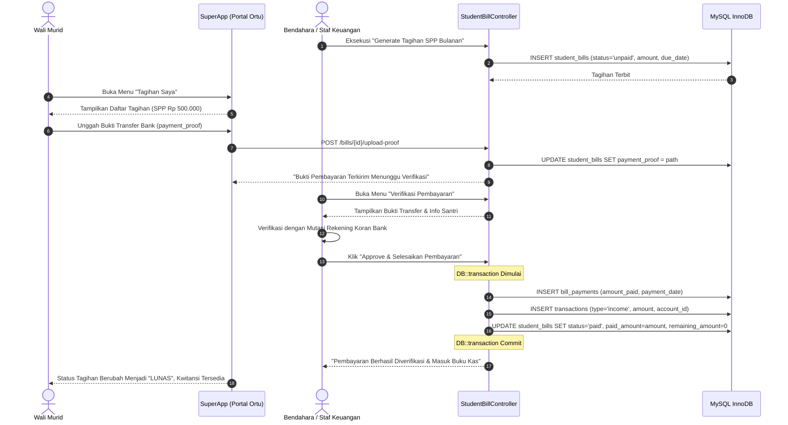
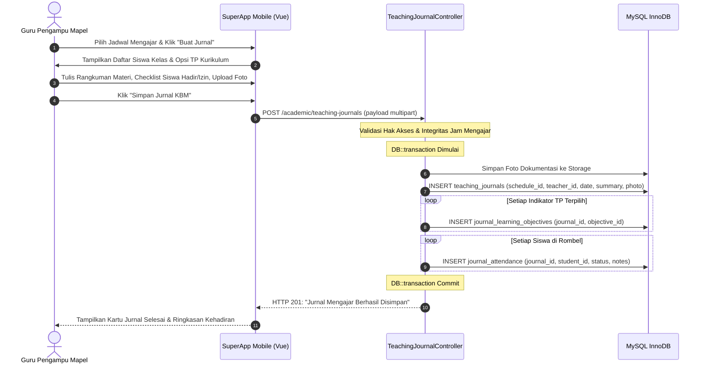
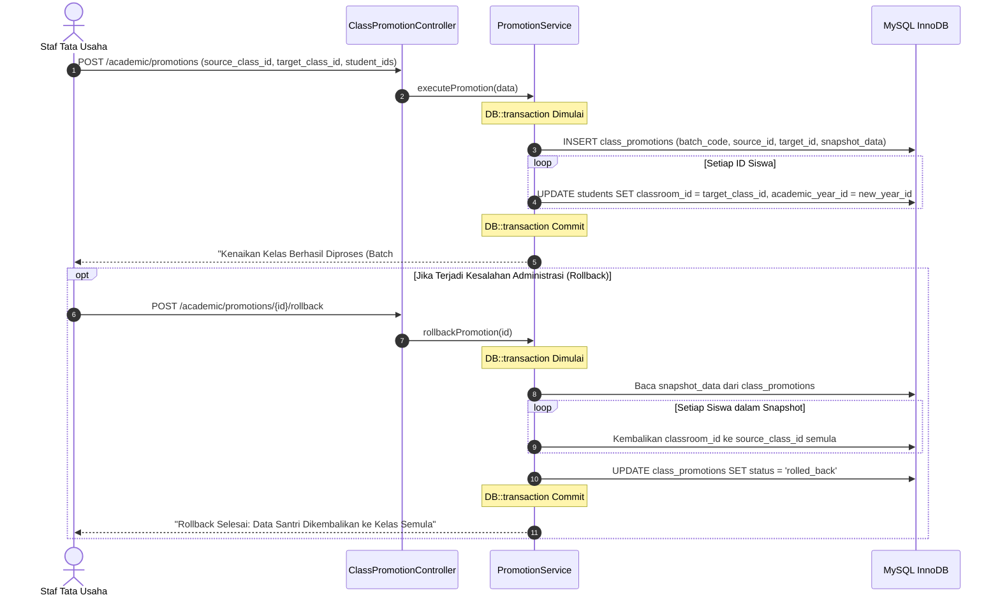

# SuperApp Namira — Diagram Urutan Alur Kritis (Sequence Diagrams)

**Dokumen Spesifikasi Interaksi Sistem & Komponen**  
**ID Dokumen:** `DOC-FLOW-03-SEQUENCE`  
**Status Audit:** `IMPLEMENTED`  
**Terkait:** [`01-business-process-catalog.md`](file:///E:/Rian%20hidayad/SuperApp_Namira/docs/05-business-flows/01-business-process-catalog.md), [`02-user-journeys.md`](file:///E:/Rian%20hidayad/SuperApp_Namira/docs/05-business-flows/02-user-journeys.md), [`05-backend-architecture.md`](file:///E:/Rian%20hidayad/SuperApp_Namira/docs/03-architecture/05-backend-architecture.md)

---

## 1. Sequence 1: Presensi Pegawai Berbasis Geofence & Kalkulasi Keterlambatan

Menjelaskan validasi koordinat GPS pegawai terhadap radius titik unit serta penentuan otomatis menit keterlambatan dinas.

---

## 2. Sequence 2: Gate QR Scanner, Reverb WebSocket & WhatsApp Notification Queue

Menjelaskan pemindaian kartu barcode santri di pos satpam, transmisi real-time ke monitor gerbang, dan otomatisasi pengiriman pesan WhatsApp kepada orang tua.

---

## 3. Sequence 3: Siklus Tagihan Siswa, Unggah Bukti Bayar & Rekonsiliasi Kas

Menjelaskan alur penagihan, konfirmasi pembayaran dari wali murid, hingga pencatatan transaksi buku kas oleh staf keuangan.

---

## 4. Sequence 4: Pengisian Jurnal Mengajar & Propagasi Presensi Sesi

Menjelaskan bagaimana seorang guru mendokumentasikan proses KBM, memilih capaian pembelajaran kurikulum, dan menyebarkan status kehadiran santri secara atomik.

---

## 5. Sequence 5: Kenaikan Kelas Massal & Mekanisme Rollback

Menjelaskan mutasi rombel siswa saat tahun ajaran baru dan proses pembatalan aman (*rollback*) jika ditemukan kesalahan administrasi.

---

## 6. Ringkasan Evaluasi Kinerja Alur Interaksi

1. **Integritas Transaksional**: Seluruh operasi yang melibatkan penulisan lebih dari 1 tabel (Jurnal KBM, Pelunasan Tagihan, Promosi Kelas) dilindungi oleh blok `DB::transaction()`.
2. **Asinkronitas Antrean**: Operasi pengiriman pesan WhatsApp dan notifikasi FCM diisolasi ke dalam sistem antrean (*queue worker*) untuk menjaga responsivitas HTTP API di bawah 200 ms.
3. **Komunikasi Real-time**: Penggunaan Laravel Reverb pada modul gerbang sekolah memberikan waktu latensi pembaruan monitor di bawah 100 ms tanpa perlu polling berulang.
