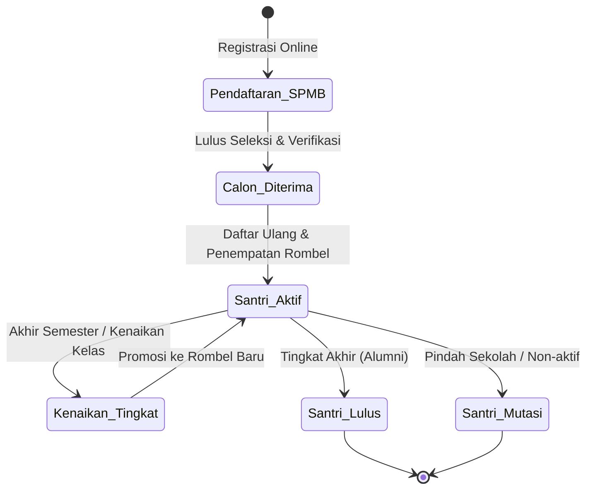
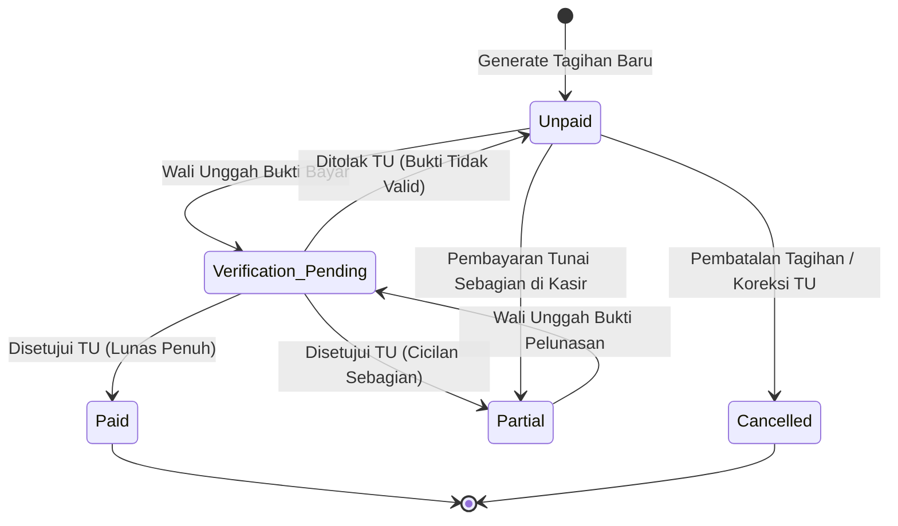
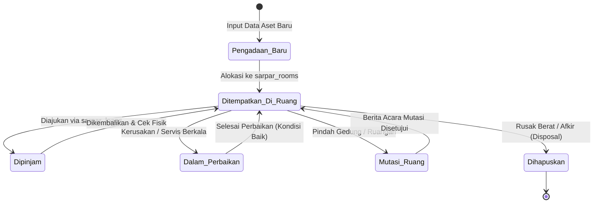

# SuperApp Namira — Siklus Hidup Data & Transisi Status (Data Lifecycle)

**Dokumen Analisis Siklus Hidup Entitas & Mesin Status (State Machine)**  
**ID Dokumen:** `DOC-FLOW-04-LIFECYCLE`  
**Status Audit:** `IMPLEMENTED`  
**Terkait:** [`01-business-process-catalog.md`](file:///E:/Rian%20hidayad/SuperApp_Namira/docs/05-business-flows/01-business-process-catalog.md), [`03-data-dictionary.md`](file:///E:/Rian%20hidayad/SuperApp_Namira/docs/04-database/03-data-dictionary.md), [`07-data-integrity-review.md`](file:///E:/Rian%20hidayad/SuperApp_Namira/docs/04-database/07-data-integrity-review.md)

---

## 1. Peta Siklus Hidup Entitas Utama

Sistem SuperApp Namira mengelola transisi status (*state transitions*) pada lima entitas bisnis bernilai tinggi: Santri/Siswa, Tagihan Keuangan, Aset Sarpras, Calon Santri SPMB, dan Kasus Konseling Santri.

---

## 2. Siklus Hidup Data Santri & Civitas Akademika

### Mesin Status: `students.status`
Kolom status santri memiliki lima kemungkinan nilai operasional:

| Nilai Status | Deskripsi Status | Tindakan Pemicu Transisi | Hak Akses Sistem Terkait |
| :--- | :--- | :--- | :--- |
| `candidate` | Calon santri baru yang baru mendaftar via SPMB online. | Registrasi via modul SPMB. | Akses terbatas ke portal SPMB calon siswa. |
| `active` | Santri resmi terdaftar, memiliki NIS, dan aktif dalam rombel kelas. | Konfirmasi pendaftaran ulang & penempatan rombel. | Akses penuh: Presensi, LMS, Rapor, Tagihan SPP. |
| `promoted` | Status transisi saat santri berpindah rombel pada tahun ajaran baru. | Eksekusi modul Kenaikan Kelas. | Akses rombel baru otomatis diperbarui. |
| `graduated` | Santri telah menyelesaikan jenjang akhir pendidikan (Alumni). | Eksekusi Kelulusan di menu Akademik. | Hak akses aktif dialihkan ke direktori alumni. |
| `transferred` / `dropped`| Santri mengundurkan diri atau mutasi keluar sekolah. | Penetapan manual oleh Staf Tata Usaha. | Akun dinonaktifkan, data diarsipkan via soft-delete. |

---

## 3. Siklus Hidup Tagihan Siswa (Student Billing Lifecycle)

### Mesin Status: `student_bills.status`

### Rincian Transisi & Perhitungan:
1. **`unpaid`**: Tagihan terbit (`paid_amount = 0`, `remaining_amount = amount`).
2. **`verification_pending`**: Wali murid mengunggah berkas `payment_proof`. Tagihan terkunci sementara dari penagihan ganda.
3. **`partial`**: Terjadi pembayaran sebagian (`paid_amount > 0` dan `remaining_amount > 0`). Sisa tagihan tetap muncul pada portal.
4. **`paid`**: Pembayaran lunas penuh (`remaining_amount = 0`). Kwitansi resmi terbit, transaksi kas masuk otomatis tercatat.
5. **`cancelled`**: Tagihan dibatalkan karena kesalahan administrasi atau santri mendapat beasiswa pembebasan penuh 100%.

---

## 4. Siklus Hidup Aset Sarana Prasarana (Asset Lifecycle)

### Mesin Status Aset: `sarpar_inventories`

### Kondisi Fisik Barang (`condition`):
- `good` (Kondisi normal/baik, siap pakai dan dipinjam).
- `minor_damage` (Kerusakan ringan, masih dapat difungsikan namun direkomendasikan perawatan).
- `heavy_damage` (Kerusakan berat, ditarik dari sirkulasi peminjaman menunggu servis atau penghapusan).

---

## 5. Siklus Hidup Calon Santri SPMB (Admission Lifecycle)

### Mesin Status: `spmb_applicants.status`
- **`registered`**: Formulir online terisi, nomor registrasi diterbitkan (`spmb_applicants.registration_number`).
- **`verified`**: Panitia SPMB telah memvalidasi berkas administrasi dan bukti biaya pendaftaran.
- **`test_scheduled` / `test_passed`**: Calon santri mengikuti tes observasi/wawancara dan dinyatakan lulus kriteria.
- **`accepted`**: Surat Keputusan Penerimaan Santri Baru diterbitkan.
- **`rejected`**: Calon santri tidak memenuhi kriteria penerimaan unit.

---

## 6. Kebijakan Retensi Data, Pengarsipan & Purging

Untuk menjaga performa basis data MySQL agar tetap responsif dalam jangka panjang, ditetapkan aturan retensi data berikut:

| Kategori Data | Tabel Sasaran | Masa Simpan Aktif | Kebijakan Pengarsipan / Purging |
| :--- | :--- | :--- | :--- |
| **Audit Trail** | `activity_log` | 2 Tahun | Baris lebih dari 2 tahun diekspor ke format JSON/Parquet dan dihapus dari tabel operasional. |
| **Telemetri Kinerja** | `pulse_*` | 7 Hari | Dihapus otomatis melalui scheduler cron Laravel Pulse (`php artisan pulse:clear`). |
| **Token Perangkat HP**| `user_device_tokens` | 6 Bulan | Token yang tidak aktif atau gagal mengirim notifikasi FCM di-purge otomatis setiap bulan. |
| **Log Antrean WA** | `whatsapp_messages_queue` | 3 Bulan | Pesan berstatus `sent` yang berusia lebih dari 90 hari dibersihkan secara berkala. |
| **Riwayat Presensi** | `employee_attendances`, `student_attendances` | Selamanya (Permanen) | Tidak pernah di-purge; merupakan arsip legal sekolah dan dasar evaluasi akreditasi. |
| **Transaksi Finansial**| `student_bills`, `transactions`, `bill_payments` | Selamanya (Permanen) | Tidak pernah dihapus; dilindungi batasan DDL `RESTRICT`. |
