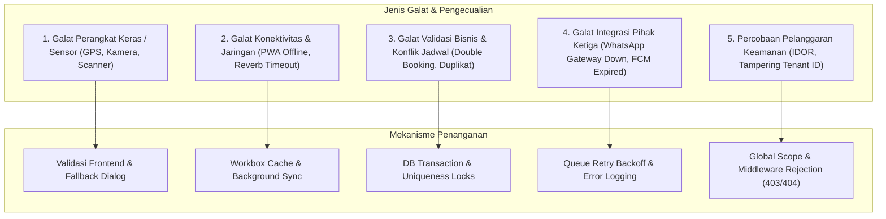

# SuperApp Namira — Penanganan Galat & Alur Pengecualian (Error & Exception Flows)

**Dokumen Spesifikasi Ketahanan Sistem & Pemulihan Galat (Fault Tolerance)**  
**ID Dokumen:** `DOC-FLOW-05-EXCEPTIONS`  
**Status Audit:** `IMPLEMENTED`  
**Terkait:** [`01-business-process-catalog.md`](file:///E:/Rian%20hidayad/SuperApp_Namira/docs/05-business-flows/01-business-process-catalog.md), [`03-sequence-diagrams.md`](file:///E:/Rian%20hidayad/SuperApp_Namira/docs/05-business-flows/03-sequence-diagrams.md), [`06-non-functional-requirements.md`](file:///E:/Rian%20hidayad/SuperApp_Namira/docs/01-product/06-non-functional-requirements.md)

---

## 1. Filosofi Ketahanan Sistem & Strategi Pertahanan

SuperApp Namira mengadopsi prinsip *fail-safe* dan *graceful degradation*. Setiap alur interaksi kritis dilengkapi mekanisme deteksi galat, validasi berlapis, pesan kesalahan yang informatif dalam Bahasa Indonesia, serta rencana pemulihan otomatis (*auto-recovery*) maupun panduan mitigasi manual.

---

## 2. Penanganan Kasus Galat per Domain Operasional

### 2.1 Presensi Geofencing & GPS Pegawai

| Kode Kasus | Kondisi Kegagalan | Respon Sistem & Pesan Galat | Mekanisme Pemulihan / Solusi |
| :--- | :--- | :--- | :--- |
| `ERR-ATT-01` | Pengguna menolak izin akses lokasi browser (*GPS Permission Denied*). | Pesan: *"Akses lokasi diperlukan untuk melakukan presensi. Silakan aktifkan izin GPS pada peramban Anda."* | Tombol pintasan ke pengaturan izin browser; tombol coba lagi. |
| `ERR-ATT-02` | Posisi koordinat pegawai berada di luar radius geofence unit (`distance > radius`). | HTTP 422: *"Presensi gagal: Anda terdeteksi berada di luar area kampus ([Jarak] meter dari lokasi resmi)."* | Tampilkan peta mini lokasi saat ini vs batas radius sekolah. Pegawai diarahkan masuk ke area sekolah atau melapor ke admin jika terjadi anomali GPS. |
| `ERR-ATT-03` | Terdeteksi indikasi manipulasi lokasi (*Mock Location / Fake GPS*). | HTTP 403: *"Presensi ditolak: Terdeteksi penggunaan aplikasi manipulasi koordinat."* | Sistem menolak check-in dan mencatat percobaan ke `activity_log` untuk audit disiplin SDM. |
| `ERR-ATT-04` | Jaringan terputus saat mengunggah foto selfie presensi. | Notifikasi: *"Koneksi terputus saat mengunggah swafoto. Mencoba kembali..."* | Service Worker PWA menyimpan data presensi ke IndexedDB lokal dan mengirimkan ulang otomatis saat internet stabil (*Background Sync*). |

---

### 2.2 Pemindai Barcode Gerbang (Gate Scanner) & Notifikasi WA

| Kode Kasus | Kondisi Kegagalan | Respon Sistem & Pesan Galat | Mekanisme Pemulihan / Solusi |
| :--- | :--- | :--- | :--- |
| `ERR-GAT-01` | Kartu barcode buram, rusak, atau tidak terbaca oleh kamera scanner. | Tampilan Scanner berkedip merah dengan audio peringatan kesalahan. | Fitur *Manual Input Search*: Satpam dapat mengetik NIS atau Nama Santri pada kolom pencarian cepat. |
| `ERR-GAT-02` | Kartu santri di-scan dua kali dalam waktu singkat (< 5 menit). | Status: *"Santri [Nama] sudah tercatat check-in pada pukul [Waktu]."* | Sistem mengabaikan scan kedua agar tidak terjadi duplikasi rekaman di basis data. |
| `ERR-GAT-03` | Gateway WhatsApp pihak ketiga mengalami gangguan (*Downtime / Rate Limit*). | Job antrean mencatat kegagalan: `cURL error / HTTP 500`. | Queue worker menerapkan *exponential backoff retry* (mencoba ulang 3 kali: 1 mnt, 5 mnt, 15 mnt). Jika tetap gagal, pesan disimpan di `whatsapp_messages_queue` dengan status `failed` untuk re-dispatch manual. |

---

### 2.3 Penjadwalan & Pengisian Jurnal Mengajar

| Kode Kasus | Kondisi Kegagalan | Respon Sistem & Pesan Galat | Mekanisme Pemulihan / Solusi |
| :--- | :--- | :--- | :--- |
| `ERR-ACD-01` | Bentrok jadwal guru (*Teacher Double Booking* pada hari dan jam yang sama). | HTTP 422: *"Guru yang bersangkutan telah dijadwalkan mengajar di kelas [Kelas] pada jam ini."* | Form input jadwal menolak penyimpanan hingga salah satu jadwal dipindahkan. |
| `ERR-ACD-02` | Guru mencoba mengisi Jurnal KBM kedua kalinya pada sesi yang sama di hari ini. | HTTP 422: *"Jurnal mengajar untuk sesi ini sudah pernah dibuat sebelumnya."* | Sistem mengarahkan guru ke halaman *Edit Jurnal* daripada membuat baris baru. |
| `ERR-ACD-03` | Kelas bersama (*Joint Class*) memiliki kapasitas siswa yang melebihi daya tampung ruangan. | Peringatan: *"Jumlah total santri ([X]) melebihi kapasitas ruangan terpilih ([Y])."* | Peringatan visual kuning di web kurikulum; tetap diperbolehkan dengan konfirmasi khusus wakasek sarpras/kurikulum. |

---

### 2.4 Pembayaran Keuangan & Sengketa Tagihan

| Kode Kasus | Kondisi Kegagalan | Respon Sistem & Pesan Galat | Mekanisme Pemulihan / Solusi |
| :--- | :--- | :--- | :--- |
| `ERR-FIN-01` | Wali murid mengunggah berkas bukti bayar dengan format tidak sah atau ukuran > 5MB. | Validasi form: *"Berkas harus berupa gambar (JPG, PNG) atau PDF maksimal 5 MB."* | Form menolak sebelum diunggah ke server. |
| `ERR-FIN-02` | Nominal transfer pada bukti mutasi bank berbeda dengan nominal invoice tagihan. | Status: *"Verifikasi Pembayaran Ditolak: Nominal transfer tidak sesuai."* | Staf TU mengisi catatan penolakan; tagihan kembali ke status `unpaid` dan wali murid menerima notifikasi perbaikan pembayaran. |
| `ERR-FIN-03` | Dua staf TU memverifikasi tagihan yang sama secara bersamaan (*Race Condition*). | `DB::transaction` dengan `lockForUpdate()`. | Staf kedua mendapat notifikasi bahwa tagihan sudah berstatus lunas dan tidak terjadi pencatatan kas ganda. |

---

### 2.5 Kenaikan Kelas & Rollback

| Kode Kasus | Kondisi Kegagalan | Respon Sistem & Pesan Galat | Mekanisme Pemulihan / Solusi |
| :--- | :--- | :--- | :--- |
| `ERR-PRM-01` | Rombel kelas tujuan telah melebihi daya tampung maksimum (`capacity`). | Dialog konfirmasi: *"Rombel tujuan melebihi daya tampung. Lanjutkan pemaksaan kapasitas?"* | Staf TU dapat memilih memecah rombel atau mengonfirmasi penambahan kapasitas darurat. |
| `ERR-PRM-02` | Mencoba melakukan Rollback pada batch promosi yang santrinya telah mengalami mutasi lanjutan. | HTTP 422: *"Rollback tidak dapat dilakukan karena sebagian santri telah dimutasikan lebih lanjut."* | Sistem mewajibkan pembatalan mutasi lanjutan secara bertahap sebelum batch awal di-rollback. |

---

### 2.6 Pelanggaran Batas Multi-Tenant (Tenant Tampering / IDOR)

| Kode Kasus | Kondisi Kegagalan | Respon Sistem & Pesan Galat | Mekanisme Pemulihan / Solusi |
| :--- | :--- | :--- | :--- |
| `ERR-SEC-01` | Admin SMA mencoba mengakses URL detail santri SMP dengan mengubah ID di rute. | HTTP 404 / 403 Forbidden: *"Data tidak ditemukan dalam unit wewenang Anda."* | `UnitScope` Eloquent dan middleware `EnsureUserBelongsToUnit` memblokir akses dan mencatat insiden ke `activity_log`. |

---

## 3. Matriks Strategi Pemulihan Sistem (Recovery Runbook Summary)

1. **Galat Transaksional**: Selalu memanfaatkan `DB::rollBack()` di blok `catch (\Throwable $e)` untuk mencegah *partial record insertion*.
2. **Galat Frontend**: Menggunakan SweetAlert2 dan toast notification dengan pesan humanis agar pengguna memahami langkah yang harus diambil tanpa melihat kode stack trace teknis.
3. **Penyimpanan Log Sentral**: Seluruh pengecualian kritis yang tidak tertangani dialirkan ke `storage/logs/laravel.log` dengan tingkat keparahan (*severity levels*) PSR-3 (`emergency`, `critical`, `error`).
