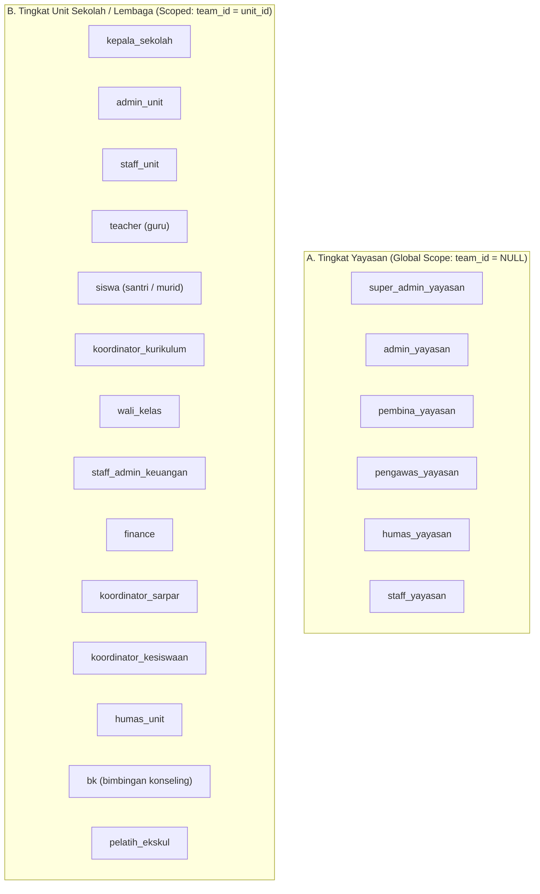

# SuperApp Namira — Matriks Peran & Hak Akses (Role-Permission Matrix)

**Dokumen Kontrak Tata Kelola Otorisasi & Keamanan**  
**ID Dokumen:** `DOC-SEC-01-RBAC-MATRIX`  
**Status Audit:** `IMPLEMENTED`  
**Total Peran:** 20 Peran (6 Tingkat Yayasan + 14 Tingkat Unit)  
**Total Modul:** 11 Modul Operasional  
**Terkait:** [`02-authorization-flow.md`](file:///E:/Rian%20hidayad/SuperApp_Namira/docs/06-access-control/02-authorization-flow.md), [`03-unit-and-tenant-isolation.md`](file:///E:/Rian%20hidayad/SuperApp_Namira/docs/06-access-control/03-unit-and-tenant-isolation.md), [`03-user-personas-and-roles.md`](file:///E:/Rian%20hidayad/SuperApp_Namira/docs/01-product/03-user-personas-and-roles.md)

---

## 1. Taksonomi 20 Peran Sistem

Pengguna dalam SuperApp Namira dikelompokkan ke dalam dua tingkatan wewenang Spatie Permission:

---

## 2. Matriks Hak Akses Lintas-Modul Komprehensif

**Keterangan Simbol Wewenang (CRUD):**
- **C** = Create (Membuat data baru)
- **R** = Read (Melihat / mengunduh data)
- **U** = Update (Mengubah / mengedit data)
- **D** = Delete (Menghapus data)
- **A** = Approve (Menyetujui / memvalidasi transaksi atau publikasi)
- **-** = Tidak Memiliki Akses (Blocked / Forbidden 403)

| Peran (Role) | Core / Yayasan | Akademik & KBM | Presensi Pegawai | Gerbang & Gate | Keuangan (SPP) | BK & Prestasi | Sarpras (Aset) | LMS Daring | Daycare | SPMB Online | Ekstrakurikuler |
| :--- | :---: | :---: | :---: | :---: | :---: | :---: | :---: | :---: | :---: | :---: | :---: |
| **`super_admin_yayasan`** | **CRUD** | **CRUD** | **CRUD** | **CRUD** | **CRUD** | **CRUD** | **CRUD** | **CRUD** | **CRUD** | **CRUD** | **CRUD** |
| **`admin_yayasan`** | CRUD | CRUD | CRUD | CRUD | CRUD | CRUD | CRUD | CRUD | CRUD | CRUD | CRUD |
| **`pembina_yayasan`** | R | R | R | R | R | R | R | R | R | R | R |
| **`pengawas_yayasan`**| R | R | R | R | R | R | R | R | R | R | R |
| **`humas_yayasan`** | R | R | - | - | - | R | - | - | - | R | R |
| **`staff_yayasan`** | R | R | CRU | R | R | R | R | - | R | R | R |
| **`kepala_sekolah`** | R | CRUA | R | R | RUA | RA | RUA | RA | RA | CRUA | RA |
| **`admin_unit`** | R | CRUD | CRUD | CRUD | CRUD | CRUD | CRUD | CRUD | CRUD | CRUD | CRUD |
| **`staff_unit`** | R | CRU | CRU | R | CRU | R | CRU | - | R | CRU | R |
| **`teacher`** | - | CRU | CRU | - | - | R | R | CRUA | - | - | - |
| **`siswa`** | - | R | - | R | R (Own) | R (Own)| - | CRU | - | - | R |
| **`koordinator_kurikulum`**| - | CRUA | R | - | - | R | - | CRUA | - | - | - |
| **`wali_kelas`** | - | CRU | R | R | R | CRUA | R | CRU | - | - | R |
| **`staff_admin_keuangan`** | - | R | - | - | CRUA | - | - | - | R | R | - |
| **`finance`** | - | R | - | - | CRUA | - | - | - | R | R | - |
| **`koordinator_sarpar`** | - | - | - | - | R | - | CRUA | - | - | - | - |
| **`koordinator_kesiswaan`**| - | R | - | R | - | CRUA | - | - | - | R | CRUA |
| **`humas_unit`** | - | - | - | - | - | - | - | - | - | R | R |
| **`bk`** | - | R | - | - | - | CRUA | - | - | - | - | - |
| **`pelatih_ekskul`** | - | - | - | - | - | - | - | - | - | - | CRUA |

---

## 3. Rincian Kebijakan Hak Akses Spesifik per Peran Kunci

### 3.1 `super_admin_yayasan` & `admin_yayasan`
- Memiliki wewenang penuh tanpa batas di seluruh unit (`team_id = null`).
- Dapat mengaktifkan/menonaktifkan modul via `CheckFeatureEnabled` (`feature_lms`, `feature_daycare`, `feature_counseling`, dsb).
- Berhak mengelola master `units`, mengubah lisensi sekolah, dan memicu audit aktivitas.

### 3.2 `kepala_sekolah` (Principal)
- Otoritas tertinggi pada tingkat unit spesifiknya.
- Berwenang melakukan *Approval* kenaikan kelas, memvalidasi pelunasan tagihan sengketa, menyetujui penghapusan aset sarpras afkir, dan meninjau warta sekolah sebelum dipublikasikan.

### 3.3 `teacher` (Dewan Guru)
- Terbatas pada unit tempatnya ditugaskan.
- Berhak membuat Jurnal Mengajar pada jadwal yang diampunya, mencatat absensi santri sesi ajar, serta menerbitkan materi dan tugas daring pada modul LMS.
- Tidak memiliki izin mengakses pembukuan kas unit atau mengubah master rombel sekolah.

### 3.4 `staff_admin_keuangan` / `finance`
- Memiliki akses eksklusif ke pembuatan tagihan santri (`student_bills`), approval bukti transfer wali murid, pencatatan mutasi kas bank (`transactions`), dan cetak kwitansi pelunasan.
- Diblokir dari pengubahan kurikulum KBM atau manipulasi nilai rapor.

### 3.5 `bk` (Guru Bimbingan Konseling) & `koordinator_kesiswaan`
- Memiliki wewenang CRUD atas tabel `violations`, `achievements`, dan `counseling_sessions`.
- Menjaga kerahasiaan notula konseling psikologis siswa dari akses staf umum.

### 3.6 `siswa` (Santri / Murid) & Wali Murid
- Beroperasi dalam status *Self-Service Access*:
  - Hanya dapat melihat jadwal dan nilai milik dirinya sendiri.
  - Mengunggah berkas lembar jawaban tugas LMS.
  - Memeriksa status tagihan SPP dan mengunggah bukti transfer bank.
  - Diblokir dari melihat catatan konseling rahasia atau data santri lain.

---

## 4. Evaluasi Prinsip Least Privilege (Hak Akses Minimum)

Penerapan RBAC di SuperApp Namira telah mematuhi prinsip *Least Privilege*:
1. Tidak ada peran staf operasional yang memiliki akses ke konfigurasi sistem global (`system_settings`).
2. Isolasi multi-tenant `team_id` mencegah staf administrasi SMP membaca atau memanipulasi data siswa SMA.
3. Seluruh mutasi data yang dilakukan oleh pemegang peran tercatat dalam log audit Spatie Activitylog untuk akuntabilitas hukum.
