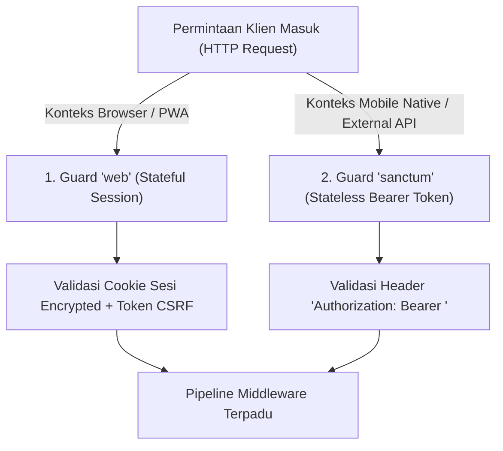
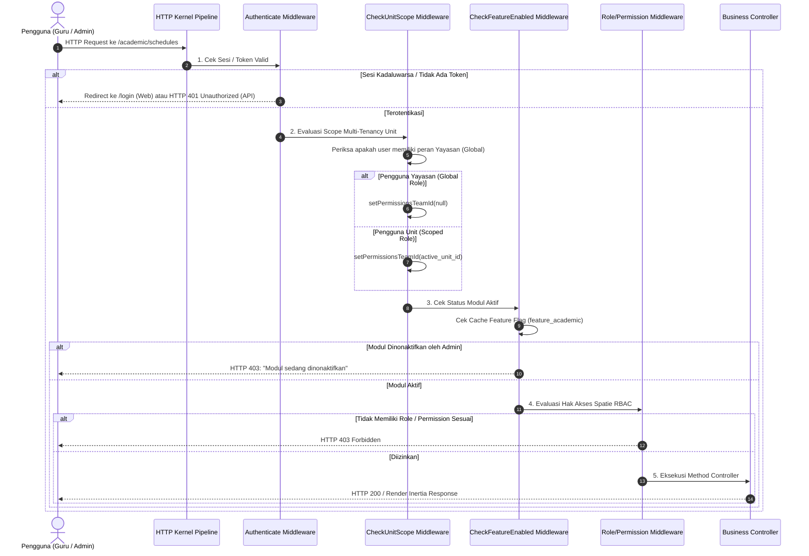

# SuperApp Namira — Alur Autentikasi & Otorisasi (Authorization Flow)

**Dokumen Spesifikasi Teknis Keamanan & Middleware**  
**ID Dokumen:** `DOC-SEC-02-AUTH-FLOW`  
**Status Audit:** `IMPLEMENTED`  
**Terkait:** [`01-role-permission-matrix.md`](file:///E:/Rian%20hidayad/SuperApp_Namira/docs/06-access-control/01-role-permission-matrix.md), [`03-unit-and-tenant-isolation.md`](file:///E:/Rian%20hidayad/SuperApp_Namira/docs/06-access-control/03-unit-and-tenant-isolation.md), [`02-component-architecture.md`](file:///E:/Rian%20hidayad/SuperApp_Namira/docs/03-architecture/02-component-architecture.md)

---

## 1. Strategi Guard Ganda (Dual Guard Architecture)

SuperApp Namira mengoperasikan dua mekanisme penjaga (*guards*) autentikasi sesuai konteks interaksi klien:

1. **Guard `web` (Sesi Stateful)**:
   - Digunakan oleh antarmuka web desktop dan PWA melalui Inertia.js.
   - Menggunakan cookie HTTP-Only terenkripsi dengan proteksi CSRF wajib pada seluruh permintaan non-GET.
2. **Guard `sanctum` (Token Stateless)**:
   - Digunakan untuk endpoint API mobile, pemindai gerbang terdistribusi, dan integrasi webhook eksternal.
   - Token disimpan dalam tabel `personal_access_tokens` dengan hash SHA-256.

---

## 2. Pipeline Middleware Otorisasi Permintaan Masuk

Setiap permintaan yang membutuhkan login wajib melewati rantai (*pipeline*) middleware sebelum diizinkan mencapai Controller:

---

## 3. Rincian Implementasi Middleware Kritis

### 3.1 `CheckUnitScope` (`App\Http\Middleware\CheckUnitScope`)
- **Tujuan**: Menjamin bahwa seluruh evaluasi hak akses Spatie Permission selalu terikat pada konteks `team_id` unit yang sah.
- **Logika Eksekusi**:
  1. Memeriksa apakah pengguna memiliki salah satu dari peran global: `super_admin_yayasan`, `admin_yayasan`, `staff_yayasan`, `pengawas_yayasan`, `humas_yayasan`, `pembina_yayasan`.
  2. Jika peran global terdeteksi: mengeksekusi `setPermissionsTeamId(null)`.
  3. Jika bukan peran global: membaca unit yang terdaftar pada profil (`teachers`, `staff`, atau `students`). Menolak sesi jika `active_unit_id` tidak ada dalam daftar unit wewenang pengguna.
  4. Mengeksekusi `setPermissionsTeamId($unitId)`.

### 3.2 `CheckFeatureEnabled` (`App\Http\Middleware\CheckFeatureEnabled`)
- **Tujuan**: Menyediakan mekanisme saklar dinamis (*feature toggle*) per modul (LMS, Daycare, Finance, BK, SPMB).
- **Logika Eksekusi**:
  1. Jika pengguna memiliki peran `super_admin_yayasan`, pemeriksaan diabaikan (*bypass* otomatis untuk pemeliharaan).
  2. Membaca status fitur dari Redis/Database cache (`system_settings`).
  3. Jika bernilai `'0'` atau `0`: permintaan dibatalkan dengan galat `HTTP 403` atau dialihkan kembali ke Dashboard dengan flash message peringatan.

---

## 4. Otorisasi Tingkat Objek (Laravel Policies & Gates)

Selain middleware tingkat rute, SuperApp Namira menerapkan *Model Policies* untuk otorisasi berbutir halus (*fine-grained authorization*):

| Kelas Policy | Model Sasaran | Aturan Otorisasi Kunci |
| :--- | :--- | :--- |
| `StudentPolicy` | `Student` | Pengguna hanya dapat mengubah biodata santri jika santri berada dalam `unit_id` aktif yang sama. |
| `TeachingJournalPolicy` | `TeachingJournal` | Hanya guru yang namanya tercatat dalam jadwal ajar (`teacher_id`) yang berhak membuat atau menyunting jurnal KBM tersebut. |
| `StudentBillPolicy` | `StudentBill` | Hanya staf dengan peran `staff_admin_keuangan` atau `finance` yang berhak menyetujui bukti bayar dan mencatat penerimaan kas. |
| `SarparInventoryPolicy` | `SarparInventory`| Pengguna biasa hanya berhak mengajukan peminjaman; perubahan status mutasi atau penghapusan hanya boleh dilakukan oleh `koordinator_sarpar`. |

---

## 5. Ringkasan Keamanan & Kepatuhan Otorisasi

1. **Pencegahan Bypass Session Hijacking**: Sesi browser dilindungi oleh flag cookie `HttpOnly`, `SameSite=Lax`, dan `Secure` (saat berjalan di atas HTTPS).
2. **Integritas Penegakan Scope**: Spatie Teams registrar direset secara berkala untuk mencegah kebocoran peran antar-percakapan pada lingkungan worker persisten seperti Octane atau Reverb.
3. **Audit Log Otomatis**: Setiap kegagalan otorisasi atau tindakan administratif penting terekam ke tabel `activity_log` untuk pelacakan forensik.
