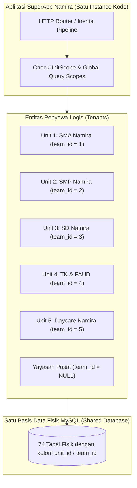
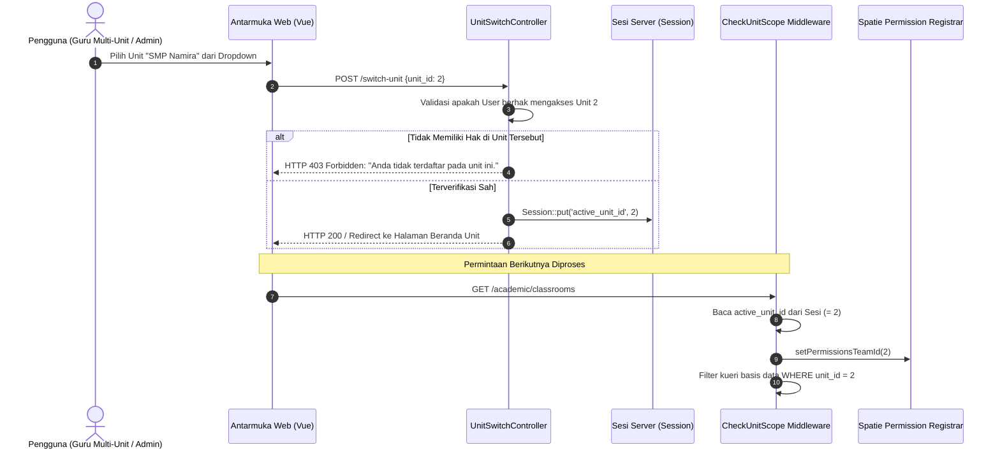

# SuperApp Namira — Isolasi Multi-Tenant & Penyekatan Data Unit (Tenant Isolation)

**Dokumen Spesifikasi Keamanan Arsitektur Multi-Tenancy**  
**ID Dokumen:** `DOC-SEC-03-TENANT-ISOLATION`  
**Status Audit:** `IMPLEMENTED`  
**Model Multi-Tenancy:** *Shared Database, Scoped Schema (Unit Scoped)*  
**Terkait:** [`01-role-permission-matrix.md`](file:///E:/Rian%20hidayad/SuperApp_Namira/docs/06-access-control/01-role-permission-matrix.md), [`02-authorization-flow.md`](file:///E:/Rian%20hidayad/SuperApp_Namira/docs/06-access-control/02-authorization-flow.md), [`01-database-overview.md`](file:///E:/Rian%20hidayad/SuperApp_Namira/docs/04-database/01-database-overview.md)

---

## 1. Model Arsitektur Multi-Tenancy

SuperApp Namira melayani seluruh entitas pendidikan di bawah naungan Yayasan (TK, SD, SMP, SMA, Daycare, Yayasan Pusat) menggunakan model arsitektur **Shared Database with Scoped Multi-Tenancy**:



### Keuntungan Pendekatan Ini untuk Yayasan:
1. **Efisiensi Sumber Daya Server**: Tidak memerlukan puluhan database terpisah atau penambahan kontainer untuk setiap unit sekolah baru.
2. **Kemudahan Konsolidasi Eksekutif**: Pengurus yayasan dapat melakukan agregasi data lintas unit (keuangan, presensi, kepegawaian) secara instan melalui kueri SQL tunggal.
3. **Akun Pengguna Tunggal (Single Sign-On)**: Guru yang mengajar di SMP dan SMA sekaligus hanya memerlukan satu akun login (`users`), dengan peran berbeda di masing-masing unit.

---

## 2. Mekanisme Spatie Teams (`team_id`)

Spatie Permission dikonfigurasi dengan fitur *Teams Support*:
- Kolom `team_id` pada tabel `roles` dan `model_has_roles` memetakan langsung ke `units.id`.
- Nilai `team_id = NULL` dialokasikan secara eksklusif untuk Peran Global Yayasan (`super_admin_yayasan`, `admin_yayasan`, `pembina_yayasan`, `pengawas_yayasan`, `humas_yayasan`, `staff_yayasan`).

### Contoh Struktur Data Penugasan Peran:

| Pengguna (User) | Peran (Role) | Nilai `team_id` | Makna Wewenang Bisnis |
| :--- | :--- | :--- | :--- |
| Ustadz Ahmad | `teacher` | `1` (SMA) | Menjadi guru di SMA Namira. |
| Ustadz Ahmad | `teacher` | `2` (SMP) | Menjadi guru di SMP Namira. |
| Pak Budi | `admin_unit` | `1` (SMA) | Administrator tata usaha khusus SMA. |
| Hj. Nurul | `admin_yayasan` | `NULL` | Administrator eksekutif lintas seluruh unit sekolah. |

---

## 3. Alur Pergantian Unit Aktif (Unit Switching Mechanism)

Pengguna multi-unit atau pengurus yayasan dapat berpindah konteks unit operasional melalui menu *Unit Switcher* di bilah navigasi atas:



---

## 4. Perlindungan Terhadap Kebocoran Data (Data Leakage & IDOR Prevention)

Untuk mencegah staf nakal atau penyerang memanipulasi parameter URL (Insecure Direct Object References / IDOR), sistem menerapkan tiga lapis pertahanan:

### Lapis 1: Validasi Sesi di Middleware (`CheckUnitScope`)
Pengguna biasa **tidak dapat** memalsukan `active_unit_id` melalui injeksi cookie atau request payload, karena middleware memvalidasi `active_unit_id` terhadap daftar unit sah milik pengguna (`$userTeamIds`):
```php
if (!$hasGlobalRole && !empty($userTeamIds) && !in_array(Session::get('active_unit_id'), $userTeamIds)) {
    // Paksa kembali ke unit pertama yang sah milik pengguna
    Session::put('active_unit_id', $userTeamIds[0]);
}
```

### Lapis 2: Eloquent Query Scoping pada Controller & Model
Kueri pengambilan data selalu mengaitkan filter `unit_id`:
```php
$students = Student::where('unit_id', Session::get('active_unit_id'))
    ->where('classroom_id', $classroomId)
    ->get();
```

### Lapis 3: Route Model Binding Validation
Pada operasi mutasi data (`UPDATE`, `DELETE`), controller memeriksa kepemilikan unit sebelum menjalankan operasi:
```php
abort_if($student->unit_id !== Session::get('active_unit_id') && !auth()->user()->isYayasan(), 403);
```

---

## 5. Ringkasan Kepatuhan Isolasi Multi-Tenant

| Vektor Serangan / Risiko | Status Pertahanan | Penjelasan Mitigasi |
| :--- | :---: | :--- |
| **IDOR via URL Parameter** | **TERLINDUNGI** | Verifikasi kepemilikan `unit_id` pada setiap controller method. |
| **Penyusupan Peran Antar-Unit** | **TERLINDUNGI** | Pemisahan Spatie Teams `team_id` pada tabel `model_has_roles`. |
| **Kebocoran Data Kueri Bersama** | **TERLINDUNGI** | Filter eksplisit `WHERE unit_id = ?` pada seluruh repositori kueri. |
| **Kebocoran Cache Antar-Tenant** | **TERLINDUNGI** | Kunci cache sistem dipisah berdasarkan prefiks unit (`unit_{id}_settings`). |
