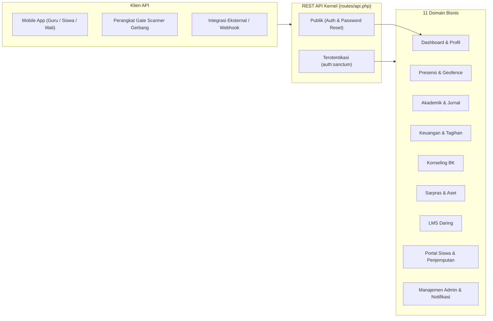

# SuperApp Namira — Katalog Endpoint REST API (Endpoint Catalog)

**Dokumen Spesifikasi Antarmuka Pemrograman Aplikasi (API)**  
**ID Dokumen:** `DOC-API-01-CATALOG`  
**Status Audit:** `IMPLEMENTED`  
**Total Endpoint REST:** 72 Endpoint Terdaftar (`routes/api.php`)  
**Guard Keamanan:** Laravel Sanctum (`auth:sanctum`)  
**Terkait:** [`02-request-response-contracts.md`](file:///E:/Rian%20hidayad/SuperApp_Namira/docs/07-api/02-request-response-contracts.md), [`03-authentication-and-errors.md`](file:///E:/Rian%20hidayad/SuperApp_Namira/docs/07-api/03-authentication-and-errors.md), [`route-inventory.md`](file:///E:/Rian%20hidayad/SuperApp_Namira/docs/02-inventory/route-inventory.md)

---

## 1. Ikhtisar Arsitektur REST API

REST API SuperApp Namira dirancang untuk melayani integrasi aplikasi mobile (Android/iOS PWA native shell), pemindai barcode gerbang fisik, serta layanan mikrokontroler presensi.

---

## 2. Katalog Lengkap 72 Endpoint REST API

### 2.1 Autentikasi Publik & Manajemen Akun

| No | Metode | Jalur Endpoint (URI) | Controller & Method | Deskripsi Fungsi | Otorisasi |
| :--- | :--- | :--- | :--- | :--- | :--- |
| 1 | `POST` | `/api/login` | `AuthController@login` | Otentikasi kredensial email/username & password, menerbitkan token Sanctum. | Publik |
| 2 | `POST` | `/api/forgot-password` | `AuthController@forgotPassword` | Mengirimkan tautan reset password ke email. | Publik |
| 3 | `POST` | `/api/reset-password` | `AuthController@resetPassword` | Menetapkan password baru menggunakan token reset. | Publik |
| 4 | `POST` | `/api/logout` | `AuthController@logout` | Mencabut (*revoke*) token Sanctum yang sedang aktif. | `auth:sanctum` |
| 5 | `GET` | `/api/user` | `AuthController@user` | Mengambil data profil lengkap pengguna yang sedang login beserta peran. | `auth:sanctum` |
| 6 | `GET` | `/api/units` | `AuthController@units` | Daftar unit sekolah yang dapat diakses oleh akun pengguna. | `auth:sanctum` |
| 7 | `POST` | `/api/switch-unit` | `AuthController@switchUnit` | Mengganti konteks unit aktif untuk kueri API sesi saat ini. | `auth:sanctum` |

---

### 2.2 Dashboard & Ringkasan Metrik

| No | Metode | Jalur Endpoint (URI) | Controller & Method | Deskripsi Fungsi | Otorisasi |
| :--- | :--- | :--- | :--- | :--- | :--- |
| 8 | `GET` | `/api/dashboard` | `DashboardController@index` | Mengambil ringkasan widget metrik (jadwal hari ini, presensi, notifikasi). | `auth:sanctum` |

---

### 2.3 Presensi Pegawai & Geofence (`/api/attendance`)

| No | Metode | Jalur Endpoint (URI) | Controller & Method | Deskripsi Fungsi | Otorisasi |
| :--- | :--- | :--- | :--- | :--- | :--- |
| 9 | `GET` | `/api/attendance/today` | `AttendanceController@today` | Status presensi pegawai hari ini (apakah sudah check-in/out). | `auth:sanctum` |
| 10 | `POST` | `/api/attendance/check-in` | `AttendanceController@checkIn` | Submit presensi masuk pegawai dengan validasi GPS dan foto selfie. | `auth:sanctum` |
| 11 | `POST` | `/api/attendance/check-out` | `AttendanceController@checkOut` | Submit presensi kepulangan pegawai. | `auth:sanctum` |
| 12 | `GET` | `/api/attendance/history` | `AttendanceController@history` | Riwayat log presensi bulanan pegawai dengan filter tanggal. | `auth:sanctum` |
| 13 | `GET` | `/api/attendance/locations`| `AttendanceController@locations`| Daftar koordinat GPS dan radius geofence unit sekolah yang sah. | `auth:sanctum` |

---

### 2.4 Akademik & KBM (`/api/academic`)

| No | Metode | Jalur Endpoint (URI) | Controller & Method | Deskripsi Fungsi | Otorisasi |
| :--- | :--- | :--- | :--- | :--- | :--- |
| 14 | `GET` | `/api/academic/schedules` | `AcademicApiController@schedules` | Jadwal mengajar guru atau jadwal pelajaran kelas per hari. | `auth:sanctum` |
| 15 | `GET` | `/api/academic/students` | `AcademicApiController@students` | Direktori santri dalam rombel tertentu untuk presensi ajar. | `auth:sanctum` |
| 16 | `GET` | `/api/academic/journals` | `AcademicApiController@journals` | Riwayat pengisian jurnal mengajar KBM oleh guru. | `auth:sanctum` |
| 17 | `GET` | `/api/academic/student-attendance` | `AcademicApiController@studentAttendance` | Log kehadiran santri per mata pelajaran. | `auth:sanctum` |
| 18 | `GET` | `/api/academic/student-attendance/recap` | `AcademicApiController@studentAttendanceRecap` | Rekapitulasi persentase kehadiran per siswa dalam semester berjalan. | `auth:sanctum` |

---

### 2.5 Keuangan & Tagihan Siswa (`/api/finance`)

| No | Metode | Jalur Endpoint (URI) | Controller & Method | Deskripsi Fungsi | Otorisasi |
| :--- | :--- | :--- | :--- | :--- | :--- |
| 19 | `GET` | `/api/finance/dashboard` | `FinanceApiController@dashboard` | Ringkasan statistik keuangan unit (kas masuk, piutang tagihan). | `auth:sanctum` |
| 20 | `GET` | `/api/finance/bills` | `FinanceApiController@bills` | Daftar tagihan siswa (filter status: unpaid, paid, partial). | `auth:sanctum` |
| 21 | `GET` | `/api/finance/bills/{id}` | `FinanceApiController@billDetail` | Rincian faktur tagihan spesifik beserta histori cicilan. | `auth:sanctum` |
| 22 | `GET` | `/api/finance/transactions` | `FinanceApiController@transactions` | Jurnal arus kas mutasi bank/kas unit. | `auth:sanctum` |

---

### 2.6 Bimbingan Konseling & Prestasi (`/api/counseling`)

| No | Metode | Jalur Endpoint (URI) | Controller & Method | Deskripsi Fungsi | Otorisasi |
| :--- | :--- | :--- | :--- | :--- | :--- |
| 23 | `GET` | `/api/counseling/violations` | `CounselingApiController@violations` | Daftar catatan pelanggaran santri beserta poin minus. | `auth:sanctum` |
| 24 | `GET` | `/api/counseling/categories` | `CounselingApiController@categories` | Master kategori tata tertib dan sanksi pelanggaran. | `auth:sanctum` |
| 25 | `GET` | `/api/counseling/sessions` | `CounselingApiController@sessions` | Jadwal dan riwayat notula sesi bimbingan konseling santri. | `auth:sanctum` |
| 26 | `GET` | `/api/counseling/sessions/{id}`| `CounselingApiController@sessionDetail`| Rincian notula rahasia dan rencana tindak lanjut konseling. | `auth:sanctum` |
| 27 | `GET` | `/api/counseling/achievements`| `CounselingApiController@achievements`| Daftar piagam prestasi kejuaraan santri dan poin apresiasi. | `auth:sanctum` |

---

### 2.7 Sarana Prasarana & Aset (`/api/sarpar`)

| No | Metode | Jalur Endpoint (URI) | Controller & Method | Deskripsi Fungsi | Otorisasi |
| :--- | :--- | :--- | :--- | :--- | :--- |
| 28 | `GET` | `/api/sarpar/dashboard` | `SarparApiController@dashboard` | Ringkasan jumlah aset, barang rusak, dan sirkulasi pinjam. | `auth:sanctum` |
| 29 | `GET` | `/api/sarpar/inventories` | `SarparApiController@inventories` | Katalog master inventaris aset fisik sekolah. | `auth:sanctum` |
| 30 | `GET` | `/api/sarpar/categories` | `SarparApiController@categories` | Master kategori sarana (elektronik, mebel, dll). | `auth:sanctum` |
| 31 | `GET` | `/api/sarpar/rooms` | `SarparApiController@rooms` | Daftar ruangan fisik penempatan aset. | `auth:sanctum` |
| 32 | `GET` | `/api/sarpar/loans` | `SarparApiController@loans` | Riwayat dan status peminjaman sarana oleh guru/staf. | `auth:sanctum` |
| 33 | `GET` | `/api/sarpar/maintenance` | `SarparApiController@maintenance` | Buku log perbaikan dan servis berkala aset. | `auth:sanctum` |

---

### 2.8 Learning Management System (`/api/lms`)

| No | Metode | Jalur Endpoint (URI) | Controller & Method | Deskripsi Fungsi | Otorisasi |
| :--- | :--- | :--- | :--- | :--- | :--- |
| 34 | `GET` | `/api/lms/classrooms` | `LmsApiController@classrooms` | Daftar kelas virtual LMS yang diikuti atau diampu. | `auth:sanctum` |
| 35 | `GET` | `/api/lms/classrooms/{id}` | `LmsApiController@classroomShow` | Detail ruang kelas virtual (feed materi, tugas, diskusi). | `auth:sanctum` |
| 36 | `GET` | `/api/lms/materials/{id}` | `LmsApiController@materialShow` | Rincian materi kuliah/sekolah beserta berkas unduhan. | `auth:sanctum` |
| 37 | `POST` | `/api/lms/materials` | `LmsApiController@materialStore` | Menerbitkan modul materi ajar baru oleh guru pengampu. | `auth:sanctum` |
| 38 | `GET` | `/api/lms/assignments/{id}` | `LmsApiController@assignmentShow` | Rincian instruksi tugas dan batas waktu pengumpulan. | `auth:sanctum` |
| 39 | `POST` | `/api/lms/assignments` | `LmsApiController@assignmentStore` | Menerbitkan lembar tugas daring baru ke kelas LMS. | `auth:sanctum` |
| 40 | `POST` | `/api/lms/assignments/{id}/submit`| `LmsApiController@assignmentSubmit`| Siswa mengunggah berkas lembar jawaban tugas. | `auth:sanctum` |
| 41 | `GET` | `/api/lms/submissions/{id}` | `LmsApiController@submissionShow` | Guru meninjau berkas jawaban yang dikirim siswa. | `auth:sanctum` |
| 42 | `POST` | `/api/lms/submissions/{id}/grade`| `LmsApiController@submissionGrade` | Guru menginput nilai angka dan feedback catatan tugas. | `auth:sanctum` |
| 43 | `GET` | `/api/lms/gradebook/{classroom}` | `LmsApiController@gradebook` | Rekapitulasi buku nilai seluruh tugas santri dalam satu kelas. | `auth:sanctum` |
| 44 | `GET` | `/api/lms/announcements` | `LmsApiController@announcements` | Pengumuman broadcast ruang kelas LMS. | `auth:sanctum` |
| 45 | `POST` | `/api/lms/announcements` | `LmsApiController@announcementStore`| Memposting pengumuman baru dalam ruang kelas LMS. | `auth:sanctum` |
| 46 | `GET` | `/api/lms/my-tasks` | `LmsApiController@myTasks` | Daftar tugas mandiri santri yang belum selesai dikerjakan. | `auth:sanctum` |

---

### 2.9 Humas & Publikasi Portal (`/api/pr`)

| No | Metode | Jalur Endpoint (URI) | Controller & Method | Deskripsi Fungsi | Otorisasi |
| :--- | :--- | :--- | :--- | :--- | :--- |
| 47 | `GET` | `/api/pr/news` | `PublicRelationsApiController@news` | Feed warta dan artikel publik sekolah. | `auth:sanctum` |
| 48 | `GET` | `/api/pr/news/{id}` | `PublicRelationsApiController@newsShow` | Isi lengkap artikel berita beserta foto lampiran. | `auth:sanctum` |
| 49 | `GET` | `/api/pr/events` | `PublicRelationsApiController@events` | Kalender agenda dan kegiatan mendatang sekolah. | `auth:sanctum` |
| 50 | `GET` | `/api/pr/events/{id}` | `PublicRelationsApiController@eventShow` | Detail lokasi, waktu, dan poster event kegiatan. | `auth:sanctum` |
| 51 | `GET` | `/api/pr/destinations` | `PublicRelationsApiController@destinations` | Data jejak alumni masuk perguruan tinggi favorit. | `auth:sanctum` |
| 52 | `GET` | `/api/pr/destinations/{id}` | `PublicRelationsApiController@destinationShow`| Detail profil alumni dan jalur masuk universitas. | `auth:sanctum` |

---

### 2.10 Portal Siswa, Penjemputan & Profil (`/api/student`)

| No | Metode | Jalur Endpoint (URI) | Controller & Method | Deskripsi Fungsi | Otorisasi |
| :--- | :--- | :--- | :--- | :--- | :--- |
| 53 | `GET` | `/api/student/dashboard` | `StudentPortalApiController@dashboard` | Ringkasan beranda siswa (jadwal esok, status tugas, SPP). | `auth:sanctum` |
| 54 | `GET` | `/api/student/tasks` | `StudentPortalApiController@tasks` | Daftar tugas kurikuler santri. | `auth:sanctum` |
| 55 | `POST` | `/api/student/tasks/{id}/complete`| `StudentPortalApiController@completeTask`| Menandai tugas mandiri telah selesai dikerjakan. | `auth:sanctum` |
| 56 | `GET` | `/api/student/pickup` | `StudentPortalApiController@pickupIndex` | Status permohonan penjemputan santri kepulangan sekolah. | `auth:sanctum` |
| 57 | `POST` | `/api/student/pickup` | `StudentPortalApiController@pickupStore` | Wali murid mengajukan mandat penjemputan santri baru. | `auth:sanctum` |
| 58 | `GET` | `/api/student/grades` | `StudentPortalApiController@grades` | Rekapitulasi nilai rapor santri per semester. | `auth:sanctum` |
| 59 | `GET` | `/api/student/schedule` | `StudentPortalApiController@schedule` | Jadwal mingguan mata pelajaran santri. | `auth:sanctum` |
| 60 | `GET` | `/api/student/profile` | `StudentPortalApiController@profile` | Biodata lengkap santri, wali, dan NISN. | `auth:sanctum` |

---

### 2.11 Manajemen Admin, SDM & Notifikasi In-App

| No | Metode | Jalur Endpoint (URI) | Controller & Method | Deskripsi Fungsi | Otorisasi |
| :--- | :--- | :--- | :--- | :--- | :--- |
| 61 | `GET` | `/api/admin/users` | `AdminManagementApiController@users` | Daftar akun pengguna dalam unit dengan paginasi. | `auth:sanctum` |
| 62 | `POST` | `/api/admin/users` | `AdminManagementApiController@storeUser`| Pembuatan akun personil sekolah baru. | `auth:sanctum` |
| 63 | `PUT` | `/api/admin/users/{id}` | `AdminManagementApiController@updateUser`| Pembaruan profil atau penetapan peran akun pengguna. | `auth:sanctum` |
| 64 | `GET` | `/api/admin/roles` | `AdminManagementApiController@roles` | Katalog peran RBAC yang tersedia di unit. | `auth:sanctum` |
| 65 | `POST` | `/api/admin/units/{id}/switch` | `AdminManagementApiController@switchUnit`| Pergantian unit secara administratif. | `auth:sanctum` |
| 66 | `GET` | `/api/employee/staff` | `EmployeeApiController@staff` | Direktori tenaga kependidikan dan staf non-guru. | `auth:sanctum` |
| 67 | `GET` | `/api/employee/attendance` | `EmployeeApiController@attendance` | Laporan kehadiran dinas pegawai unit. | `auth:sanctum` |
| 68 | `GET` | `/api/notifications` | `NotificationApiController@index` | Daftar feed notifikasi in-app pengguna. | `auth:sanctum` |
| 69 | `POST` | `/api/notifications/{id}/read` | `NotificationApiController@markRead` | Menandai satu notifikasi in-app telah dibaca. | `auth:sanctum` |
| 70 | `POST` | `/api/notifications/read-all` | `NotificationApiController@markAllRead`| Menandai seluruh notifikasi telah dibaca (*Clear badge*). | `auth:sanctum` |
| 71 | `POST` | `/api/notifications/test-trigger` | `NotificationApiController@testTrigger`| Trigger uji coba notifikasi internal pengembang. | `auth:sanctum` |
| 72 | `POST` | `/api/notifications/test-trigger-admin` | `NotificationApiController@testTriggerAdmin`| Trigger uji coba notifikasi admin yayasan. | `auth:sanctum` |

---

## 3. Ringkasan Format & Protokol Standar

- **Header Wajib Request Terotentikasi**:
  - `Accept: application/json`
  - `Authorization: Bearer <token_sanctum>`
- **Format Respons**: Standar JSON Envelope (`status`, `message`, `data`, `meta`).
