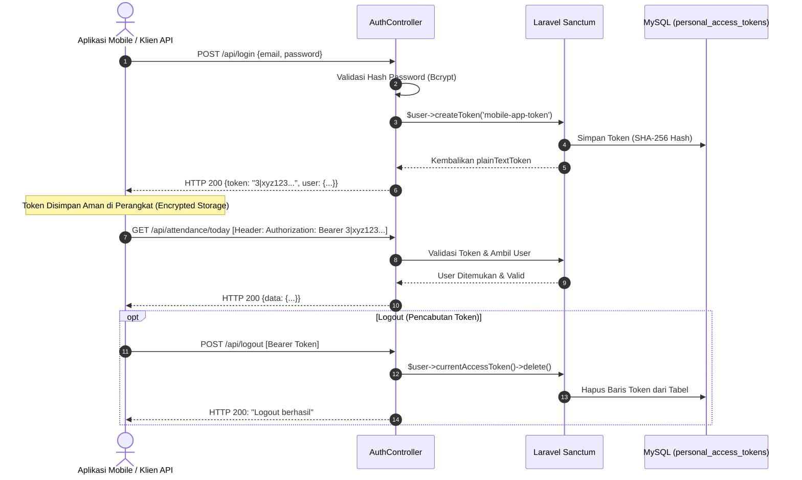

# SuperApp Namira — Autentikasi API & Penanganan Galat (Authentication & Errors)

**Dokumen Standar Keamanan & Respons Galat API**  
**ID Dokumen:** `DOC-API-03-AUTH-ERRORS`  
**Status Audit:** `IMPLEMENTED`  
**Mekanisme Autentikasi:** Laravel Sanctum (Personal Access Tokens)  
**Terkait:** [`01-endpoint-catalog.md`](file:///E:/Rian%20hidayad/SuperApp_Namira/docs/07-api/01-endpoint-catalog.md), [`02-request-response-contracts.md`](file:///E:/Rian%20hidayad/SuperApp_Namira/docs/07-api/02-request-response-contracts.md), [`02-authorization-flow.md`](file:///E:/Rian%20hidayad/SuperApp_Namira/docs/06-access-control/02-authorization-flow.md)

---

## 1. Mekanisme Autentikasi Laravel Sanctum

REST API SuperApp Namira menggunakan Laravel Sanctum untuk otentikasi berbasis token (*stateless token authentication*).



---

## 2. Struktur Standar Amplop Galat API (Error Envelope)

Setiap respon galat dari sistem diformat secara seragam agar mudah di-parse oleh klien frontend:

```json
{
  "success": false,
  "message": "Pesan ringkas kesalahan yang dapat dibaca manusia",
  "errors": {
    "field_name": [
      "Pesan validasi spesifik kolom pertama",
      "Pesan validasi spesifik kolom kedua"
    ]
  },
  "error_code": "ERR_VALIDATION_FAILED"
}
```

---

## 3. Matriks Kode Status HTTP & Format Galat Standar

### 3.1 HTTP 400 — Bad Request
Terjadi apabila format permintaan tidak sesuai sintaks atau parameter wajib hilang sebelum evaluasi validasi.
```json
{
  "success": false,
  "message": "Permintaan tidak dapat diproses: Format JSON tidak valid.",
  "error_code": "ERR_BAD_REQUEST"
}
```

### 3.2 HTTP 401 — Unauthorized
Terjadi jika token Sanctum tidak disertakan, format header salah, atau masa berlaku token telah berakhir.
```json
{
  "success": false,
  "message": "Sesi Anda telah berakhir atau token tidak sah. Silakan login kembali.",
  "error_code": "ERR_UNAUTHORIZED"
}
```

### 3.3 HTTP 403 — Forbidden
Terjadi saat pengguna terotentikasi mencoba mengakses modul/fitur yang dinonaktifkan (`CheckFeatureEnabled`) atau tidak memiliki peran Spatie RBAC yang memadai.
```json
{
  "success": false,
  "message": "Akses ditolak: Anda tidak memiliki wewenang untuk melihat data keuangan unit ini.",
  "error_code": "ERR_FORBIDDEN"
}
```

### 3.4 HTTP 404 — Not Found
Terjadi saat data yang dicari tidak ditemukan atau data tersebut berada di luar batas `unit_id` wewenang pengguna (*tenant isolation*).
```json
{
  "success": false,
  "message": "Data santri dengan ID tersebut tidak ditemukan pada unit aktif.",
  "error_code": "ERR_RESOURCE_NOT_FOUND"
}
```

### 3.5 HTTP 422 — Unprocessable Content (Galat Validasi)
Terjadi saat aturan validasi bisnis pada Laravel FormRequest gagal terpenuhi.
```json
{
  "success": false,
  "message": "Validasi formulir gagal. Mohon periksa kembali isian Anda.",
  "errors": {
    "latitude": [
      "Titik koordinat latitude wajib diisi."
    ],
    "photo": [
      "Berkas swafoto harus berupa gambar berformat JPG atau PNG maksimal 3 MB."
    ]
  },
  "error_code": "ERR_VALIDATION_FAILED"
}
```

### 3.6 HTTP 429 — Too Many Requests (Pembatasan Frekuensi / Rate Limiting)
Diberlakukan oleh middleware pembatasan laju (*Rate Limiter*) untuk mencegah serangan brute force pada endpoint sensitif (seperti `/api/login` maksimal 5 percobaan per menit, endpoint biasa 60 permintaan per menit).
```json
{
  "success": false,
  "message": "Terlalu banyak permintaan. Silakan tunggu 60 detik sebelum mencoba kembali.",
  "error_code": "ERR_RATE_LIMITED"
}
```

### 3.7 HTTP 500 — Internal Server Error
Terjadi saat terjadi kegagalan fatal (*unhandled exception*) pada logika backend. Pada lingkungan produksi (`APP_DEBUG=false`), jejak kode (*stack trace*) disembunyikan untuk mencegah kebocoran informasi arsitektur.
```json
{
  "success": false,
  "message": "Terjadi kesalahan internal pada peladen. Tim teknis telah menerima laporan galat ini.",
  "error_code": "ERR_INTERNAL_SERVER"
}
```

---

## 4. Panduan Penanganan Token pada Aplikasi Klien (Mobile Client Best Practices)

1. **Penyimpanan Aman (Secure Storage)**:
   - Pada aplikasi Android/iOS PWA Shell, token Sanctum tidak boleh disimpan dalam plain `localStorage` yang rentan terhadap serangan XSS jika ada dependensi pihak ketiga. Disarankan menggunakan Secure Storage atau cookie HTTP-Only.
2. **Penanganan Interceptor HTTP 401**:
   - Klien HTTP (Axios / Fetch) wajib memiliki *response interceptor*: jika server mengembalikan HTTP 401, aplikasi secara otomatis menghapus token lokal dan mengarahkan pengguna kembali ke halaman Login tanpa membuat UI crash.
3. **Penyertaan Header Konteks Unit**:
   - Jika pengguna memiliki akses ke lebih dari satu unit sekolah, klien wajib menyertakan header `X-Unit-ID: <id>` atau memanggil endpoint `POST /api/switch-unit` sebelum meminta data spesifik unit.
