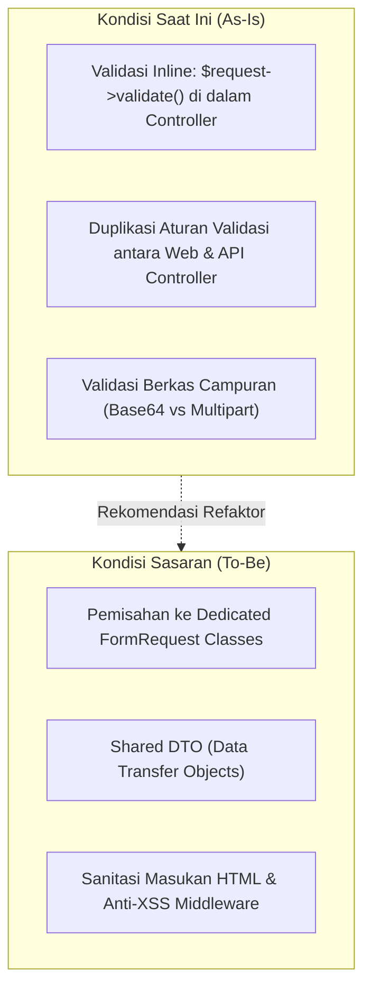

# SuperApp Namira — Analisis Kesenjangan Validasi API (Validation Gaps)

**Dokumen Audit Kualitas & Keamanan Validasi API**  
**ID Dokumen:** `DOC-API-04-VALIDATION-GAPS`  
**Status Audit:** `PARTIAL` (Fungsional Berjalan, Perlu Refaktor Arsitektur)  
**Terkait:** [`01-endpoint-catalog.md`](file:///E:/Rian%20hidayad/SuperApp_Namira/docs/07-api/01-endpoint-catalog.md), [`03-authentication-and-errors.md`](file:///E:/Rian%20hidayad/SuperApp_Namira/docs/07-api/03-authentication-and-errors.md), [`08-gap-analysis.md`](file:///E:/Rian%20hidayad/SuperApp_Namira/docs/01-product/08-gap-analysis.md)

---

## 1. Ikhtisar Audit Validasi Masukan API

Evaluasi menyeluruh terhadap 55 controller API menunjukkan bahwa validasi masukan telah bekerja dengan baik secara fungsional. Namun, ditemukan sejumlah kesenjangan arsitektural (*architectural debt*) dan inkonsistensi yang perlu ditingkatkan untuk mencapai kematangan *enterprise-grade*.



---

## 2. Kesenjangan Validasi Teridentifikasi (Gaps & Vulnerabilities)

### 2.1 Penggunaan Validasi Inline vs Dedicated FormRequest
- **Kondisi Teramati**:
  - Sebagian besar controller API (seperti `AttendanceController@checkIn`, `LmsApiController@materialStore`, `AdminManagementApiController@storeUser`) menggunakan validasi inline:
    ```php
    $request->validate([
        'type' => 'required|in:present,business_trip,sick,permit',
        ...
    ]);
    ```
- **Kesenjangan (Gap)**:
  - Aturan validasi terduplikasi antara modul Web (Inertia) dan modul API (Sanctum). Jika terdapat perubahan aturan bisnis (misalnya penambahan status dinas baru), pengembang harus mengubah kode di dua tempat berbeda.
- **Rekomendasi Solusi**:
  - Pindahkan aturan validasi ke kelas `App\Http\Requests\Api\*` terdedikasi (misal `CheckInApiRequest`, `StoreLmsMaterialRequest`).

---

### 2.2 Penanganan Berkas Foto Presensi (Base64 vs Multipart)
- **Kondisi Teramati**:
  - Pada `AttendanceController@checkIn`, berkas swafoto diterima dalam format string base64 (`photo => 'nullable|string'`).
- **Kesenjangan (Gap)**:
  - String base64 tidak divalidasi ukuran memorinya (*memory footprint*) sebelum di-decode. Pengguna nakal dapat mengirimkan payload string base64 berukuran raksasa (50 MB) yang berpotensi memicu kegagalan memori (*Out of Memory / DoS*) pada PHP-FPM.
  - Kurangnya validasi magic byte (*MIME type sniffing*) pada hasil decoding base64 sebelum disimpan ke storage publik.
- **Rekomendasi Solusi**:
  - Terapkan validasi batas ukuran string (`max:10000000`) dan validasi library pemrosesan gambar (*intervention/image*) untuk memastikan berkas benar-benar merupakan gambar raster valid (JPEG/PNG).

---

### 2.3 Sanitasi Masukan Teks Panjang & Rich Text (XSS Prevention)
- **Kondisi Teramati**:
  - Kolom teks seperti pengumuman kelas (`lms_announcements.content`), instruksi tugas (`lms_assignments.instructions`), dan notula bimbingan konseling (`counseling_sessions.issue_summary`) divalidasi dengan aturan `required|string`.
- **Kesenjangan (Gap)**:
  - Belum ada sanitasi otomatis terhadap tag HTML berbahaya (`<script>`, `<iframe>`, `onload=`) pada lapisan request API sebelum data disimpan ke basis data MySQL.
- **Rekomendasi Solusi**:
  - Gunakan helper sanitasi `strip_tags()` atau pustaka HTMLPurifier untuk kolom teks yang tidak memerlukan format HTML, dan konfigurasi filter khusus pada kolom yang menggunakan WYSIWYG editor.

---

### 2.4 Validasi Header Multi-Tenant `X-Active-Unit`
- **Kondisi Teramati**:
  - Trait `HasUnitScope` membaca header `X-Active-Unit` secara langsung:
    ```php
    $headerUnit = $request->header('X-Active-Unit');
    if ($headerUnit) {
        return (int) $headerUnit;
    }
    ```
- **Kesenjangan (Gap)**:
  - Jika klien mobile mengirimkan header `X-Active-Unit: 99` (ID unit yang tidak berhak diakses oleh pengguna), sistem mengabaikan verifikasi izin jika controller tidak secara eksplisit memanggil policy.
- **Rekomendasi Solusi**:
  - Pasang guard validasi di dalam trait `HasUnitScope`: jika `X-Active-Unit` dikirimkan oleh pengguna non-global, pastikan ID tersebut wajib ada dalam `auth()->user()->units->pluck('id')`. Jika tidak sah, batalkan dengan `HTTP 403 Forbidden`.

---

## 3. Matriks Kesenjangan Validasi & Skala Prioritas

| Area Validasi | Tingkat Keparahan (Severity) | Status Saat Ini | Dampak Bisnis | Prioritas Remediasi |
| :--- | :---: | :---: | :--- | :---: |
| **Validasi Base64 Presensi** | `HIGH` | `PARTIAL` | Potensi memory exhaustion / DoS dari payload raksasa. | Prioritas 1 |
| **Verifikasi Tenant Header `X-Active-Unit`** | `HIGH` | `PARTIAL` | Potensi IDOR lintas unit sekolah jika policy terlewat. | Prioritas 1 |
| **Pemisahan FormRequest Classes** | `MEDIUM` | `GAP` | Kesulitan pemeliharaan kode & testing regresi API. | Prioritas 2 |
| **Sanitasi Tag HTML (LMS & BK)** | `MEDIUM` | `PARTIAL` | Risiko Stored XSS saat dibuka di portal web desktop. | Prioritas 2 |
| **Pembatasan Rate Limit per Rute** | `LOW` | `IMPLEMENTED` | Global limit 60 req/min sudah aktif via Sanctum throttle. | Prioritas 3 |

---

## 4. Kesimpulan Evaluasi Validasi

Meskipun secara operasional API telah mampu melayani alur bisnis normal, perbaikan pada 4 kesenjangan utama di atas akan meningkatkan ketahanan (*robustness*) dan keamanan arsitektur SuperApp Namira ke standar aplikasi enterprise berskala nasional.
