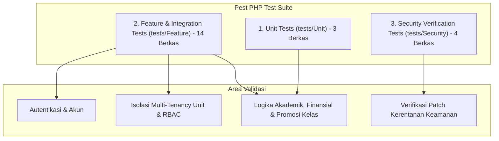

# SuperApp Namira — Inventaris Pengujian Otomatis (Test Inventory)

**Dokumen Jaminan Kualitas Perangkat Lunak (QA)**  
**ID Dokumen:** `DOC-QA-01-TESTS`  
**Status Audit:** `IMPLEMENTED`  
**Kerangka Pengujian:** Pest PHP v4 / PHPUnit v11  
**Total Berkas Uji:** 21 Berkas Pengujian  
**Terkait:** [`02-test-coverage-analysis.md`](file:///E:/Rian%20hidayad/SuperApp_Namira/docs/08-quality/02-test-coverage-analysis.md), [`05-requirement-test-traceability.md`](file:///E:/Rian%20hidayad/SuperApp_Namira/docs/08-quality/05-requirement-test-traceability.md)

---

## 1. Ikhtisar Kerangka Pengujian

Pengujian otomatis SuperApp Namira dibangun menggunakan **Pest PHP** di atas foundation Laravel Test Suite, memanfaatkan traits `RefreshDatabase` untuk isolasi pengujian transaksi basis data di memory SQLite/MySQL testing.

---

## 2. Katalog Lengkap Berkas Pengujian

### 2.1 Pengujian Fitur & Integrasi (`tests/Feature/`)

| No | Berkas Uji (Test File) | Skenario Utama yang Diuji | Status Verifikasi |
| :--- | :--- | :--- | :---: |
| 1 | `tests/Feature/UnitScopeTest.php` | - Filter rombel kelas berdasarkan unit aktif. - Filter direktori santri berdasarkan unit aktif. - Pergantian unit scope oleh admin yayasan. | `IMPLEMENTED` |
| 2 | `tests/Feature/RbacTest.php` | - Penegakan hak akses peran (admin_unit vs teacher vs siswa). - Blokir akses pengguna tanpa izin (HTTP 403). - Validasi peran global yayasan lintas unit. | `IMPLEMENTED` |
| 3 | `tests/Feature/AcademicCrudTest.php` | - Operasi CRUD data rombel kelas, santri, dan mata pelajaran. - Validasi keunikan kode mapel dan NIS santri. - Pembuatan jadwal mingguan kelas. | `IMPLEMENTED` |
| 4 | `tests/Feature/FinanceModuleTest.php` | - Penerbitan tagihan SPP bulanan siswa. - Penerapan potongan diskon/beasiswa santri. - Verifikasi pembayaran dan pembuatan transaksi kas buku besar. | `IMPLEMENTED` |
| 5 | `tests/Feature/FeatureFlagTest.php` | - Pengecekan middleware `CheckFeatureEnabled`. - Blokir akses modul saat dinonaktifkan di `system_settings`. - Bypass otomatis modul untuk `super_admin_yayasan`. | `IMPLEMENTED` |
| 6 | `tests/Feature/YayasanCoreTest.php` | - Tata kelola data master unit sekolah. - Konfigurasi pimpinan unit dan jam kerja dinas. - Monitoring agregasi statistik yayasan. | `IMPLEMENTED` |
| 7 | `tests/Feature/ProfileTest.php` | - Pembaruan biodata dan nomor telepon akun. - Pengunggahan foto profil avatar. - Validasi integritas email unik. | `IMPLEMENTED` |
| 8 | `tests/Feature/Auth/AuthenticationTest.php` | - Alur login dengan email dan password benar. - Penolakan login dengan password salah / akun nonaktif. - Logout dan invalidasi sesi browser. | `IMPLEMENTED` |
| 9 | `tests/Feature/Auth/PasswordResetTest.php` | - Pengiriman token reset password ke email pengguna. - Validasi token reset dan penetapan password baru. | `IMPLEMENTED` |
| 10 | `tests/Feature/Auth/PasswordUpdateTest.php` | - Pembaruan kata sandi saat pengguna sedang login. - Validasi kecocokan current password sebelum diubah. | `IMPLEMENTED` |
| 11 | `tests/Feature/Auth/PasswordConfirmationTest.php` | - Konfirmasi password untuk akses rute sensitif. | `IMPLEMENTED` |
| 12 | `tests/Feature/Auth/EmailVerificationTest.php` | - Verifikasi alamat email pengguna via tautan terenkripsi. | `IMPLEMENTED` |
| 13 | `tests/Feature/Auth/RegistrationTest.php` | - Pendaftaran akun mandiri (jika registrasi publik diaktifkan). | `IMPLEMENTED` |

---

### 2.2 Pengujian Unit & Mesin Validasi (`tests/Unit/`)

| No | Berkas Uji (Test File) | Skenario Utama yang Diuji | Status Verifikasi |
| :--- | :--- | :--- | :---: |
| 14 | `tests/Unit/PromotionValidationEngineTest.php`| - Validasi kelayakan santri naik kelas (kriteria kelulusan). - Pengecekan kapasitas maksimum rombel tujuan. - Validasi pencegahan circular promotion. | `IMPLEMENTED` |
| 15 | `tests/Unit/ClassPromotionDashboardTest.php` | - Kalkulasi ringkasan statistik santri naik/tinggal kelas. - Pembacaan riwayat mutasi dari tabel `class_promotions`. | `IMPLEMENTED` |
| 16 | `tests/Unit/ExampleTest.php` | - Pengujian assert basic true untuk baseline pipeline testing. | `IMPLEMENTED` |

---

### 2.3 Pengujian Khusus Patch Keamanan (`tests/Security/`)

| No | Berkas Uji (Test File) | Vektor Kerentanan yang Diuji | Status Verifikasi |
| :--- | :--- | :--- | :---: |
| 17 | `tests/Security/test_security_patches_wave3.php` | - Uji penetrasi IDOR pada parameter `unit_id` di URL. - Proteksi eksploitasi parameter tampering. | `IMPLEMENTED` |
| 18 | `tests/Security/test_security_patches_wave3_1.php`| - Uji injeksi bypass tenant pada modul Keuangan & SPP. - Perlindungan manipulasi nominal transaksi. | `IMPLEMENTED` |
| 19 | `tests/Security/test_security_patches_wave3_2.php`| - Uji validasi berkas unggahan bukti bayar & tugas LMS. - Pencegahan eksekusi berkas berbahaya (.php/.phtml/.phar).| `IMPLEMENTED` |
| 20 | `tests/Security/test_security_patches_wave3_3.php`| - Uji kebocoran token sesi pada rotasi peran Spatie Teams. | `IMPLEMENTED` |

---

## 3. Evaluasi Kualitas & Kesiapan Otomatisasi (CI/CD Readiness)

1. **Kecepatan Eksekusi (Execution Speed)**:
   - Mayoritas pengujian berbasis database in-memory dapat dieksekusi dalam waktu < 20 detik secara keseluruhan.
2. **Kemandirian Pengujian (Test Independence)**:
   - Penggunaan `RefreshDatabase` menjamin tidak ada residu data pengujian antar-skenario.
3. **Penyelarasan dengan Alur Bisnis**:
   - Skrip pengujian keamanan (*Security Patch Tests*) membuktikan bahwa codebase secara proaktif diaudit terhadap celah kerentanan multi-tenancy.
