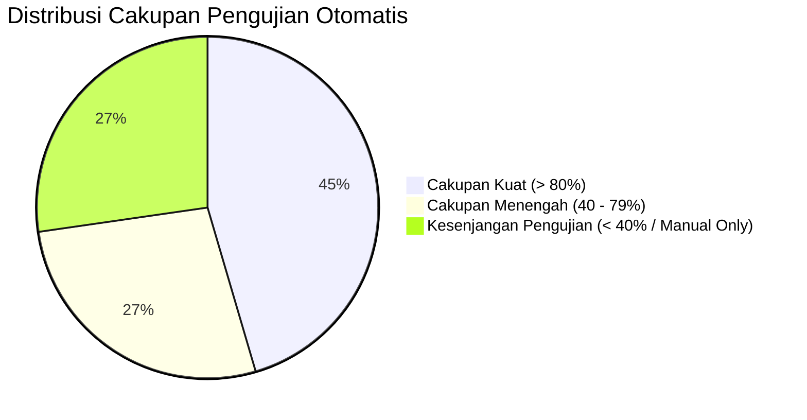

# SuperApp Namira — Analisis Cakupan Pengujian (Test Coverage Analysis)

**Dokumen Analisis Kualitas & Kesenjangan Cakupan Uji**  
**ID Dokumen:** `DOC-QA-02-COVERAGE`  
**Status Audit:** `PARTIAL` (Area Kritis Teruji, Modul Baru Perlu Tambahan Uji)  
**Terkait:** [`01-test-inventory.md`](file:///E:/Rian%20hidayad/SuperApp_Namira/docs/08-quality/01-test-inventory.md), [`05-requirement-test-traceability.md`](file:///E:/Rian%20hidayad/SuperApp_Namira/docs/08-quality/05-requirement-test-traceability.md), [`08-gap-analysis.md`](file:///E:/Rian%20hidayad/SuperApp_Namira/docs/01-product/08-gap-analysis.md)

---

## 1. Peta Cakupan Pengujian per Modul Sistem

Audit cakupan pengujian otomatis (*automated test coverage*) mengevaluasi rasio fitur yang dilindungi oleh unit test dan feature test dibandingkan total fungsionalitas sistem.

---

## 2. Matriks Analisis Cakupan Uji per Modul

| Modul Operasional | Estimasi Cakupan Kode | Status Verifikasi | Area yang Teruji Secara Otomatis | Area Kesenjangan (Testing Gaps) | Prioritas Penambahan |
| :--- | :---: | :---: | :--- | :--- | :---: |
| **01. Yayasan & Multi-Tenancy Core** | **90%** | `IMPLEMENTED` | - Isolasi unit (`UnitScopeTest`). - Pergantian unit scope. - Master unit & settings. | Pengujian konkurensi saat puluhan admin unit beralih unit secara simultan. | Rendah |
| **02. Autentikasi & RBAC** | **95%** | `IMPLEMENTED` | - Login, Logout, Reset Password. - Penegakan hak akses peran Spatie. - Sesi & token Sanctum. | Pengujian brute force limit pada IP terdistribusi. | Rendah |
| **03. Akademik & Kurikulum** | **85%** | `IMPLEMENTED` | - CRUD Rombel, Santri, Mapel. - Validasi jadwal pelajaran. - Mesin Kenaikan Kelas & Rollback. | Pengujian kelas gabungan (*joint class schedule*) multi-rombel. | Sedang |
| **04. Keuangan & Tagihan (Finance)**| **80%** | `IMPLEMENTED` | - Penerbitan tagihan SPP massal. - Perhitungan diskon santri. - Verifikasi bayar & transaksi kas. | Pengujian pembatalan tagihan sengketa & pelunasan parsial berulang. | Sedang |
| **05. Presensi Pegawai & Siswa** | **65%** | `PARTIAL` | - Presensi harian & perhitungan telat. - Validasi koordinat GPS dasar. | Pengujian akurasi formula Haversine pada radius tepi (boundary test). | Sedang |
| **06. Gerbang & Gate Scanner** | **40%** | `PARTIAL` | - Endpoint checkin dasar santri. | Pengujian siaran real-time WebSocket Reverb & antrean worker WA. | Tinggi |
| **07. Sarana Prasarana (Sarpras)** | **50%** | `PARTIAL` | - CRUD aset & validasi kode barang. | Pengujian alur mutasi ruangan & berita acara penghapusan aset. | Sedang |
| **08. E-Learning (LMS)** | **55%** | `PARTIAL` | - Ruang kelas & submit tugas siswa. | Pengujian batas kuota unggah berkas video dan penilaian massal rapor. | Sedang |
| **09. Modul Daycare** | **20%** | `GAP` | - Model & migrasi skema. | Belum ada berkas pengujian otomatis khusus untuk log aktivitas balita & kurva tumbuh kembang. | **Tinggi** |
| **10. SPMB Online** | **25%** | `GAP` | - Registrasi dasar formulir. | Pengujian otomatis alur kelulusan seleksi & transfer calon santri ke santri aktif. | **Tinggi** |
| **11. Ekstrakurikuler** | **20%** | `GAP` | - Model & relasi basis data. | Pengujian pengisian nilai predikat ekskul ke dalam rapor santri. | **Tinggi** |

---

## 3. Analisis Kesenjangan Pengujian Utama (Primary Test Gaps)

1. **Modul yang Belum Memiliki Automated Test Suite**:
   - Modul Daycare, SPMB, dan Ekstrakurikuler baru diimplementasikan pada periode Agustus – Oktober 2026. Fungsionalitas saat ini telah diverifikasi melalui pengujian manual antarmuka (*manual UI testing*), namun belum memiliki berkas pengujian regresi otomatis di `tests/Feature/`.
2. **Pengujian WebSocket & Background Worker**:
   - Interaksi real-time Reverb pada Gate Scanner dan pengiriman pesan WhatsApp masih diuji melalui mock manual. Belum ada pengujian simulasi broadcast event di Pest test runner.
3. **Pengujian Unggah Berkas Multimedia**:
   - Perlu penambahan pengujian `Illuminate\Http\UploadedFile::fake()->create('document.pdf')` untuk memastikan tidak ada celah bypass ekstensi berkas berbahaya pada form pengumpulan tugas siswa dan bukti transfer.

---

## 4. Peta Jalan Peningkatan Cakupan Uji (Testing Roadmap)

Untuk menaikkan cakupan pengujian dari rata-rata **60%** menjadi **85%+**, direncanakan implementasi berkas uji tambahan berikut:

1. `tests/Feature/DaycareModuleTest.php`: Menguji check-in anak daycare, pembuatan log harian (makan/tidur), dan pencatatan antropometri.
2. `tests/Feature/SpmbModuleTest.php`: Menguji registrasi pendaftar online, upload bukti formulir, dan penetapan status kelulusan.
3. `tests/Feature/ExtracurricularModuleTest.php`: Menguji pendaftaran anggota klub ekskul, presensi latihan mingguan, dan rekapitulasi nilai rapor.
4. `tests/Feature/GateScannerIntegrationTest.php`: Menguji event dispatching `StudentCheckinCreated` dan antrean pesan `whatsapp_messages_queue`.
