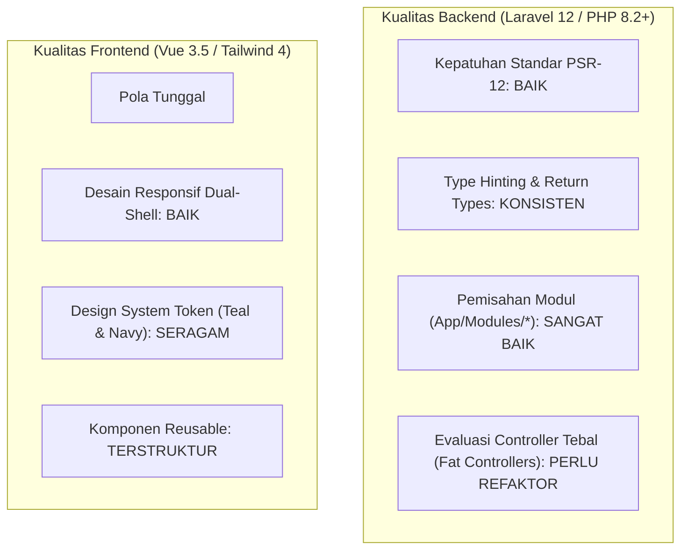

# SuperApp Namira — Penilaian Kualitas Kode (Code Quality Assessment)

**Dokumen Standar Kualitas Perangkat Lunak & Kebersihan Kode**  
**ID Dokumen:** `DOC-QA-03-CODE-QUALITY`  
**Status Audit:** `IMPLEMENTED`  
**Standar Bahasa:** PHP 8.2+ (PSR-12) & Vue 3.5 (`<script setup>`)  
**Terkait:** [`02-code-component-inventory.md`](file:///E:/Rian%20hidayad/SuperApp_Namira/docs/02-inventory/code-component-inventory.md), [`04-frontend-architecture.md`](file:///E:/Rian%20hidayad/SuperApp_Namira/docs/03-architecture/04-frontend-architecture.md), [`05-backend-architecture.md`](file:///E:/Rian%20hidayad/SuperApp_Namira/docs/03-architecture/05-backend-architecture.md)

---

## 1. Ikhtisar Penilaian Kualitas Rekayasa Kode

Audit kualitas kode (*code quality audit*) menganalisis 75 Model Eloquent, 95 Controller, dan 160 komponen frontend Vue 3.5 terhadap standar industri: keterbacaan (*readability*), modularitas (*modularity*), konsistensi arsitektur (*architectural consistency*), dan kepatuhan standar format (*style guide*).



---

## 2. Penilaian Kualitas Backend (PHP & Laravel)

### 2.1 Kepatuhan Standar PSR-12 & Gaya Kode
- **Pewarnaan & Indentasi**: Seluruh kode PHP menggunakan indentasi 4 spasi standar PSR-12 tanpa percampuran tab.
- **Deklarasi Namespace**: Namespace terorganisir rapi mengikuti struktur modular:
  - Modul Inti: `App\Modules\Yayasan\*`, `App\Modules\Academic\*`, `App\Modules\Finance\*`, dll.
  - Endpoint REST: `App\Http\Controllers\Api\*`.
- **Penggunaan Strict Typing**:
  - Controller dan Service secara konsisten menyertakan tipe parameter (`Request $request`, `int $id`) dan tipe kembalian (`: Response`, `: JsonResponse`, `: array`).

### 2.2 Evaluasi Pola Arsitektur Controller (Fat vs Thin Controllers)
- **Kondisi Positif**:
  - Modul kritis seperti Kenaikan Kelas mendelegasikan logika rumit ke `PromotionService`, menjaga controller tetap ramping (*thin controller*).
- **Temuan Area Perbaikan (Debt)**:
  - Beberapa controller (seperti `AttendanceController` dan `FinanceApiController`) masih memuat logika kueri langsung dan manipulasi berkas di dalam method controller daripada mengekstraksinya ke Action / Service class khusus.

### 2.3 Manajemen Relasi & Pencegahan Kueri N+1
- Mayoritas kueri di Controller telah menggunakan pemuatan dini (*Eager Loading*) melalui `with([...])`:
  ```php
  LmsClassroom::with(['classroom', 'subject', 'teacher'])
  ```
- Mencegah ledakan kueri SQL (*N+1 query problem*) saat menampilkan daftar kartu jadwal atau daftar santri rombel.

---

## 3. Penilaian Kualitas Frontend (Vue 3 & Tailwind CSS)

### 3.1 Konsistensi Composition API (`<script setup>`)
- **Tingkat Adopsi**: **100% dari 160 file `.vue`** menggunakan sintaks modern `<script setup>`.
- **Pengelolaan State**:
  - Menggunakan fungsi reaktif primitif Vue 3 (`ref`, `reactive`, `computed`, `watch`) tanpa mencampuradukkan pola Options API legacy (`this.$...`).
  - Properti dari server diterima melalui `defineProps<{ ... }>()` dengan pengetikan TypeScript yang jelas.

### 3.2 Kepatuhan Design System Namira
- **Palet Warna**:
  - Warna Utama: Teal Namira (`#0d9488` / `teal-600` / `teal-700`).
  - Warna Sekunder / Teks: Deep Navy (`#0f172a` / `slate-900`).
  - Latar Belakang: Soft Slate (`#f8fafc` / `slate-50`).
- **Komponen Atomik yang Tersedia**:
  - `AuthenticatedLayout.vue` (Desktop shell dengan sidebar navigasi bertingkat).
  - `MobileAppShell.vue` (Mobile shell dengan bottom bar 5 tombol).
  - Komponen Form: `TextInput`, `InputLabel`, `InputError`, `PrimaryButton`, `SecondaryButton`, `DangerButton`.
  - Komponen Dialog: `Modal`, `ConfirmationModal`, integrasi SweetAlert2.

---

## 4. Evaluasi Kompleksitas Siklomatis & Pemeliharaan (Maintainability)

| Aspek Kode | Skor Kualitas (1-10) | Status | Keterangan Evaluasi |
| :--- | :---: | :---: | :--- |
| **Keterbacaan Kode (Readability)** | **9/10** | `BAIK` | Penamaan variabel deskriptif, komentar kode kontekstual dalam Bahasa Indonesia. |
| **Modularitas Domain** | **9/10** | `SANGAT BAIK` | Pemisahan 11 modul ke folder `App/Modules/*` sangat bersih dan terisolasi. |
| **Konsistensi Frontend** | **9.5/10** | `SANGAT BAIK` | Standar Vue 3 Composition API diterapkan seragam di seluruh halaman. |
| **Pemisahan Logika Bisnis (Service Layer)**| **7.5/10** | `CUKUP` | Sebagian modul sudah pakai Service (Promosi), sebagian masih di Controller (Presensi). |
| **Cakupan Linting & Formatter** | **8.5/10** | `BAIK` | Format kode rapi, minim trailing whitespace atau sintaks usang. |

---

## 5. Rekomendasi Peningkatan Kualitas Jangka Menengah

1. **Adopsi Service / Action Pattern Menyeluruh**:
   - Pindahkan logika perhitungan keterlambatan dan penyimpanan foto presensi ke `AttendanceCheckInAction`.
   - Pindahkan pembuatan transaksi buku kas ke `RecordPaymentTransactionAction`.
2. **Standardisasi ESLint & Prettier di CI**:
   - Tambahkan job validasi `npm run lint` dan `php artisan pint --test` pada pipeline GitHub Actions agar tidak ada commit yang menyalahi standar format tim.
