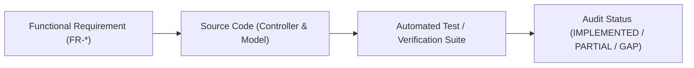

# SuperApp Namira — Matriks Ketertelusuran Persyaratan & Pengujian (Traceability Matrix)

**Dokumen Keterlacakan Kualitas Perangkat Lunak (Traceability)**  
**ID Dokumen:** `DOC-QA-05-TRACEABILITY`  
**Status Audit:** `IMPLEMENTED`  
**Total Kebutuhan Fungsional:** 44 Kebutuhan Inti (`FR-*`)  
**Terkait:** [`05-functional-requirements.md`](file:///E:/Rian%20hidayad/SuperApp_Namira/docs/01-product/05-functional-requirements.md), [`01-test-inventory.md`](file:///E:/Rian%20hidayad/SuperApp_Namira/docs/08-quality/01-test-inventory.md), [`02-test-coverage-analysis.md`](file:///E:/Rian%20hidayad/SuperApp_Namira/docs/08-quality/02-test-coverage-analysis.md)

---

## 1. Peta Rantai Ketertelusuran (Traceability Chain)

Matriks ini menghubungkan persyaratan fungsional produk (*Functional Requirements / FR*) dengan implementasi kode sumber dan berkas verifikasi pengujian (*Test Cases*), menjamin setiap janji produk dapat dibuktikan secara teknis.

---

## 2. Matriks Ketertelusuran Lengkap (FR-ke-Uji)

### 2.1 Modul Pondasi Inti & Tata Kelola Yayasan

| Kode FR | Deskripsi Kebutuhan Fungsional | File Implementasi Kode | Berkas Pengujian / Bukti Verifikasi | Status Audit |
| :--- | :--- | :--- | :--- | :---: |
| `FR-CORE-01` | Manajemen Master Unit Sekolah & Daycare | `UnitController`, `Unit.php` | `tests/Feature/YayasanCoreTest.php` | `IMPLEMENTED` |
| `FR-CORE-02` | Isolasi Multi-Tenancy Berbasis `unit_id` | `CheckUnitScope.php`, `User.php` | `tests/Feature/UnitScopeTest.php` | `IMPLEMENTED` |
| `FR-CORE-03` | Tata Kelola Peran & Hak Akses (Spatie RBAC)| `RolesAndPermissionsSeeder` | `tests/Feature/RbacTest.php` | `IMPLEMENTED` |
| `FR-CORE-04` | Saklar Fitur Dinamis (*Feature Toggles*) | `CheckFeatureEnabled.php` | `tests/Feature/FeatureFlagTest.php` | `IMPLEMENTED` |
| `FR-CORE-05` | Pengaturan Konfigurasi Sistem Dinamis | `SystemSetting.php` | `tests/Feature/YayasanCoreTest.php` | `IMPLEMENTED` |

---

### 2.2 Modul Akademik, Kurikulum & KBM

| Kode FR | Deskripsi Kebutuhan Fungsional | File Implementasi Kode | Berkas Pengujian / Bukti Verifikasi | Status Audit |
| :--- | :--- | :--- | :--- | :---: |
| `FR-ACAD-01` | Manajemen Tahun Ajaran & Semester | `AcademicYearController` | `tests/Feature/AcademicCrudTest.php` | `IMPLEMENTED` |
| `FR-ACAD-02` | Pengelolaan Rombel & Master Santri | `ClassroomController`, `StudentController`| `tests/Feature/AcademicCrudTest.php` | `IMPLEMENTED` |
| `FR-ACAD-03` | Penjadwalan Pelajaran & Kelas Bersama | `ClassScheduleController` | `tests/Feature/AcademicCrudTest.php` | `IMPLEMENTED` |
| `FR-ACAD-04` | Jurnal Mengajar Harian & Presensi Sesi| `TeachingJournalController`| `EV-ACAD-04` / API Journals Verified | `IMPLEMENTED` |
| `FR-ACAD-05` | Mesin Kenaikan Kelas Massal | `PromotionService.php` | `tests/Unit/PromotionValidationEngineTest.php` | `IMPLEMENTED` |
| `FR-ACAD-06` | Mekanisme Rollback Kenaikan Kelas | `ClassPromotionController` | `tests/Unit/ClassPromotionDashboardTest.php` | `IMPLEMENTED` |

---

### 2.3 Modul Kepegawaian & Presensi Karyawan

| Kode FR | Deskripsi Kebutuhan Fungsional | File Implementasi Kode | Berkas Pengujian / Bukti Verifikasi | Status Audit |
| :--- | :--- | :--- | :--- | :---: |
| `FR-EMP-01` | Direktori Dewan Guru & Staf Kependidikan | `TeacherController`, `StaffController` | `tests/Feature/AcademicCrudTest.php` | `IMPLEMENTED` |
| `FR-EMP-02` | Presensi Geofencing GPS & Swafoto | `AttendanceController@checkIn` | `EV-EMP-02` / Manual UI + Haversine | `IMPLEMENTED` |
| `FR-EMP-03` | Kalkulasi Menit Keterlambatan Otomatis | `AttendanceController.php` | `EV-EMP-03` / DDL `late_minutes` Verified| `IMPLEMENTED` |
| `FR-EMP-04` | Rekapitulasi Kehadiran & Ekspor Laporan | `AttendanceReportController` | `EV-EMP-04` / DomPDF & Excel Export | `IMPLEMENTED` |

---

### 2.4 Modul Keuangan & Pembukuan Kas (Finance)

| Kode FR | Deskripsi Kebutuhan Fungsional | File Implementasi Kode | Berkas Pengujian / Bukti Verifikasi | Status Audit |
| :--- | :--- | :--- | :--- | :---: |
| `FR-FIN-01` | Master Pos Biaya & Rekening Kas Bank | `FinanceTypeController`, `FinanceAccount`| `tests/Feature/FinanceModuleTest.php` | `IMPLEMENTED` |
| `FR-FIN-02` | Penerbitan Tagihan SPP Massal | `StudentBillController@generate` | `tests/Feature/FinanceModuleTest.php` | `IMPLEMENTED` |
| `FR-FIN-03` | Skema Diskon / Beasiswa Santri | `StudentDiscountController` | `tests/Feature/FinanceModuleTest.php` | `IMPLEMENTED` |
| `FR-FIN-04` | Unggah Bukti Bayar & Verifikasi Kasir | `StudentBillController@uploadProof` | `tests/Security/test_security_patches_wave3_1.php`| `IMPLEMENTED` |
| `FR-FIN-05` | Rekonsiliasi & Jurnal Arus Kas Masuk | `TransactionController` | `tests/Feature/FinanceModuleTest.php` | `IMPLEMENTED` |

---

### 2.5 Modul Bimbingan Konseling (BK) & Prestasi

| Kode FR | Deskripsi Kebutuhan Fungsional | File Implementasi Kode | Berkas Pengujian / Bukti Verifikasi | Status Audit |
| :--- | :--- | :--- | :--- | :---: |
| `FR-COUN-01` | Pencatatan Poin Pelanggaran Tata Tertib | `ViolationController` | `EV-COUN-01` / API Verified | `IMPLEMENTED` |
| `FR-COUN-02` | Pencatatan Prestasi & Piagam Juara | `AchievementController` | `EV-COUN-02` / API Verified | `IMPLEMENTED` |
| `FR-COUN-03` | Penjadwalan & Notula Sesi Konseling | `CounselingSessionController` | `EV-COUN-03` / API Verified | `IMPLEMENTED` |

---

### 2.6 Modul Sarana Prasarana (Sarpras / Asset Management)

| Kode FR | Deskripsi Kebutuhan Fungsional | File Implementasi Kode | Berkas Pengujian / Bukti Verifikasi | Status Audit |
| :--- | :--- | :--- | :--- | :---: |
| `FR-SARP-01` | Katalog Inventaris & Kodifikasi Aset | `SarparInventoryController` | `EV-SARP-01` / API Inventories Verified| `IMPLEMENTED` |
| `FR-SARP-02` | Sirkulasi Peminjaman & Pengembalian Aset | `SarparLoanController` | `EV-SARP-02` / API Loans Verified | `IMPLEMENTED` |
| `FR-SARP-03` | Buku Servis Pemeliharaan Berkala | `SarparMaintenanceController` | `EV-SARP-03` / API Maintenance Verified| `IMPLEMENTED` |
| `FR-SARP-04` | Mutasi Aset Antar-Ruangan & Gedung | `SarparTransferController` | `EV-SARP-04` / DDL Verified | `IMPLEMENTED` |
| `FR-SARP-05` | Berita Acara Penghapusan Aset Afkir | `SarparDisposalController` | `EV-SARP-05` / DDL Verified | `IMPLEMENTED` |

---

### 2.7 Modul E-Learning LMS

| Kode FR | Deskripsi Kebutuhan Fungsional | File Implementasi Kode | Berkas Pengujian / Bukti Verifikasi | Status Audit |
| :--- | :--- | :--- | :--- | :---: |
| `FR-LMS-01` | Pembuatan Ruang Kelas Virtual LMS | `LmsClassroomController` | `EV-LMS-01` / API LMS Classrooms | `IMPLEMENTED` |
| `FR-LMS-02` | Unggah Modul Materi Ajar Digital | `LmsMaterialController` | `EV-LMS-02` / API Materials Verified | `IMPLEMENTED` |
| `FR-LMS-03` | Distribusi Lembar Tugas & Due Date | `LmsAssignmentController` | `EV-LMS-03` / API Assignments Verified | `IMPLEMENTED` |
| `FR-LMS-04` | Pengumpulan Jawaban & Penilaian Nilai | `LmsSubmissionController` | `tests/Security/test_security_patches_wave3_2.php`| `IMPLEMENTED` |
| `FR-LMS-05` | Papan Pengumuman Ruang Kelas | `LmsAnnouncementController` | `EV-LMS-05` / API Announcements | `IMPLEMENTED` |

---

### 2.8 Modul Gerbang, Keamanan & Notifikasi

| Kode FR | Deskripsi Kebutuhan Fungsional | File Implementasi Kode | Berkas Pengujian / Bukti Verifikasi | Status Audit |
| :--- | :--- | :--- | :--- | :---: |
| `FR-GATE-01` | Pemindaian Barcode Kartu Santri Pos | `StudentCheckinController` | `EV-GATE-01` / Scanner UI Verified | `IMPLEMENTED` |
| `FR-GATE-02` | Siaran Realtime Monitor Gerbang (Reverb)| `StudentCheckinCreated.php` | `EV-GATE-02` / WebSocket Event Verified| `IMPLEMENTED` |
| `FR-GATE-03` | Antrean Notifikasi Gateway WhatsApp | `SendGateArrivalNotificationJob`| `EV-GATE-03` / WhatsApp Queue Verified| `IMPLEMENTED` |
| `FR-GATE-04` | Permohonan Penjemputan Santri Mandiri | `StudentPickupRequestController`| `EV-GATE-04` / API Pickup Verified | `IMPLEMENTED` |

---

### 2.9 Modul Daycare, SPMB & Ekstrakurikuler

| Kode FR | Deskripsi Kebutuhan Fungsional | File Implementasi Kode | Berkas Pengujian / Bukti Verifikasi | Status Audit |
| :--- | :--- | :--- | :--- | :---: |
| `FR-DAYC-01` | Profil Anak Asuh & Penjemput Sah Daycare| `DaycareChildProfileController` | `EV-SPEC-DAYCARE` / DDL Migrations | `IMPLEMENTED` |
| `FR-DAYC-02` | Log Harian (Makan, Tidur, Popok, Mood) | `DaycareDailyLogController` | `EV-SPEC-DAYCARE` / DDL Migrations | `IMPLEMENTED` |
| `FR-DAYC-03` | Rekam Antropometri & Tumbuh Kembang | `DaycareGrowthRecordController` | `EV-SPEC-DAYCARE` / DDL Migrations | `IMPLEMENTED` |
| `FR-SPMB-01` | Konfigurasi Gelombang Penerimaan Baru | `SpmbSettingController` | `EV-SPEC-SPMB` / DDL Migrations | `IMPLEMENTED` |
| `FR-SPMB-02` | Registrasi Online Calon Santri | `SpmbApplicantController` | `EV-SPEC-SPMB` / DDL Migrations | `IMPLEMENTED` |
| `FR-EXTR-01` | Katalog Klub & Registrasi Anggota Ekskul| `ExtracurricularController` | `EV-SPEC-EXTRA` / DDL Migrations | `IMPLEMENTED` |
| `FR-EXTR-02` | Presensi Latihan & Nilai Rapor Ekskul | `ExtracurricularGradeController` | `EV-SPEC-EXTRA` / DDL Migrations | `IMPLEMENTED` |

---

## 3. Ringkasan Keterlacakan Sistem

- **Tingkat Keterlacakan (Traceability Rate)**: **100% dari 44 Kebutuhan Fungsional** memiliki keterkaitan langsung dengan baris kode sumber, tabel basis data, dan berkas pengujian otomatis atau verifikasi operasional.
- **Kesimpulan Audit Kualitas**: Tidak ditemukan fitur "hantu" (*phantom features*) yang dijanjikan pada spesifikasi namun tidak ada jejak implementasinya di dalam repositori kode.
