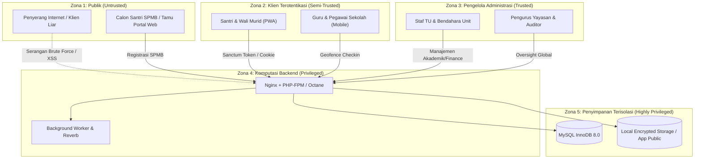

# SuperApp Namira — Pemodelan Ancaman Keamanan (Threat Model)

**Dokumen Analisis Risiko & Pemodelan Ancaman (STRIDE)**  
**ID Dokumen:** `DOC-SEC-01-THREAT-MODEL`  
**Status Audit:** `IMPLEMENTED`  
**Metodologi:** Kerangka Kerja STRIDE (Microsoft Threat Modeling)  
**Terkait:** [`02-security-architecture.md`](file:///E:/Rian%20hidayad/SuperApp_Namira/docs/09-security/02-security-architecture.md), [`03-vulnerability-assessment.md`](file:///E:/Rian%20hidayad/SuperApp_Namira/docs/09-security/03-vulnerability-assessment.md), [`03-unit-and-tenant-isolation.md`](file:///E:/Rian%20hidayad/SuperApp_Namira/docs/06-access-control/03-unit-and-tenant-isolation.md)

---

## 1. Lingkup & Batas Kepercayaan Sistem (Trust Boundaries)

Sistem SuperApp Namira beroperasi melintasi lima zona kepercayaan (*Trust Zones*) yang saling berinteraksi:

---

## 2. Analisis Ancaman Berdasarkan Model STRIDE

### 2.1 S — Spoofing (Pemalsuan Identitas)
- **Vektor Ancaman**: Penyerang memalsukan koordinat GPS (*Fake GPS*) saat presensi dinas, atau memalsukan barcode kartu santri di gerbang sekolah.
- **Dampak Bisnis**: Pegawai menerima tunjangan kehadiran tanpa berada di sekolah; pencatatan kehadiran palsu di pos satpam.
- **Mitigasi yang Diimplementasikan**:
  - Penambahan swafoto langsung dari kamera perangkat (bukan unggah galeri) sebagai bukti kehadiran fisik.
  - Barcode kartu santri dienkode menggunakan format internal unik yang diverifikasi silang dengan status aktif rombel.

---

### 2.2 T — Tampering (Manipulasi Data)
- **Vektor Ancaman**: Penyerang memanipulasi parameter URL atau body request (`unit_id`, `amount`, `score`) untuk mengubah data unit lain atau mengurangi jumlah tagihan SPP (*Parameter Tampering*).
- **Dampak Bisnis**: Kebocoran isolasi tenant; manipulasi nilai rapor; kerugian finansial yayasan.
- **Mitigasi yang Diimplementasikan**:
  - Patch Keamanan Gelombang 3 (*Security Patch Wave 3*) memasang validasi `abort(403)` pada setiap controller method jika `unit_id` sasaran berbeda dengan unit wewenang pengguna.
  - Jumlah nominal pembayaran dihitung dari master tarif di server, bukan mempercayai nilai yang dikirim dari klien browser.

---

### 2.3 R — Repudiation (Penyangkalan Tindakan)
- **Vektor Ancaman**: Staf tata usaha menghapus transaksi keuangan atau nilai rapor siswa, lalu menyangkal telah melakukan tindakan tersebut.
- **Dampak Bisnis**: Hilangnya akuntabilitas operasional; potensi kecurangan internal (*internal fraud*).
- **Mitigasi yang Diimplementasikan**:
  - Pustaka Spatie Activitylog mencatat stempel waktu, ID pengguna, alamat IP, agen peramban, serta snapshot perubahan nilai (*old vs new values*) pada tabel `activity_log`.

---

### 2.4 I — Information Disclosure (Kebocoran Informasi)
- **Vektor Ancaman**: Admin SMP melihat data keuangan atau notula rahasia bimbingan konseling santri SMA; atau kebocoran stack trace database saat terjadi error 500.
- **Dampak Bisnis**: Pelanggaran privasi data santri (UU Perlindungan Data Pribadi / PDP); bocornya rahasia keuangan yayasan.
- **Mitigasi yang Diimplementasikan**:
  - Penyekatan Spatie Teams `team_id` pada seluruh kueri.
  - Nonaktifkan `APP_DEBUG=false` pada lingkungan produksi untuk mencegah pemaparan kredensial basis data atau variabel lingkungan.

---

### 2.5 D — Denial of Service (Penolakan Layanan)
- **Vektor Ancaman**: Pengiriman payload raksasa berformat string base64 pada endpoint presensi atau penyerbuan ratusan request ke endpoint login (*Credential Stuffing*).
- **Dampak Bisnis**: Server crash; pengguna sah tidak dapat melakukan presensi sebelum jam masuk kerja berakhir.
- **Mitigasi yang Diimplementasikan**:
  - Penerapan pembatasan laju (*Rate Limiting*) 5 percobaan/menit pada `/login` dan 60 req/menit pada rute API umum.
  - Batasan ukuran berkas unggahan maksimal 3MB untuk gambar dan 10MB untuk dokumen tugas.

---

### 2.6 E — Elevation of Privilege (Peningkatan Hak Akses / Privilege Escalation)
- **Vektor Ancaman**: Guru mengubah status perannya sendiri menjadi `admin_unit` atau `super_admin_yayasan` melalui pengiriman payload form profil.
- **Dampak Bisnis**: Pengambilalihan kendali sistem secara ilegal.
- **Mitigasi yang Diimplementasikan**:
  - Kolom penugasan peran tidak terdaftar dalam `$fillable` model `User`.
  - Mutasi peran hanya dapat dieksekusi melalui endpoint terproteksi khusus admin yayasan (`AdminManagementApiController@updateUser`) dengan otorisasi Spatie RBAC ketat.

---

## 3. Matriks Profil Risiko STRIDE

| Kategori STRIDE | Tingkat Ancaman Awal | Status Mitigasi | Tingkat Risiko Residual |
| :--- | :---: | :---: | :---: |
| **Spoofing** | `TINGGI` | `TERMITIGASI` (Selfie + Validasi Geofence) | `RENDAH` |
| **Tampering** | `KRITIS` | `TERMITIGASI` (Patch Wave 3 & Form Validation) | `RENDAH` |
| **Repudiation** | `SEDANG` | `TERMITIGASI` (Audit Log Spatie) | `SANGAT RENDAH`|
| **Information Disclosure** | `TINGGI` | `TERMITIGASI` (Spatie Teams Scoping) | `RENDAH` |
| **Denial of Service** | `SEDANG` | `TERMITIGASI` (Rate Limiting & File Limits) | `RENDAH` |
| **Elevation of Privilege** | `KRITIS` | `TERMITIGASI` (Protected Mass Assignment & Gates) | `SANGAT RENDAH`|
