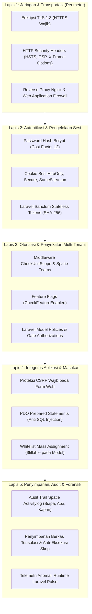

# SuperApp Namira — Arsitektur Keamanan Berlapis (Security Architecture)

**Dokumen Spesifikasi Teknis Keamanan Informasi**  
**ID Dokumen:** `DOC-SEC-02-SECURITY-ARCH`  
**Status Audit:** `IMPLEMENTED`  
**Prinsip Desain:** *Defense-in-Depth (Pertahanan Berlapis)*  
**Terkait:** [`01-threat-model.md`](file:///E:/Rian%20hidayad/SuperApp_Namira/docs/09-security/01-threat-model.md), [`03-vulnerability-assessment.md`](file:///E:/Rian%20hidayad/SuperApp_Namira/docs/09-security/03-vulnerability-assessment.md), [`02-authorization-flow.md`](file:///E:/Rian%20hidayad/SuperApp_Namira/docs/06-access-control/02-authorization-flow.md)

---

## 1. Prinsip Pertahanan Berlapis (Defense-in-Depth)

SuperApp Namira menerapkan model keamanan *Defense-in-Depth* dengan lima lapisan proteksi independen. Jika salah satu lapisan terlewati, lapisan berikutnya tetap mampu menahan intrusi dan mencegah eskalasi serangan.

---

## 2. Rincian Implementasi 5 Lapisan Keamanan

### 2.1 Lapis 1: Keamanan Jaringan & Protokol Transportasi
- **Enkripsi End-to-End**: Seluruh lalu lintas data antara klien (browser / mobile) dan server dienkripsi menggunakan protokol TLS 1.2/1.3. Permintaan HTTP port 80 secara otomatis dialihkan (*redirect 301*) ke HTTPS port 443.
- **Konfigurasi Header Keamanan**:
  - `Strict-Transport-Security: max-age=31536000; includeSubDomains`: Memaksa peramban hanya berkomunikasi melalui HTTPS.
  - `X-Frame-Options: SAMEORIGIN`: Mencegah serangan *Clickjacking* melalui penyematan `<iframe>` berbahaya.
  - `X-Content-Type-Options: nosniff`: Mencegah eksploitasi *MIME-type confusion*.
  - `Referrer-Policy: strict-origin-when-cross-origin`: Melindungi kebocoran parameter sensitif di URL.

---

### 2.2 Lapis 2: Autentikasi & Keamanan Kredensial
- **Penyimpanan Kata Sandi**:
  - Menggunakan algoritma hash adaptif `bcrypt` dengan faktor biaya (*work factor*) 12.
  - Password tidak pernah disimpan atau dicatat dalam bentuk teks biasa (*plain text*) di basis data maupun berkas log.
- **Keamanan Cookie Sesi**:
  - Token sesi dienkripsi dengan kunci aplikasi (`APP_KEY`).
  - Dilengkapi atribut `HttpOnly` (tidak dapat diakses oleh skrip JavaScript via `document.cookie`) dan `SameSite=Lax` untuk mencegah pencurian token sesi melalui serangan XSS/CSRF.

---

### 2.3 Lapis 3: Otorisasi Berbutir Halus & Penyekatan Tenant
- **Spatie Teams Multi-Tenancy**:
  - Penegakan izin berbasis kombinasi `(user_id, role_id, team_id)`.
  - Staf unit terkunci pada `team_id` unit tempat mereka bertugas, menghapus risiko pembacaan silang data antar unit (*cross-tenant leakage*).
- **Proteksi Rute Sensitif**:
  - Rute administratif yayasan dilindungi oleh middleware `role:super_admin_yayasan|admin_yayasan`.
  - Akses fitur yang dinonaktifkan secara otomatis dibatalkan pada lapisan middleware `CheckFeatureEnabled`.

---

### 2.4 Lapis 4: Ketahanan Kode Terhadap Eksploitasi Umum
- **Pencegahan SQL Injection**:
  - 100% kueri basis data dibangun menggunakan Laravel Eloquent ORM atau Query Builder yang memanfaatkan *PDO Parameter Binding* bawaan PHP.
  - Tidak ada penggabungan string mentah (*raw string concatenation*) pada kueri yang melibatkan masukan pengguna.
- **Pencegahan Cross-Site Request Forgery (CSRF)**:
  - Seluruh permintaan HTTP `POST`, `PUT`, `PATCH`, dan `DELETE` pada antarmuka web divalidasi menggunakan token `X-CSRF-TOKEN` / `X-XSRF-TOKEN` oleh middleware `VerifyCsrfToken`.
- **Proteksi Mass Assignment**:
  - Setiap Model Eloquent mendefinisikan array `$fillable` secara eksplisit, mencegah penyerang menyuntikkan kolom sensitif (seperti `status`, `is_admin`, `unit_id`) ke dalam basis data.

---

### 2.5 Lapis 5: Keamanan Berkas, Audit Trail & Pemantauan
- **Isolasi Berkas Unggahan**:
  - Seluruh berkas unggahan publik (foto profil, cover berita) disimpan di `storage/app/public` dan diakses melalui symlink `public/storage`.
  - Direktori penyimpanan dikonfigurasi pada level web server untuk menolak eksekusi skrip PHP secara langsung (`php_flag engine off` atau Nginx rule `location ~ \.php$ { deny all; }`).
- **Jejak Audit Forensik**:
  - Tabel `activity_log` mencatat riwayat perubahan model, memungkinkan tim audit merekonstruksi insiden jika terjadi anomali data operasional.
