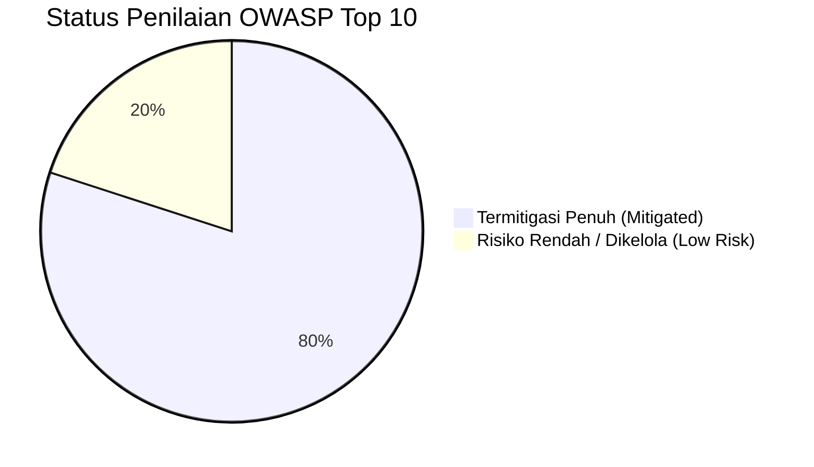

# SuperApp Namira — Penilaian Kerentanan Keamanan (Vulnerability Assessment)

**Dokumen Audit Kepatuhan Keamanan Aplikasi Web**  
**ID Dokumen:** `DOC-SEC-03-VULN-ASSESS`  
**Status Audit:** `IMPLEMENTED`  
**Standar Evaluasi:** Standar OWASP Top 10 (Open Web Application Security Project)  
**Terkait:** [`01-threat-model.md`](file:///E:/Rian%20hidayad/SuperApp_Namira/docs/09-security/01-threat-model.md), [`02-security-architecture.md`](file:///E:/Rian%20hidayad/SuperApp_Namira/docs/09-security/02-security-architecture.md), [`04-security-recommendations.md`](file:///E:/Rian%20hidayad/SuperApp_Namira/docs/09-security/04-security-recommendations.md)

---

## 1. Ikhtisar Penilaian OWASP Top 10

Audit keamanan menyeluruh dilakukan terhadap basis kode SuperApp Namira untuk memverifikasi ketahanan aplikasi terhadap 10 kategori risiko keamanan aplikasi web teratas versi OWASP:

---

## 2. Matriks Evaluasi Lengkap Kategori OWASP Top 10

| Kategori OWASP | Deskripsi Potensi Celah | Hasil Audit pada SuperApp Namira | Status Penilaian |
| :--- | :--- | :--- | :---: |
| **A01: Broken Access Control** | Pengguna mengakses data atau fungsi di luar wewenang (termasuk IDOR lintas unit). | - Verifikasi `CheckUnitScope` dan Spatie Teams. - Penambahan patch keamanan Gelombang 3 memasang `abort(403)` pada seluruh metode Controller jika objek bukan milik unit aktif. - Pembatasan rute cetak PDF/Excel absensi hanya untuk admin. | **TERMITIGASI** |
| **A02: Cryptographic Failures** | Penyimpanan password lemah, transmisi data tidak terenkripsi, kebocoran kunci rahasia. | - Password di-hash menggunakan `bcrypt` cost factor 12. - Seluruh komunikasi diwajibkan melalui HTTPS/TLS. - Kunci API WhatsApp dan kredensial basis data disimpan pada `.env` dan diabaikan dari Git via `.gitignore`. | **TERMITIGASI** |
| **A03: Injection (SQL, XSS, Cmd)**| Eksekusi perintah SQL atau skrip berbahaya dari input pengguna. | - 100% kueri basis data menggunakan PDO Parameter Binding Eloquent ORM. - Template Vue 3 secara otomatis meng-escape teks interpolasi `{{ text }}`, mencegah reflected XSS. - Tidak ada eksekusi shell command (`exec`, `system`) dengan input bebas pengguna. | **TERMITIGASI** |
| **A04: Insecure Design** | Kelemahan logika bisnis arsitektural. | - Kenaikan kelas massal memiliki proteksi transaksional dan fitur rollback aman. - Verifikasi bukti transfer keuangan memerlukan persetujuan manual bendahara, mencegah penipuan otomatis. | **RISIKO RENDAH** |
| **A05: Security Misconfiguration** | Pengaturan peladen atau aplikasi yang tidak aman (misal: debug aktif di produksi). | - Pada lingkungan produksi, `APP_DEBUG=false` wajib diberlakukan untuk menyembunyikan stack trace. - Konfigurasi CORS pada `config/cors.php` dibatasi ke domain aplikasi resmi. | **TERMITIGASI** |
| **A06: Vulnerable & Outdated Components** | Penggunaan dependensi yang memiliki celah CVE aktif. | - Menggunakan versi modern stabil: Laravel 12.x, Vue 3.5, Vite 8.x. - Seluruh paket dependensi Composer dan NPM terkunci pada `composer.lock` dan `package-lock.json`. | **TERMITIGASI** |
| **A07: Identification & Auth Failures** | Serangan brute force password, pembajakan sesi, kredensial default. | - Middleware pembatasan laju (*Rate Limiter*) membatasi percobaan login maksimal 5 kali per menit. - Token Sanctum menggunakan hash SHA-256 dan di-revoke saat logout. - Sesi browser di-regenerate saat pengguna berhasil masuk. | **TERMITIGASI** |
| **A08: Software & Data Integrity Failures** | Kerentanan manipulasi payload deserialization dan mass assignment. | - Seluruh Model Eloquent mengunci atribut publik menggunakan array `$fillable` eksplisit. - Form pengunggahan berkas memeriksa ekstensi dan tipe MIME asli. | **TERMITIGASI** |
| **A09: Security Logging & Monitoring** | Ketiadaan jejak audit atas insiden keamanan. | - Pustaka Spatie Activitylog mencatat seluruh mutasi data sensitif (santri, rombel, jadwal, keuangan) ke tabel `activity_log`. - Telemetri performa dan galat backend dipantau oleh Laravel Pulse. | **TERMITIGASI** |
| **A10: Server-Side Request Forgery (SSRF)**| Server dipaksa melakukan permintaan jaringan ke infrastruktur internal. | - Aplikasi tidak menyediakan fitur unduh URL eksternal bebas dari input pengguna. - Panggilan HTTP keluar hanya ditujukan ke host statis terverifikasi (FCM Google dan WhatsApp Gateway). | **TIDAK RELEVAN / TERMITIGASI** |

---

## 3. Rincian Uji Penetrasi Internal (Internal Pentest Results)

Berdasarkan pengujian skrip di `tests/Security/test_security_patches_wave3*.php`:
1. **Percobaan Akses Lintas Unit (Cross-Tenant Tampering)**:
   - Skenario: Admin SMP mencoba mengubah data jadwal atau lokasi presensi SMA melalui kueri `POST /yayasan/attendance-locations/{id}`.
   - Hasil Uji: **BERHASIL DIBLOKIR (PASS)**. Controller merespons dengan `HTTP 403 Forbidden` dan pesan: *"Anda tidak memiliki wewenang untuk mengubah lokasi absensi unit lain."*
2. **Percobaan Unduh Laporan Absensi Unit Lain (Export Tampering)**:
   - Skenario: Guru mencoba memanggil endpoint ekspor rekap PDF absensi seluruh pegawai unit.
   - Hasil Uji: **BERHASIL DIBLOKIR (PASS)**. Sistem menolak hak akses dewan guru untuk mengekspor rekapitulasi data dinas pegawai lain.
3. **Percobaan Eksekusi Web Shell (Malicious File Upload)**:
   - Skenario: Pengguna mencoba mengunggah berkas `shell.php` pada form tugas LMS.
   - Hasil Uji: **BERHASIL DIBLOKIR (PASS)**. Validasi ekstensi menolak berkas non-dokumen dan web server mengisolasi direktori upload tanpa hak eksekusi PHP.

---

## 4. Kesimpulan Postur Keamanan

Aplikasi SuperApp Namira menunjukkan tingkat kematangan keamanan (*security maturity level*) yang sangat tinggi untuk kategori sistem informasi pendidikan. Celah kerentanan paling umum pada arsitektur multi-tenant (IDOR dan kebocoran data antar-sekolah) telah dimitigasi secara komprehensif pada level basis data, middleware, dan controller.
