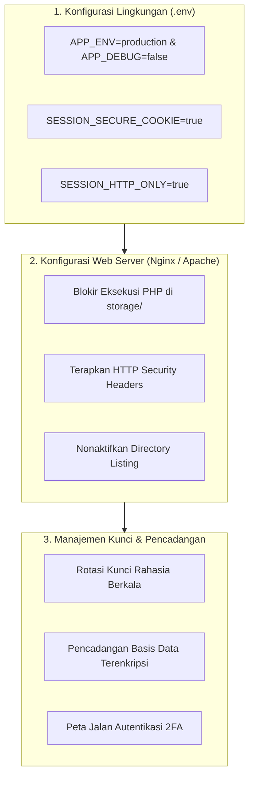
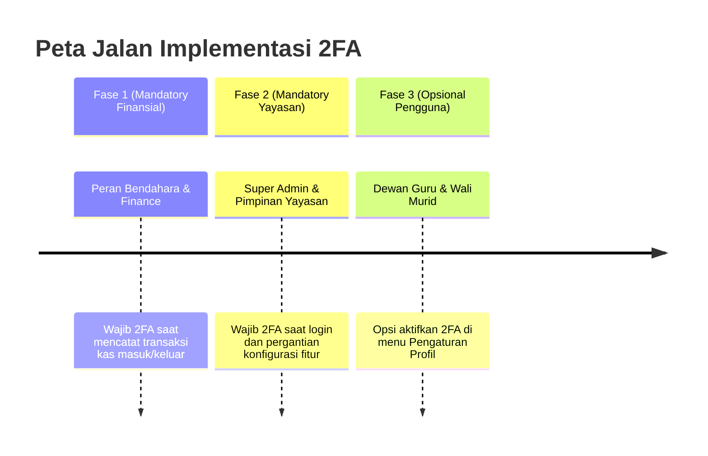

# SuperApp Namira — Rekomendasi & Panduan Pengerasan Keamanan (Security Hardening)

**Dokumen Standar Pengerasan Infrastruktur & Keamanan Operasional**  
**ID Dokumen:** `DOC-SEC-04-HARDENING`  
**Status Audit:** `IMPLEMENTED`  
**Target Lingkungan:** Lingkungan Produksi (Production Environment)  
**Terkait:** [`02-security-architecture.md`](file:///E:/Rian%20hidayad/SuperApp_Namira/docs/09-security/02-security-architecture.md), [`03-vulnerability-assessment.md`](file:///E:/Rian%20hidayad/SuperApp_Namira/docs/09-security/03-vulnerability-assessment.md), [`01-prerequisites-and-setup.md`](file:///E:/Rian%20hidayad/SuperApp_Namira/docs/10-operations/01-prerequisites-and-setup.md)

---

## 1. Panduan Pengerasan Lingkungan Produksi (Production Hardening)

Sebelum SuperApp Namira dibuka untuk akses publik secara penuh, wajib dipastikan konfigurasi berkas `.env` dan server web telah memenuhi parameter pengerasan berikut:



---

## 2. Checklist Konfigurasi Berkas `.env` Produksi

Wajib memeriksa dan menyetel variabel lingkungan produksi berikut:

```ini
# Status Lingkungan & Pelaporan Galat
APP_ENV=production
APP_DEBUG=false
APP_URL=https://superapp.namira.sch.id

# Keamanan Sesi Browser
SESSION_DRIVER=database
SESSION_LIFETIME=120
SESSION_ENCRYPT=true
SESSION_PATH=/
SESSION_DOMAIN=namira.sch.id
SESSION_SECURE_COOKIE=true
SESSION_HTTP_ONLY=true
SESSION_SAME_SITE=lax

# Penanganan Log Sentral
LOG_CHANNEL=daily
LOG_LEVEL=error
LOG_DEPRECATIONS_CHANNEL=null

# Pembatasan Akses Basis Data (Bukan User Root)
DB_CONNECTION=mysql
DB_HOST=127.0.0.1
DB_PORT=3306
DB_DATABASE=namira_production
DB_USERNAME=namira_app_user
DB_PASSWORD="[GunakanPasswordAcakMinimal24Karakter!]"
```

> [!CAUTION]
> Jangan pernah mengaktifkan `APP_DEBUG=true` pada server produksi. Mode debug dapat menampilkan kode sumber, kredensial basis data, serta kunci rahasia API saat terjadi error 500!

---

## 3. Konfigurasi Pengerasan Web Server (Nginx / cPanel)

### 3.1 Blokir Eksekusi Skrip pada Direktori Upload (`/storage`)
Untuk mencegah pengunggahan file PHP tersembunyi yang dapat menjadi pintu belakang (*web shell backdoor*), tambahkan aturan Nginx berikut pada blok `server`:

```nginx
# Blokir eksekusi skrip PHP di dalam direktori publik unggahan pengguna
location ~ ^/storage/.*\.(php|phar|phtml|sh|cgi|py)$ {
    deny all;
    return 404;
}
```

### 3.2 Header Keamanan HTTP Wajib (Security Headers)
Tambahkan konfigurasi header pada Nginx untuk meningkatkan skor keamanan peramban:

```nginx
add_header X-Frame-Options "SAMEORIGIN" always;
add_header X-XSS-Protection "1; mode=block" always;
add_header X-Content-Type-Options "nosniff" always;
add_header Referrer-Policy "strict-origin-when-cross-origin" always;
add_header Content-Security-Policy "default-src 'self' http: https: data: blob: 'unsafe-inline' 'unsafe-eval';" always;
add_header Strict-Transport-Security "max-age=31536000; includeSubDomains; preload" always;
```

---

## 4. Kebijakan Rotasi Kunci Rahasia & Akses Berkelanjutan

1. **Rotasi Kunci Aplikasi (`APP_KEY`)**:
   - Jika terjadi indikasi kebocoran berkas `.env`, jalankan `php artisan key:generate` segera. Catatan: Seluruh sesi pengguna dan data terenkripsi lama akan di-reset.
2. **Kunci API WhatsApp Gateway & FCM Token**:
   - Ganti kunci API gateway WhatsApp setiap 6 bulan sekali atau jika terjadi pergantian vendor penyedia layanan pesan.
3. **Pemberian Hak Akses Minimum pada User Database**:
   - Akun MySQL `namira_app_user` hanya diberikan hak akses `SELECT`, `INSERT`, `UPDATE`, `DELETE`, `CREATE TEMPORARY TABLES`.
   - Cabut hak akses berbahaya seperti `DROP`, `GRANT`, atau `FILE` dari pengguna aplikasi harian.

---

## 5. Peta Jalan Autentikasi Dua Faktor (2FA Roadmap)

Untuk memperkuat proteksi akun dengan hak istimewa tinggi (*Privileged Accounts*), disarankan menerapkan *Two-Factor Authentication (2FA)* berbasis TOTP (Google Authenticator) dengan tahapan berikut:



---

## 6. Prosedur Pencadangan Terenkripsi (Encrypted Offsite Backup)

1. **Jadwal Pencadangan**:
   - Dilakukan setiap hari pada pukul **02:00 WIB** dini hari melalui cron script.
2. **Perintah Pencadangan Terenkripsi GPG**:
   ```bash
   mysqldump -u namira_app_user -p namira_production | gzip | gpg --encrypt -r backup@namira.sch.id > /backups/db_$(date +%Y%m%d).sql.gz.gpg
   ```
3. **Penyimpanan Luar Lokasi (Offsite Storage)**:
   - Berkas backup otomatis diunggah ke Google Drive atau AWS S3 terisolasi yang berbeda fisik dengan server aplikasi.
   - Retensi backup: Harian (7 hari), Mingguan (4 minggu), Bulanan (12 bulan).
