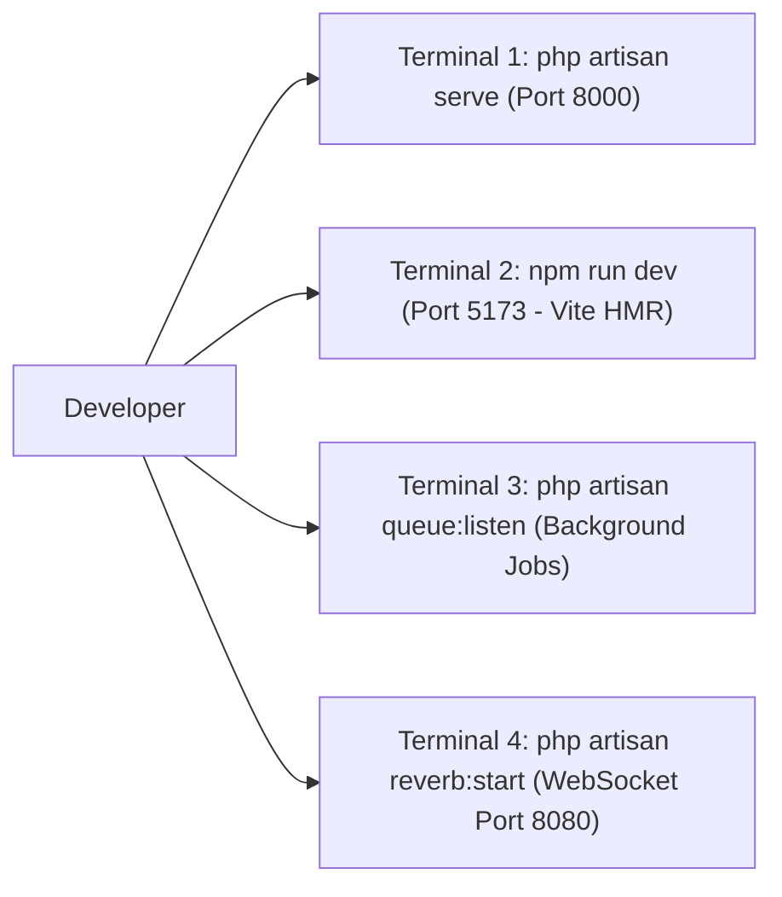

# SuperApp Namira — Prasyarat Sistem & Panduan Setup Lingkungan (Setup Guide)

**Dokumen Panduan Operasional & Instalasi**  
**ID Dokumen:** `DOC-OPS-01-PREREQUISITES`  
**Status Audit:** `IMPLEMENTED`  
**Sasaran:** Pengembang Baru, Tim DevOps & SysAdmin  
**Terkait:** [`02-configuration-guide.md`](file:///E:/Rian%20hidayad/SuperApp_Namira/docs/10-operations/02-configuration-guide.md), [`03-deployment-guide.md`](file:///E:/Rian%20hidayad/SuperApp_Namira/docs/10-operations/03-deployment-guide.md), [`project-inventory.md`](file:///E:/Rian%20hidayad/SuperApp_Namira/docs/02-inventory/project-inventory.md)

---

## 1. Prasyarat Perangkat Keras & Perangkat Lunak

### 1.1 Spesifikasi Server / Komputer Pengembang Minimum

| Komponen | Lingkungan Pengembangan (Local Dev) | Lingkungan Produksi (Production Server) |
| :--- | :--- | :--- |
| **Sistem Operasi** | Windows 10/11, macOS 12+, Ubuntu 22.04 LTS | Ubuntu 22.04 LTS / 24.04 LTS Server |
| **CPU / Prosesor** | 4 Cores (Intel Core i5 / AMD Ryzen 5 / Apple Silicon) | 4 vCPU (Rekomendasi 8 vCPU untuk beban penuh) |
| **Memori RAM** | Minimal 8 GB (Direkomendasikan 16 GB) | Minimal 8 GB (Direkomendasikan 16 GB) |
| **Penyimpanan Disk**| 20 GB Ruang Kosong (SSD) | 100 GB NVMe SSD (Termasuk ruang berkas media) |

---

### 1.2 Dependensi Perangkat Lunak Inti

1. **PHP 8.2 atau 8.3**:
   - Ekstensi PHP Wajib Aktif:
     - `pdo_mysql` (Koneksi database MySQL)
     - `mbstring` (Manipulasi string multi-byte)
     - `openssl` (Enkripsi dan kriptografi)
     - `bcmath` (Perhitungan matematika presisi tinggi keuangan)
     - `curl` (Panggilan HTTP keluar ke WA Gateway & FCM)
     - `xml` & `dom` (Parsing dokumen dan ekspor laporan DomPDF)
     - `gd` atau `imagick` (Kompresi foto profil dan swafoto presensi)
     - `zip` (Ekstraksi dan ekspor file zip/excel)
     - `pcntl` & `posix` (Manajemen sinyal proses worker queue pada Linux)
2. **Node.js & Manajer Paket**:
   - Node.js LTS v20.x atau v22.x
   - NPM v10.x+
3. **Basis Data**:
   - MySQL 8.0+ atau MariaDB 10.6+ (Mode strict SQL aktif)
   - Driver engine: InnoDB dengan dukungan UTF8MB4
4. **Composer**:
   - Composer v2.6+

---

## 2. Panduan Instalasi Langkah-demi-Langkah (Local Setup)

Ikuti urutan langkah berikut untuk menyiapkan repositori dari awal:

### Langkah 1: Kloning Repositori
```bash
git clone https://github.com/namira/superapp-namira.git
cd superapp-namira
```

### Langkah 2: Instalasi Dependensi Backend (Composer)
```bash
composer install --no-interaction --prefer-dist --optimize-autoloader
```

### Langkah 3: Konfigurasi Berkas Lingkungan (.env)
Salin berkas template lingkungan dan sesuaikan kredensial basis data:
```bash
cp .env.example .env
php artisan key:generate
```

Buka berkas `.env`, kemudian sesuaikan parameter koneksi basis data:
```ini
DB_CONNECTION=mysql
DB_HOST=127.0.0.1
DB_PORT=3306
DB_DATABASE=superapp_namira
DB_USERNAME=root
DB_PASSWORD=
```

### Langkah 4: Migrasi & Pengisian Data Awal (Seeders)
Pastikan basis data `superapp_namira` telah dibuat di MySQL, lalu jalankan:
```bash
php artisan migrate --seed
```
*Catatan: Perintah ini akan mengeksekusi 82 berkas migrasi dan mengisi master unit sekolah, akun demo admin, dewan guru, dan hak akses Spatie RBAC.*

### Langkah 5: Buat Simbolik Link Media Publik (Storage Link)
```bash
php artisan storage:link
```

### Langkah 6: Instalasi Dependensi Frontend & Kompilasi Aset (Vite)
```bash
npm install
npm run build   # Atau 'npm run dev' untuk live reloading pengembangan
```

---

## 3. Menjalankan Server Pengembangan Lokal

Untuk menjalankan seluruh ekosistem layanan secara simultan di lingkungan pengembang:



1. **Terminal 1 — HTTP Application Server**:
   ```bash
   php artisan serve --port=8000
   ```
2. **Terminal 2 — Vite Hot Module Replacement (HMR)**:
   ```bash
   npm run dev
   ```
3. **Terminal 3 — Background Queue Worker**:
   ```bash
   php artisan queue:listen
   ```
4. **Terminal 4 — Laravel Reverb WebSocket Server**:
   ```bash
   php artisan reverb:start --debug
   ```

Aplikasi siap diakses melalui peramban web di alamat: `http://localhost:8000`.
Kredensial akun default demo:
- Email: `superadmin@namira.sch.id`
- Password: `password`
