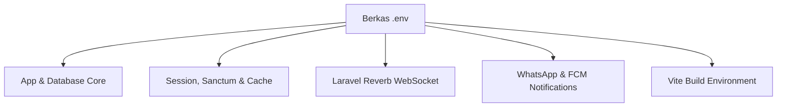

# SuperApp Namira — Panduan Konfigurasi Lingkungan (.env Reference)

**Dokumen Spesifikasi Teknis Konfigurasi & Variabel Lingkungan**  
**ID Dokumen:** `DOC-OPS-02-CONFIGURATION`  
**Status Audit:** `IMPLEMENTED`  
**Berkas Sasaran:** `.env` / `config/*.php`  
**Terkait:** [`01-prerequisites-and-setup.md`](file:///E:/Rian%20hidayad/SuperApp_Namira/docs/10-operations/01-prerequisites-and-setup.md), [`03-deployment-guide.md`](file:///E:/Rian%20hidayad/SuperApp_Namira/docs/10-operations/03-deployment-guide.md)

---

## 1. Ikhtisar Konfigurasi Berkas `.env`

Berkas `.env` mengatur seluruh parameter runtime aplikasi. Variabel-variabel ini dibaca oleh file konfigurasi di direktori `config/` dan di-cache menggunakan `php artisan config:cache` di lingkungan produksi untuk kecepatan akses.



---

## 2. Kamus Variabel Lingkungan Lengkap

### 2.1 Konfigurasi Aplikasi & Lokalisasi (Core App)

| Nama Variabel | Tipe Data | Nilai Default | Deskripsi & Rekomendasi Nilai |
| :--- | :--- | :--- | :--- |
| `APP_NAME` | `string` | `"SuperApp Namira"` | Nama resmi aplikasi yang tampil pada judul tab browser dan email. |
| `APP_ENV` | `string` | `local` | Lingkungan runtime (`local`, `staging`, `production`). |
| `APP_KEY` | `string` | `base64:...` | Kunci enkripsi AES-256 untuk sesi dan cookie. Wajib di-generate via `php artisan key:generate`. |
| `APP_DEBUG` | `boolean` | `true` (dev) / `false` (prod)| Wajib disetel `false` pada produksi untuk keamanan. |
| `APP_URL` | `string` | `http://localhost:8000` | URL publik dasar aplikasi (misal: `https://superapp.namira.sch.id`). |
| `APP_TIMEZONE` | `string` | `Asia/Jakarta` | Zona waktu operasional sekolah (WIB / UTC+7). |
| `APP_LOCALE` | `string` | `id` | Bahasa default antarmuka sistem (Bahasa Indonesia). |

---

### 2.2 Konfigurasi Basis Data (MySQL / MariaDB)

| Nama Variabel | Tipe Data | Nilai Default | Deskripsi & Rekomendasi Nilai |
| :--- | :--- | :--- | :--- |
| `DB_CONNECTION` | `string` | `mysql` | Driver basis data relasional. |
| `DB_HOST` | `string` | `127.0.0.1` | Host alamat server database (atau `localhost` pada cPanel). |
| `DB_PORT` | `integer` | `3306` | Port listening MySQL standar. |
| `DB_DATABASE` | `string` | `superapp_namira` | Nama skema basis data utama. |
| `DB_USERNAME` | `string` | `root` | Pengguna database dengan wewenang terbatas di produksi. |
| `DB_PASSWORD` | `string` | `""` | Kata sandi koneksi database yang aman. |

---

### 2.3 Sesi, Cache & Antrean (Session, Cache & Queue)

| Nama Variabel | Tipe Data | Nilai Default | Deskripsi & Rekomendasi Nilai |
| :--- | :--- | :--- | :--- |
| `SESSION_DRIVER` | `string` | `database` | Penyimpanan sesi pengguna (tabel `sessions`). |
| `SESSION_LIFETIME` | `integer`| `120` | Masa berlaku sesi aktif pengguna dalam menit (2 jam). |
| `SESSION_ENCRYPT` | `boolean` | `true` | Enkripsi payload data sesi untuk perlindungan privasi. |
| `CACHE_STORE` | `string` | `database` | Driver cache sistem (`database` atau `redis`). |
| `QUEUE_CONNECTION`| `string` | `database` | Driver antrean latar belakang (`database` atau `redis`). |

---

### 2.4 WebSocket Realtime (Laravel Reverb)

Digunakan untuk siaran kedatangan santri secara real-time pada modul Gate Scanner gerbang sekolah.

| Nama Variabel | Tipe Data | Nilai Default | Deskripsi & Pemetaan Frontend |
| :--- | :--- | :--- | :--- |
| `BROADCAST_CONNECTION` | `string` | `reverb` | Mengaktifkan driver siaran Laravel Reverb. |
| `REVERB_APP_ID` | `string` | `1001` | ID aplikasi unik Reverb server. |
| `REVERB_APP_KEY` | `string` | `namira-reverb-key` | Kunci publik untuk koneksi WebSocket klien. |
| `REVERB_APP_SECRET` | `string` | `namira-reverb-secret` | Kunci rahasia komunikasi internal peladen. |
| `REVERB_HOST` | `string` | `"127.0.0.1"` | Host listening Reverb server. |
| `REVERB_PORT` | `integer`| `8080` | Port listening proses Reverb. |
| `REVERB_SCHEME` | `string` | `http` (dev) / `https` (prod) | Protokol koneksi WebSocket (`http` atau `https/wss`). |
| `VITE_REVERB_APP_KEY` | `string` | `${REVERB_APP_KEY}` | Diteruskan ke bundle frontend Vue saat kompilasi Vite. |
| `VITE_REVERB_HOST` | `string` | `${REVERB_HOST}` | Host domain WebSocket yang diakses browser klien. |
| `VITE_REVERB_PORT` | `integer`| `${REVERB_PORT}` | Port WebSocket klien (biasanya 443 via reverse proxy). |
| `VITE_REVERB_SCHEME`| `string` | `${REVERB_SCHEME}` | Skema wss:// untuk klien produksi. |

---

### 2.5 Integrasi Notifikasi Eksternal (WhatsApp & FCM)

| Nama Variabel | Tipe Data | Nilai Default | Deskripsi |
| :--- | :--- | :--- | :--- |
| `WA_GATEWAY_URL` | `string` | `https://api.fonnte.com/send` | URL API penyedia layanan pengiriman pesan WhatsApp. |
| `WA_GATEWAY_API_KEY`| `string` | `""` | Kunci API / Token autentikasi vendor WhatsApp gateway. |
| `WA_GATEWAY_SENDER` | `string` | `""` | Nomor pengirim resmi WhatsApp Yayasan Namira. |
| `FCM_SERVER_KEY` | `string` | `""` | Kunci otentikasi Firebase Cloud Messaging untuk push notification mobile. |

---

### 2.6 Konfigurasi Pengiriman Email (SMTP Mail)

| Nama Variabel | Nilai Contoh Produksi | Deskripsi |
| :--- | :--- | :--- |
| `MAIL_MAILER` | `smtp` | Driver protokol email. |
| `MAIL_HOST` | `smtp.mailgun.org` / `smtp.gmail.com` | Host peladen SMTP. |
| `MAIL_PORT` | `587` | Port TLS standar pengiriman email. |
| `MAIL_USERNAME` | `noreply@namira.sch.id` | Akun pengguna autentikasi SMTP. |
| `MAIL_PASSWORD` | `[PasswordSMTP]` | Kata sandi SMTP. |
| `MAIL_ENCRYPTION` | `tls` | Protokol enkripsi transmisi email. |
| `MAIL_FROM_ADDRESS`| `noreply@namira.sch.id` | Alamat pengirim resmi yang tertera di inbox penerima. |
| `MAIL_FROM_NAME` | `"SuperApp Namira"` | Nama label pengirim email. |

---

## 3. Prosedur Penerapan Konfigurasi di Lingkungan Produksi

Setelah menyunting berkas `.env` di server produksi, wajib menjalankan pembersihan dan caching konfigurasi:

```bash
# 1. Cache konfigurasi berkas .env ke satu file PHP yang dioptimalkan
php artisan config:cache

# 2. Cache rute aplikasi untuk mempercepat dispatching HTTP
php artisan route:cache

# 3. Cache kompilasi view Blade
php artisan view:cache

# 4. Restart worker antrean agar membaca konfigurasi baru
php artisan queue:restart
```
