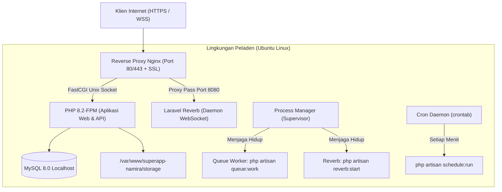

# SuperApp Namira — Panduan Deployment Linux VPS (Ubuntu / Nginx)

**Dokumen Standar Operasional Prosedur (SOP) Deployment**  
**ID Dokumen:** `DOC-OPS-03-DEPLOYMENT`  
**Status Audit:** `IMPLEMENTED`  
**Sistem Operasi Target:** Ubuntu Server 22.04 / 24.04 LTS  
**Terkait:** [`01-prerequisites-and-setup.md`](file:///E:/Rian%20hidayad/SuperApp_Namira/docs/10-operations/01-prerequisites-and-setup.md), [`04-cpanel-deployment-guide.md`](file:///E:/Rian%20hidayad/SuperApp_Namira/docs/10-operations/04-cpanel-deployment-guide.md), [`06-queue-and-worker-management.md`](file:///E:/Rian%20hidayad/SuperApp_Namira/docs/10-operations/06-queue-and-worker-management.md)

---

## 1. Topologi Arsitektur Deployment VPS

Arsitektur produksi berbasis VPS tunggal (*single node*) yang dioptimalkan untuk melayani aplikasi web Laravel 12, proses kompilasi Vite, antrean background worker, serta daemon WebSocket Laravel Reverb:



---

## 2. Provisi Awal Server Ubuntu (Initial Server Provisioning)

Jalankan perintah berikut pada terminal server Ubuntu baru:

### Langkah 1: Pembaruan Paket & Instalasi Dependensi Dasar
```bash
sudo apt update && sudo apt upgrade -y
sudo apt install -y curl git unzip ufw supervisor software-properties-common

# Tambahkan repositori PHP Ondrej
sudo add-apt-repository ppa:ondrej/php -y
sudo apt update

# Instalasi PHP 8.2 dan ekstensi yang dibutuhkan
sudo apt install -y php8.2-fpm php8.2-cli php8.2-mysql php8.2-mbstring \
    php8.2-xml php8.2-bcmath php8.2-curl php8.2-gd php8.2-zip \
    php8.2-intl php8.2-tokenizer php8.2-redis

# Instalasi Nginx dan Certbot SSL
sudo apt install -y nginx certbot python3-certbot-nginx

# Instalasi Node.js 20 LTS & Composer
curl -fsSL https://deb.nodesource.com/setup_20.x | sudo -E bash -
sudo apt install -y nodejs
sudo curl -sS https://getcomposer.org/installer | php -- --install-dir=/usr/local/bin --filename=composer
```

### Langkah 2: Konfigurasi Firewall (UFW)
```bash
sudo ufw default deny incoming
sudo ufw default allow outgoing
sudo ufw allow OpenSSH
sudo ufw allow 'Nginx Full'
sudo ufw enable
```

---

## 3. Konfigurasi Nginx Virtual Host & WebSocket Proxy

Buat berkas konfigurasi blok Nginx di `/etc/nginx/sites-available/superapp-namira`:

```nginx
server {
    listen 80;
    listen [::]:80;
    server_name superapp.namira.sch.id;
    return 301 https://$host$request_uri;
}

server {
    listen 443 ssl http2;
    listen [::]:443 ssl http2;
    server_name superapp.namira.sch.id;

    root /var/www/superapp-namira/public;
    index index.php index.html;

    # Sertifikat SSL (dikelola Certbot)
    ssl_certificate /etc/letsencrypt/live/superapp.namira.sch.id/fullchain.pem;
    ssl_certificate_key /etc/letsencrypt/live/superapp.namira.sch.id/privkey.pem;

    # Log Server
    access_log /var/log/nginx/namira_access.log;
    error_log /var/log/nginx/namira_error.log;

    # Batas Ukuran Unggah Berkas (Lampiran Tugas & Swafoto)
    client_max_body_size 25M;

    # Keamanan Header HTTP
    add_header X-Frame-Options "SAMEORIGIN" always;
    add_header X-Content-Type-Options "nosniff" always;
    add_header X-XSS-Protection "1; mode=block" always;

    location / {
        try_files $uri $uri/ /index.php?$query_string;
    }

    # Penanganan Skrip PHP via FastCGI
    location ~ \.php$ {
        include snippets/fastcgi-php.conf;
        fastcgi_pass unix:/var/run/php/php8.2-fpm.sock;
        fastcgi_param SCRIPT_FILENAME $realpath_root$fastcgi_script_name;
        include fastcgi_params;
    }

    # Reverse Proxy Laravel Reverb WebSocket (/app)
    location /app {
        proxy_pass http://127.0.0.1:8080;
        proxy_http_version 1.1;
        proxy_set_header Upgrade $http_upgrade;
        proxy_set_header Connection "Upgrade";
        proxy_set_header Host $host;
        proxy_set_header X-Real-IP $remote_addr;
        proxy_set_header X-Forwarded-For $proxy_add_x_forwarded_for;
        proxy_set_header X-Forwarded-Proto $scheme;
        proxy_read_timeout 60;
        proxy_connect_timeout 60;
    }

    # Blokir Eksekusi PHP di Folder Media Upload
    location ~ ^/storage/.*\.(php|phtml|phar|sh|py)$ {
        deny all;
        return 404;
    }

    # Cache Aset Statis Browser
    location ~* \.(jpg|jpeg|png|gif|ico|css|js|woff|woff2|ttf|svg)$ {
        expires 30d;
        add_header Cache-Control "public, no-transform";
    }

    location ~ /\.ht {
        deny all;
    }
}
```

Aktifkan konfigurasi dan uji sintaks:
```bash
sudo ln -s /etc/nginx/sites-available/superapp-namira /etc/nginx/sites-enabled/
sudo nginx -t
sudo systemctl reload nginx
```

---

## 4. Skrip Otomatisasi Deployment (Zero-Downtime Deploy Script)

Simpan skrip deployment di `/var/www/superapp-namira/deploy.sh` dengan hak eksekusi `chmod +x deploy.sh`:

```bash
#!/bin/bash
set -e

echo "=== Memulai Siklus Deployment SuperApp Namira ==="

# 1. Masuk ke direktori aplikasi
cd /var/www/superapp-namira

# 2. Aktifkan mode pemeliharaan dengan bypass secret
php artisan down --refresh=15 --secret="namira-deploy-bypass-token" || true

# 3. Tarik pembaruan kode terbaru dari Git
git fetch origin main
git reset --hard origin/main

# 4. Instalasi dependensi backend tanpa paket dev
composer install --no-dev --no-interaction --prefer-dist --optimize-autoloader

# 5. Eksekusi migrasi basis data jika ada skema baru
php artisan migrate --force

# 6. Kompilasi aset frontend Vue 3 dengan Vite
npm ci
npm run build

# 7. Optimasi Caching Framework
php artisan config:cache
php artisan route:cache
php artisan view:cache
php artisan event:cache

# 8. Pastikan symlink media publik terhubung
php artisan storage:link || true

# 9. Atur izin kepemilikan berkas ke www-data
sudo chown -R www-data:www-data /var/www/superapp-namira/storage /var/www/superapp-namira/bootstrap/cache
sudo chmod -R 775 /var/www/superapp-namira/storage /var/www/superapp-namira/bootstrap/cache

# 10. Restart Background Queue Worker & Reverb Daemon
php artisan queue:restart
sudo supervisorctl restart all

# 11. Buka kembali aplikasi untuk pengguna publik
php artisan up

echo "=== Deployment Berhasil Diselesaikan! ==="
```

---

## 5. Konfigurasi Penjadwal Rutin (Cron Scheduler)

Jalankan perintah pengeditan crontab:
```bash
sudo crontab -u www-data -e
```
Tambahkan baris berikut di akhir berkas:
```cron
* * * * * cd /var/www/superapp-namira && php artisan schedule:run >> /dev/null 2>&1
```
*Catatan: Konfigurasi ini menjamin background tasks (pembersihan token usang, pengiriman rekap presensi harian, dan agregasi Pulse) berjalan tepat waktu setiap menit.*
