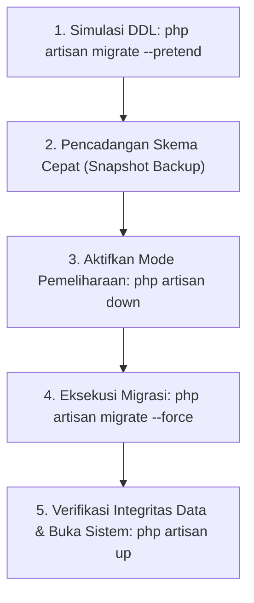

# SuperApp Namira — Operasional & Pemeliharaan Basis Data (Database Operations)

**Dokumen Standar Operasional Prosedur (SOP) Database Administrator (DBA)**  
**ID Dokumen:** `DOC-OPS-05-DATABASE-OPS`  
**Status Audit:** `IMPLEMENTED`  
**RDBMS:** MySQL 8.0+ / MariaDB 10.6+ InnoDB  
**Terkait:** [`01-database-overview.md`](file:///E:/Rian%20hidayad/SuperApp_Namira/docs/04-database/01-database-overview.md), [`05-migration-history.md`](file:///E:/Rian%20hidayad/SuperApp_Namira/docs/04-database/05-migration-history.md), [`07-backup-and-recovery.md`](file:///E:/Rian%20hidayad/SuperApp_Namira/docs/10-operations/07-backup-and-recovery.md)

---

## 1. Siklus Hidup Eksekusi Migrasi di Lingkungan Produksi

Eksekusi perubahan skema (migrasi) di lingkungan produksi harus mematuhi protokol keamanan ketat untuk mencegah *downtime* atau *table locks* yang mengganggu jam operasional belajar:



### Panduan Perintah Migrasi:
1. **Pratilik Perintah SQL Mentah Tanpa Mengeksekusi (`--pretend`)**:
   ```bash
   php artisan migrate --pretend
   ```
   *Memungkinkan DBA memeriksa apakah ada query `ALTER TABLE` besar yang berisiko mengunci tabel.*
2. **Eksekusi Resmi di Produksi**:
   ```bash
   php artisan migrate --force
   ```
3. **Pembatalan Darurat Jika Terjadi Kesalahan (Rollback)**:
   ```bash
   # Membatalkan batch migrasi paling terakhir
   php artisan migrate:rollback --step=1 --force
   ```

---

## 2. Prosedur Penambahan Data Master (Production Seeding)

> [!WARNING]
> Jangan pernah menjalankan perintah `php artisan db:seed` secara menyeluruh di server produksi, karena dapat mengeksekusi seeder demo santri palsu (`DemoStudentSeeder`, `DummySDAccountsSeeder`) yang merusak data riil.

Gunakan flag `--class` spesifik hanya untuk data master sistem atau pembaruan hak akses peran:

```bash
# Memperbarui daftar hak akses Spatie RBAC terbaru tanpa merusak data lain
php artisan db:seed --class=RolesAndPermissionsSeeder --force

# Menginisialisasi pengaturan default sistem baru
php artisan db:seed --class=SystemSettingSeeder --force
```

---

## 3. Pemeliharaan Tabel Bervolume Tinggi (High-Volume Table Maintenance)

Tiga tabel berikut mengalami pertumbuhan rekaman yang sangat cepat dan memerlukan pembersihan berkala (*housekeeping*):

### 3.1 Tabel Telemetri Kinerja (`pulse_entries`, `pulse_aggregates`)
- **Tingkat Pertumbuhan**: ~50.000 baris per hari pada jam sibuk.
- **Prosedur Pembersihan**:
  ```bash
  # Menghapus rekaman Pulse yang berusia lebih dari 7 hari
  php artisan pulse:clear --force
  ```
  *Dijalankan secara otomatis melalui cron Laravel scheduler setiap minggu.*

### 3.2 Tabel Audit Jejak Aktivitas (`activity_log`)
- **Tingkat Pertumbuhan**: ~5.000 baris per hari.
- **Prosedur Pengarsipan**:
  Jalankan perintah SQL untuk mengekspor dan menghapus log audit yang berusia lebih dari 1 tahun:
  ```sql
  DELETE FROM activity_log WHERE created_at < DATE_SUB(NOW(), INTERVAL 1 YEAR);
  OPTIMIZE TABLE activity_log;
  ```

### 3.3 Tabel Antrean Pesan WhatsApp (`whatsapp_messages_queue`)
- **Prosedur Pembersihan**:
  Hapus pesan berstatus `sent` yang telah terkirim sukses lebih dari 90 hari:
  ```sql
  DELETE FROM whatsapp_messages_queue WHERE status = 'sent' AND sent_at < DATE_SUB(NOW(), INTERVAL 90 DAY);
  ```

---

## 4. Diagnostik Kueri Lambat & Kebuntuan (Slow Query & Deadlock Troubleshooting)

### 4.1 Mengaktifkan MySQL Slow Query Log
Tambahkan konfigurasi berikut pada berkas konfigurasi MySQL (`/etc/mysql/mysql.conf.d/mysqld.cnf`):
```ini
slow_query_log = 1
slow_query_log_file = /var/log/mysql/mysql-slow.log
long_query_time = 2
log_queries_not_using_indexes = 1
```
*Setiap kueri yang membutuhkan waktu lebih dari 2 detik atau tidak menggunakan indeks akan dicatat untuk dioptimalkan oleh tim pengembang.*

### 4.2 Menyelidiki Kebuntuan Transaksi (InnoDB Deadlock)
Jika aplikasi mencatat galat `Deadlock found when trying to get lock; try restarting transaction`, jalankan perintah diagnostik berikut pada klien MySQL:
```sql
SHOW ENGINE INNODB STATUS\G
```
Periksa bagian **LATEST DETECTED DEADLOCK** untuk melihat dua kueri yang saling memblokir kunci baris (*row-level locks*) dan sesuaikan urutan penguncian transaksi di kode Laravel (`lockForUpdate()`).
