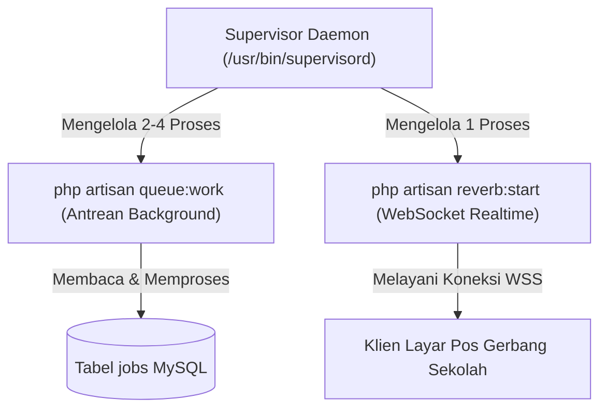

# SuperApp Namira — Manajemen Worker Antrean & WebSocket (Queue & Reverb Management)

**Dokumen Standar Operasional Pengelolaan Proses Daemon**  
**ID Dokumen:** `DOC-OPS-06-QUEUES-WORKERS`  
**Status Audit:** `IMPLEMENTED`  
**Manajer Proses:** Supervisor Daemon (Linux)  
**Terkait:** [`03-deployment-guide.md`](file:///E:/Rian%20hidayad/SuperApp_Namira/docs/10-operations/03-deployment-guide.md), [`07-integrations-and-background-jobs.md`](file:///E:/Rian%20hidayad/SuperApp_Namira/docs/03-architecture/07-integrations-and-background-jobs.md)

---

## 1. Arsitektur Proses Latar Belakang (Supervisor Process Architecture)

Dua proses daemon persisten wajib dijalankan secara terus-menerus di peladen Linux menggunakan **Supervisor**:
1. **Queue Worker (`superapp-worker`)**: Memproses pengiriman pesan WhatsApp, push notifikasi FCM, dan agregasi data asinkron dari tabel `jobs`.
2. **Reverb Server (`superapp-reverb`)**: Melayani koneksi WebSocket dua arah persisten untuk pembaruan instan pada monitor pos gerbang sekolah.



---

## 2. Berkas Konfigurasi Supervisor Lengkap

### 2.1 Konfigurasi Queue Worker: `/etc/supervisor/conf.d/superapp-worker.conf`

```ini
[program:superapp-worker]
process_name=%(program_name)s_%(process_num)02d
command=php /var/www/superapp-namira/artisan queue:work database --sleep=3 --tries=3 --max-time=3600 --timeout=90 --memory=512
autostart=true
autorestart=true
stopasgroup=true
killasgroup=true
user=www-data
numprocs=2
redirect_stderr=true
stdout_logfile=/var/www/superapp-namira/storage/logs/worker.log
stopwaitsecs=3600
```

**Penjelasan Parameter Kunci:**
- `numprocs=2`: Menjalankan 2 worker paralel untuk mempercepat pemrosesan antrean saat lonjakan presensi pagi.
- `--tries=3`: Mencoba ulang job sebanyak 3 kali sebelum memindahkannya ke tabel `failed_jobs`.
- `--max-time=3600`: Me-restart proses worker setiap 1 jam untuk mencegah kebocoran memori (*memory leak*).
- `--timeout=90`: Membatasi waktu eksekusi satu job maksimal 90 detik.

---

### 2.2 Konfigurasi Laravel Reverb: `/etc/supervisor/conf.d/superapp-reverb.conf`

```ini
[program:superapp-reverb]
process_name=%(program_name)s
command=php /var/www/superapp-namira/artisan reverb:start --host=127.0.0.1 --port=8080
autostart=true
autorestart=true
stopasgroup=true
killasgroup=true
user=www-data
numprocs=1
redirect_stderr=true
stdout_logfile=/var/www/superapp-namira/storage/logs/reverb.log
```

---

## 3. Perintah Operasional Supervisor (Runbook)

Setelah membuat atau menyunting berkas konfigurasi di atas, terapkan perubahan dengan:

```bash
# 1. Daftarkan konfigurasi baru ke Supervisor
sudo supervisorctl reread

# 2. Aktifkan proses yang baru didaftarkan
sudo supervisorctl update

# 3. Periksa status proses apakah RUNNING
sudo supervisorctl status
```

**Contoh Output Normal:**
```
superapp-reverb                  RUNNING   pid 14205, uptime 4 days, 12:30:15
superapp-worker:superapp-worker_00   RUNNING   pid 14206, uptime 4 days, 12:30:15
superapp-worker:superapp-worker_01   RUNNING   pid 14207, uptime 4 days, 12:30:15
```

**Perintah Manajemen Operasional:**
```bash
# Me-restart seluruh worker antrean (Wajib dijalankan setiap kali deploy kode baru)
sudo supervisorctl restart superapp-worker:*

# Me-restart Reverb WebSocket
sudo supervisorctl restart superapp-reverb

# Menghentikan sementara proses antrean untuk pemeliharaan server
sudo supervisorctl stop superapp-worker:*
```

---

## 4. Penanganan Tugas Gagal (Failed Jobs Recovery)

Jika terjadi kegagalan koneksi ke API WhatsApp atau kesalahan logika, job dipindahkan ke tabel `failed_jobs`:

```bash
# 1. Menampilkan daftar seluruh job yang gagal dieksekusi
php artisan queue:failed

# 2. Mencoba mengeksekusi ulang satu job berdasarkan ID-nya
php artisan queue:retry [job_id]

# 3. Mencoba mengeksekusi ulang SELURUH antrean yang gagal
php artisan queue:retry all

# 4. Menghapus rekaman job gagal yang sudah tidak relevan
php artisan queue:forget [job_id]

# 5. Membersihkan seluruh log job gagal
php artisan queue:flush
```

---

## 5. Pemantauan & Peringatan Antrean (Queue Monitoring & Alerts)

- **Pemantauan Antrean Menumpuk**:
  Jalankan perintah berikut untuk melihat jumlah antrean yang belum terproses:
  ```bash
  php artisan queue:monitor database:default --max=100
  ```
  *Jika antrean melebihi 100 job, sistem administrator disarankan menaikkan `numprocs` pada konfigurasi Supervisor.*
- **Rotasi Log Worker**:
  Gunakan utilitas Linux `logrotate` untuk mencegah berkas `storage/logs/worker.log` membengkak melebihi 500 MB.
