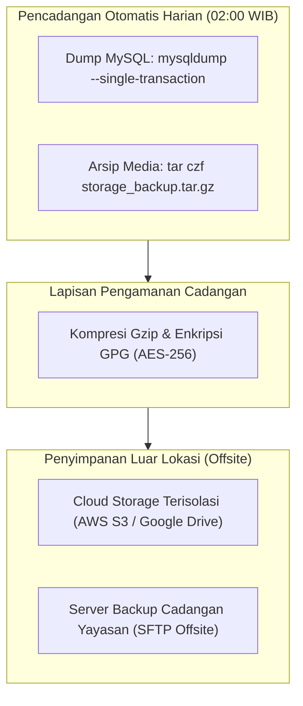

# SuperApp Namira — Pencadangan & Pemulihan Bencana (Backup & Disaster Recovery)

**Dokumen Standar Operasional Prosedur (SOP) Pemulihan Bencana**  
**ID Dokumen:** `DOC-OPS-07-BACKUP-RECOVERY`  
**Status Audit:** `IMPLEMENTED`  
**Target Ketahanan:** RPO <= 24 Jam, RTO <= 2 Jam  
**Terkait:** [`05-database-operations.md`](file:///E:/Rian%20hidayad/SuperApp_Namira/docs/10-operations/05-database-operations.md), [`04-security-recommendations.md`](file:///E:/Rian%20hidayad/SuperApp_Namira/docs/09-security/04-security-recommendations.md)

---

## 1. Parameter Sasaran Pemulihan (RPO & RTO Targets)

| Metrik Pemulihan | Definisi Operasional | Target SuperApp Namira |
| :--- | :--- | :--- |
| **Recovery Point Objective (RPO)** | Batas toleransi maksimal kehilangan data jika terjadi insiden kehancuran server. | **Maksimal 24 Jam** (Dengan backup harian) / **1 Jam** (Jika MySQL Binary Log aktif). |
| **Recovery Time Objective (RTO)** | Waktu maksimal yang dibutuhkan hingga sistem kembali online dan dapat diakses pengguna. | **Maksimal 2 Jam** dari pernyataan status bencana (*Disaster Declaration*). |

---

## 2. Strategi Pencadangan Terpadu (Backup Strategy)

Pencadangan mencakup dua komponen utama yang disimpan secara terpisah:
1. **Basis Data Relasional (MySQL Database Dump)**: Memuat seluruh data tabular 74 tabel (santri, nilai, tagihan, presensi).
2. **Media Unggahan Fisik (`storage/app/public`)**: Berkas foto profil, swafoto presensi, dokumen tugas LMS, dan bukti transfer pembayaran.



---

## 3. Skrip Otomatisasi Pencadangan Harian (Production Backup Script)

Simpan skrip di `/usr/local/bin/namira-backup.sh` dengan hak akses `chmod 700`:

```bash
#!/bin/bash
set -e

DATE=$(date +%Y%m%d_%H%M%S)
BACKUP_DIR="/var/backups/namira"
DB_NAME="superapp_namira"
DB_USER="namira_backup_user"
DB_PASS="[PasswordBackupAman]"
APP_DIR="/var/www/superapp-namira"
GPG_RECIPIENT="backup@namira.sch.id"

mkdir -p $BACKUP_DIR

echo "[$DATE] Memulai proses pencadangan basis data..."

# 1. Dump Basis Data MySQL (Menggunakan --single-transaction agar tidak mengunci tabel operasional)
mysqldump -u$DB_USER -p$DB_PASS \
    --single-transaction \
    --quick \
    --skip-lock-tables \
    --default-character-set=utf8mb4 \
    $DB_NAME | gzip > $BACKUP_DIR/db_${DATE}.sql.gz

# 2. Arsip Direktori Media Storage
echo "[$DATE] Mencadangkan berkas media storage..."
tar -czf $BACKUP_DIR/media_${DATE}.tar.gz -C $APP_DIR/storage/app public

# 3. Enkripsi Berkas Backup dengan GPG
echo "[$DATE] Melakukan enkripsi berkas cadangan..."
gpg --batch --yes --encrypt --recipient $GPG_RECIPIENT $BACKUP_DIR/db_${DATE}.sql.gz
gpg --batch --yes --encrypt --recipient $GPG_RECIPIENT $BACKUP_DIR/media_${DATE}.tar.gz

# Hapus berkas mentah sebelum dienkripsi
rm $BACKUP_DIR/db_${DATE}.sql.gz $BACKUP_DIR/media_${DATE}.tar.gz

# 4. Sinkronisasi ke Cloud Storage Luar Lokasi (Rclone / AWS CLI)
echo "[$DATE] Mengunggah berkas terenkripsi ke Cloud Storage..."
rclone copy $BACKUP_DIR remote-drive:namira-backups/ --include "*.gpg"

# 5. Rotasi Pembersihan Cadangan Lokal yang Lebih Tua dari 7 Hari
find $BACKUP_DIR -type f -name "*.gpg" -mtime +7 -delete

echo "[$DATE] Pencadangan sukses selesai!"
```

Jadwalkan di root crontab (`sudo crontab -e`):
```cron
0 2 * * * /usr/local/bin/namira-backup.sh >> /var/log/namira-backup.log 2>&1
```

---

## 4. Prosedur Pemulihan Bencana Menyeluruh (Disaster Recovery Runbook)

Jika terjadi kehancuran total pada peladen produksi (misal: perangkat keras rusak atau ransomware), ikuti tahapan pemulihan berikut:

### Langkah 1: Siapkan Server Baru & Provisi Dasar
1. Siapkan VPS Ubuntu 22.04 LTS baru dengan IP publik baru.
2. Ikuti instruksi provisi perangkat lunak pada [`03-deployment-guide.md`](file:///E:/Rian%20hidayad/SuperApp_Namira/docs/10-operations/03-deployment-guide.md) (instalasi Nginx, PHP 8.2, MySQL 8.0, Supervisor).

### Langkah 2: Unduh & Dekripsi Berkas Cadangan Terbaru
1. Unduh berkas cadangan terakhir dari Cloud Storage:
   ```bash
   rclone copy remote-drive:namira-backups/ /var/backups/restore/ --include "*20261016*.gpg"
   ```
2. Dekripsi berkas menggunakan kunci privat yayasan:
   ```bash
   gpg --decrypt /var/backups/restore/db_20261016_020000.sql.gz.gpg > /var/backups/restore/db_restore.sql.gz
   gpg --decrypt /var/backups/restore/media_20261016_020000.tar.gz.gpg > /var/backups/restore/media_restore.tar.gz
   gunzip /var/backups/restore/db_restore.sql.gz
   ```

### Langkah 3: Restorasi Basis Data MySQL
1. Buat basis data kosong di MySQL:
   ```sql
   CREATE DATABASE superapp_namira CHARACTER SET utf8mb4 COLLATE utf8mb4_unicode_ci;
   ```
2. Impor struktur dan data:
   ```bash
   mysql -u root -p superapp_namira < /var/backups/restore/db_restore.sql
   ```

### Langkah 4: Kloning Kode Aplikasi & Restorasi Media Storage
1. Kloning kode sumber dari Git ke `/var/www/superapp-namira`.
2. Pulihkan direktori media yang telah didekripsi:
   ```bash
   tar -xzf /var/backups/restore/media_restore.tar.gz -C /var/www/superapp-namira/storage/app/
   ```
3. Konfigurasi berkas `.env` dan kaitkan storage link:
   ```bash
   cd /var/www/superapp-namira
   composer install --no-dev --optimize-autoloader
   php artisan storage:link
   php artisan optimize
   ```

### Langkah 5: Alihkan DNS Domain & Verifikasi Operasional
1. Arahkan DNS Record A `superapp.namira.sch.id` ke IP server baru.
2. Terbitkan sertifikat SSL Let's Encrypt via `sudo certbot --nginx`.
3. Lakukan uji coba login menggunakan akun pengurus yayasan dan verifikasi data transaksi terakhir.
