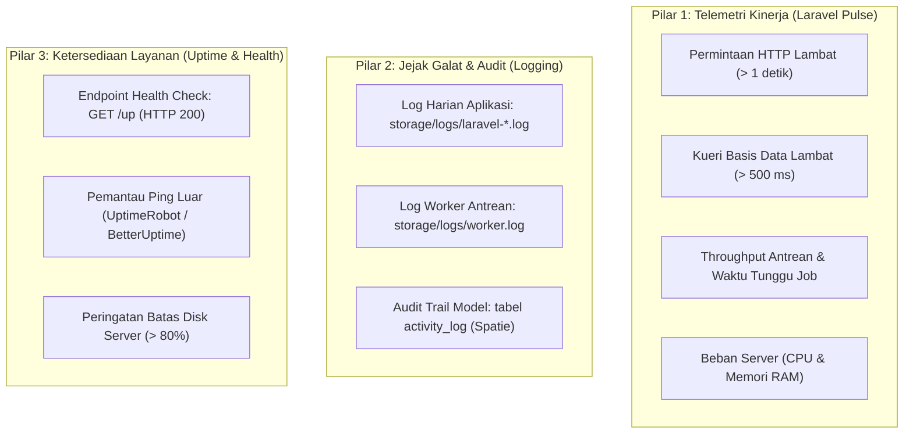

# SuperApp Namira — Pemantauan & Observabilitas Sistem (Monitoring & Observability)

**Dokumen Standar Operasional Pemantauan Kinerja & Telemetri**  
**ID Dokumen:** `DOC-OPS-08-MONITORING`  
**Status Audit:** `IMPLEMENTED`  
**Perangkat Pemantau:** Laravel Pulse, PSR-3 Logger, Health Check Endpoint  
**Terkait:** [`04-performance-and-scalability.md`](file:///E:/Rian%20hidayad/SuperApp_Namira/docs/08-quality/04-performance-and-scalability.md), [`06-runtime-architecture.md`](file:///E:/Rian%20hidayad/SuperApp_Namira/docs/03-architecture/06-runtime-architecture.md)

---

## 1. Arsitektur Pemantauan Tiga Dimensi (Three-Pillar Monitoring)

SuperApp Namira memantau kesehatan ekosistem sistem melalui tiga pilar terintegrasi:



---

## 2. Telemetri Kinerja Aplikasi (Laravel Pulse)

SuperApp Namira menyertakan dashboard performa real-time bawaan Laravel Pulse yang dapat diakses di rute `/pulse`:

### 2.1 Metrik Kunci yang Dipantau:
1. **Slow Requests (Permintaan Lambat)**:
   - Mencatat setiap endpoint yang membutuhkan waktu respons lebih dari 1.000 ms.
   - Mengidentifikasi controller mana yang mengalami bottleneck pemrosesan.
2. **Slow Queries (Kueri Lambat)**:
   - Mencatat kueri SQL yang memakan waktu lebih dari 500 ms.
   - Membantu DBA menentukan kebutuhan indeks baru pada tabel tertentu.
3. **Queue Throughput**:
   - Menghitung jumlah job antrean yang diproses per menit serta job yang mengalami kegagalan (*failed rate*).
4. **Penggunaan Memori & CPU Server**:
   - Grafik beban prosesor peladen untuk mendeteksi lonjakan trafik presensi pagi.

### 2.2 Pembatasan Hak Akses Dashboard `/pulse`
Akses ke dashboard telemetri dilindungi secara ketat pada `app/Providers/PulseServiceProvider.php`:
```php
Gate::define('viewPulse', function (User $user) {
    return $user->hasRole('super_admin_yayasan');
});
```
*Pengguna biasa, guru, atau staf unit yang mencoba mengakses URL `/pulse` akan menerima respon HTTP 403 Forbidden.*

---

## 3. Strategi Pengelolaan Log (Logging Strategy)

### 3.1 Konfigurasi Rotasi Harian (`config/logging.php`)
Log aplikasi disimpan dengan saluran `daily` yang membuat satu berkas log baru setiap hari dengan masa simpan 14 hari:
```php
'daily' => [
    'driver' => 'daily',
    'path' => storage_path('logs/laravel.log'),
    'level' => env('LOG_LEVEL', 'error'),
    'days' => 14,
    'replace_placeholders' => true,
],
```

### 3.2 Tingkat Keparahan Log (Severity Levels)
- `DEBUG`: Hanya aktif di lingkungan lokal (`APP_ENV=local`).
- `INFO`: Pencatatan mutasi transaksi finansial dan kenaikan kelas.
- `WARNING`: Percobaan login gagal berulang atau koordinat GPS di luar toleransi.
- `ERROR` & `CRITICAL`: Pengecualian backend yang tidak tertangani, kegagalan worker antrean, atau koneksi basis data terputus.

---

## 4. Pemantau Ketersediaan Layanan (Uptime & Health Checks)

### 4.1 Endpoint Health Check Bawaan (`GET /up`)
Laravel 12 menyediakan endpoint standar `/up` yang secara otomatis memverifikasi:
- Ketersediaan peladen HTTP Nginx & PHP-FPM.
- Konektivitas ke basis data MySQL (menjalankan query uji `SELECT 1`).
- Status driver cache.

Jika sistem sehat, endpoint mengembalikan respon:
```http
HTTP/1.1 200 OK
Content-Type: text/html; charset=UTF-8
```

### 4.2 Integrasi Notifikasi Peringatan Eksternal (Uptime Alerts)
Disarankan mendaftarkan URL `https://superapp.namira.sch.id/up` ke layanan eksternal (seperti UptimeRobot atau Pingdom) dengan interval ping setiap **1 menit**. Jika peladen tidak merespons dalam 10 detik, notifikasi darurat langsung dikirimkan ke Telegram / WhatsApp tim teknis.

---

## 5. Ringkasan Prosedur Respon Insiden (Incident Response Runbook)

1. **Jika Terjadi Lonjakan Error 500**:
   - Buka terminal server, pantau log secara langsung:
     ```bash
     tail -f /var/www/superapp-namira/storage/logs/laravel-$(date +%Y-%m-%d).log
     ```
2. **Jika Antrean WhatsApp Macet**:
   - Periksa status proses worker:
     ```bash
     sudo supervisorctl status superapp-worker:*
     ```
   - Periksa daftar job gagal:
     ```bash
     php artisan queue:failed
     ```
3. **Jika CPU Peladen Mencapai 100%**:
   - Buka utilitas `htop` pada server untuk menemukan proses PHP-FPM yang mengalami loop tak terbatas (*infinite loop*).
   - Jalankan `sudo systemctl reload php8.2-fpm` untuk me-reset pool worker.
