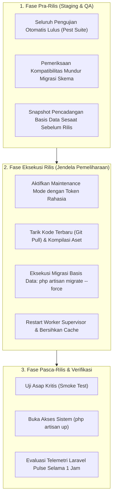
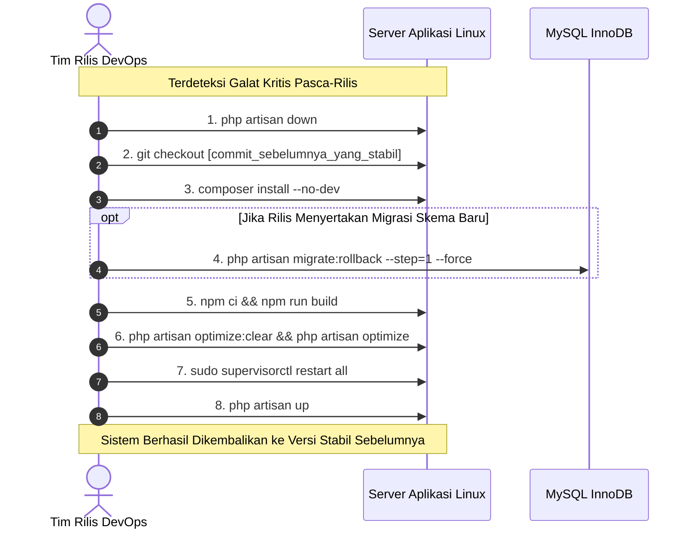

# SuperApp Namira — Prosedur Rilis & Pembatalan Versi (Release & Rollback)

**Dokumen Standar Operasional Prosedur (SOP) Rilis Perangkat Lunak**  
**ID Dokumen:** `DOC-OPS-09-RELEASE-ROLLBACK`  
**Status Audit:** `IMPLEMENTED`  
**Sasaran:** Tim Rilis DevOps & Tim Pengembang Inti  
**Terkait:** [`03-deployment-guide.md`](file:///E:/Rian%20hidayad/SuperApp_Namira/docs/10-operations/03-deployment-guide.md), [`05-database-operations.md`](file:///E:/Rian%20hidayad/SuperApp_Namira/docs/10-operations/05-database-operations.md), [`07-backup-and-recovery.md`](file:///E:/Rian%20hidayad/SuperApp_Namira/docs/10-operations/07-backup-and-recovery.md)

---

## 1. Siklus Rilis Perangkat Lunak (Release Lifecycle)

SuperApp Namira menerapkan alur rilis terkontrol untuk menjamin stabilitas kegiatan belajar mengajar dan transaksi keuangan harian sekolah:



---

## 2. Checklist Verifikasi Pra-Rilis (Pre-Release Checklist)

Sebelum memicu deployment ke peladen produksi, tim rilis wajib memverifikasi poin-poin berikut:

- [ ] Seluruh unit test dan feature test lulus (`./vendor/bin/pest`).
- [ ] Tidak ada berkas migrasi yang menghapus kolom aktif (*destructive DROP COLUMN*) tanpa fase depresiasi bertahap.
- [ ] Jendela rilis dijadwalkan di luar jam sekolah (disarankan **pukul 22:00 – 04:00 WIB**).
- [ ] Pencadangan snapshot basis data telah berhasil dibuat dan disimpan di `/var/backups/`.
- [ ] Tim teknis siap siaga (*on-call*) selama 60 menit setelah sistem dibuka kembali.

---

## 3. Eksekusi Rilis & Smoke Test (Release Execution Runbook)

### Langkah 1: Masuk ke Mode Pemeliharaan dengan Kunci Rahasia
```bash
# Pengguna biasa melihat halaman pemeliharaan, tim rilis tetap bisa mengakses via cookie rahasia
php artisan down --secret="namira-release-auth-key-2026" --render="errors::503"
```
*Tim rilis dapat mengakses aplikasi melalui URL: `https://superapp.namira.sch.id/namira-release-auth-key-2026`.*

### Langkah 2: Pembaruan Kode & Skema Basis Data
```bash
git fetch origin main
git reset --hard origin/main

composer install --no-dev --prefer-dist --optimize-autoloader
php artisan migrate --force

npm ci
npm run build

php artisan optimize:clear
php artisan optimize
```

### Langkah 3: Restart Worker Daemon
```bash
php artisan queue:restart
sudo supervisorctl restart all
```

### Langkah 4: Uji Asap Jalur Kritis (Critical Smoke Test)
Verifikasi minimal 4 skenario berikut sebelum membuka sistem:
1. **Login & Session Check**: Berhasil login dengan akun demo guru dan admin unit.
2. **Jadwal & Jurnal Check**: Halaman jadwal pelajaran terbuka dan tombol buat jurnal berfungsi.
3. **Presensi GPS Check**: Peta geofence memuat koordinat dengan benar.
4. **Tagihan Siswa Check**: Daftar tagihan SPP tampil tanpa galat query SQL.

### Langkah 5: Buka Kembali Aplikasi
```bash
php artisan up
```

---

## 4. Prosedur Pembatalan Darurat (Rollback Runbook)

Jika selama uji asap atau 30 menit pasca-rilis ditemukan galat kritis yang melumpuhkan operasional (seperti error 500 massal atau kegagalan presensi), **eksekusi rollback segera** tanpa menunggu perbaikan kode (*hotfix*) di tempat:



### Perintah Rollback Lengkap:
```bash
# 1. Kunci aplikasi
php artisan down

# 2. Kembalikan kode sumber ke tag atau commit stabil sebelumnya
git reset --hard HEAD~1

# 3. Batalkan migrasi paling akhir (jika ada)
php artisan migrate:rollback --step=1 --force

# 4. Re-kompilasi aset frontend versi stabil
npm ci && npm run build

# 5. Segarkan cache
php artisan optimize:clear
php artisan optimize

# 6. Restart daemon antrean
php artisan queue:restart
sudo supervisorctl restart all

# 7. Buka kembali sistem
php artisan up
```

---

## 5. Format Laporan Evaluasi Insiden (Post-Mortem Template)

Jika prosedur rollback terpaksa dieksekusi, tim pengembang wajib menyusun dokumen *Incident Post-Mortem* dalam kurun waktu 24 jam dengan struktur berikut:

1. **Ringkasan Insiden**: Waktu kejadian, durasi *downtime*, dampak operasional pada santri/guru.
2. **Akar Masalah (Root Cause Analysis / RCA)**: Analisis teknis mengapa galat tidak terdeteksi pada tahap pengujian lokal/staging.
3. **Kronologi Peristiwa**: Urutan stempel waktu dari deployment awal, kemunculan galat, hingga keputusan rollback diambil.
4. **Tindakan Pencegahan**: Penambahan skenario unit test baru atau perbaikan skrip CI/CD agar insiden serupa tidak terulang di masa mendatang.
