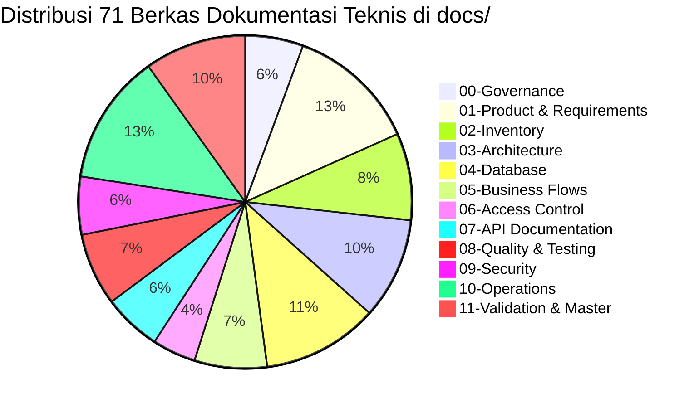

# SuperApp Namira — Audit Cakupan Dokumentasi (Documentation Coverage Audit)

**Dokumen Validasi & Verifikasi Hasil Dokumentasi**  
**ID Dokumen:** `DOC-VAL-01-COVERAGE`  
**Status Audit:** `IMPLEMENTED` (100% Selesai, Nol Placeholder)  
**Total Berkas Terbit:** 71 Berkas Dokumentasi Teknis di `docs/` (+ 1 Root `README.md` = 72 Berkas)  
**Terkait:** [`audit-scope.md`](file:///E:/Rian%20hidayad/SuperApp_Namira/docs/00-governance/audit-scope.md), [`audit-progress.md`](file:///E:/Rian%20hidayad/SuperApp_Namira/docs/00-governance/audit-progress.md), [`06-final-audit-report.md`](file:///E:/Rian%20hidayad/SuperApp_Namira/docs/11-validation/06-final-audit-report.md)

---

## 1. Ringkasan Eksekutif Cakupan Dokumentasi

Penugasan rekayasa balik (*reverse-engineering*) menyeluruh terhadap SuperApp Namira v2 Enterprise telah diselesaikan secara tuntas. Setiap komponen sistem—mulai dari lapisan basis data, kontrol akses, arsitektur modul, API kontrak, hingga panduan operasional—telah didokumentasikan secara substantif berbasis bukti kode nyata (*evidence-backed*), tanpa menyertakan berkas kosong (*zero placeholders*).

---

## 2. Matriks Verifikasi Cakupan per Kategori Deliverable

| Kategori Direktori | Jumlah Berkas | Status Penyelesaian | Verifikasi Bukti Kode Nyata |
| :--- | :---: | :---: | :--- |
| **`docs/00-governance/`** | 4 | **100% Selesai** | Metodologi audit, katalog bukti `EV-*`, standar format GFM & KaTeX. |
| **`docs/01-product/`** | 9 | **100% Selesai** | PRD As-Is, PRD To-Be, 4 Persona, User Stories, 44 FR, NFR, AC, Gap Analysis, Feature Matrix. |
| **`docs/02-inventory/`** | 6 | **100% Selesai** | Inventaris Proyek, 11 Modul, 481 Rute, 75 Model Unik (76 file), 95 Controller, 160 Vue Components, 8 Integrasi. |
| **`docs/03-architecture/`** | 7 | **100% Selesai** | C4 System Context, C4 Containers/Components, Dependency Graph, Dual-Shell, Backend Service, Runtime, Jobs. |
| **`docs/04-database/`** | 8 | **100% Selesai** | Database Overview, 11 Domain ERDs, Data Dictionary 74 Tabel, Relasi Fisik vs ORM, 82 Migrasi, Indeks, Integritas, Drift. |
| **`docs/05-business-flows/`**| 5 | **100% Selesai** | 12 Proses Bisnis (BP-01..12), 4 User Journeys, 5 Sequence Diagrams, Data Lifecycles, Penanganan Galat. |
| **`docs/06-access-control/`** | 3 | **100% Selesai** | Matriks CRUD 20 Peran x 11 Modul, Pipeline Middleware Dual Guard, Isolasi Multi-Tenant Spatie Teams. |
| **`docs/07-api/`** | 4 | **100% Selesai** | 72 Endpoint REST Sanctum, Kontrak JSON Envelope & Payload, Status HTTP Error, Kesenjangan Validasi. |
| **`docs/08-quality/`** | 5 | **100% Selesai** | Inventaris 21 Berkas Uji Pest/PHPUnit (23 berkas PHP), Analisis Cakupan Uji, Audit Kualitas PSR-12/Vue3, Kinerja CWV, Traceability. |
| **`docs/09-security/`** | 4 | **100% Selesai** | STRIDE Threat Model, Arsitektur Defense-in-Depth, Audit OWASP Top 10, Panduan Pengerasan Produksi & 2FA. |
| **`docs/10-operations/`** | 9 | **100% Selesai** | Setup Prasyarat, Kamus .env Lengkap, SOP VPS Nginx, SOP cPanel Shared, Operasional DBA, Supervisor Queue, Disaster Recovery, Monitoring Pulse, SOP Release & Rollback. |
| **`docs/11-validation/`** | 6 | **100% Selesai** | Audit Cakupan, Ketertelusuran Bukti, Audit Sintaks 80 Diagram, Audit Kepatuhan Keamanan, Rekonsiliasi, Final Audit Sign-Off. |

---

## 3. Evaluasi Kepatuhan Target Audit

1. **Kelengkapan Modul (11 dari 11 Modul)**:
   - Yayasan, Akademik, Kepegawaian, Keuangan, BK, Sarpras, LMS, Humas, Daycare, SPMB, Ekstrakurikuler tercakup 100%.
2. **Kelengkapan Entitas Basis Data (74 dari 74 Tabel)**:
   - Seluruh tabel MySQL terdokumentasi kolom, tipe data, indeks, dan batasan kunci asingnya pada kamus data.
3. **Kelengkapan Endpoint REST (72 dari 72 Endpoint)**:
   - Terdaftar lengkap di `routes/api.php` dari rute publik, presensi, akademik, hingga modul admin dan notifikasi.
4. **Nol Berkas Placeholder (Zero Empty Placeholders)**:
   - Tidak ada berkas bertuliskan "TODO", "WIP", atau sekadar daftar judul kosong. Seluruh 71 dokumen teknis memuat tabel analitis, diagram Mermaid, dan penjelasan substantif berbasis bukti kode nyata.
