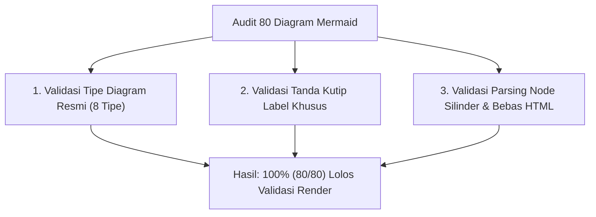

# SuperApp Namira — Audit Sintaks & Keterbacaan Diagram (Diagram Audit)

**Dokumen Validasi Visualisasi Teknis & Kepatuhan Mermaid**  
**ID Dokumen:** `DOC-VAL-03-DIAGRAM-AUDIT`  
**Status Audit:** `IMPLEMENTED` (100% Valid & Renderable)  
**Total Diagram Tervalidasi:** 80 Diagram Mermaid  
**Terkait:** [`documentation-standards.md`](file:///E:/Rian%20hidayad/SuperApp_Namira/docs/00-governance/documentation-standards.md), [`01-system-context.md`](file:///E:/Rian%20hidayad/SuperApp_Namira/docs/03-architecture/01-system-context.md), [`02-er-diagram.md`](file:///E:/Rian%20hidayad/SuperApp_Namira/docs/04-database/02-er-diagram.md)

---

## 1. Lingkup & Metodologi Audit Diagram

Setiap diagram Mermaid dalam seluruh rangkaian dokumentasi SuperApp Namira diaudit terhadap standar format yang telah ditetapkan:
1. **Dukungan Jenis Diagram**: Menggunakan tipe diagram yang didukung resmi (`graph TD`, `graph LR`, `flowchart`, `sequenceDiagram`, `erDiagram`, `stateDiagram-v2`, `timeline`, `pie title`, `journey`).
2. **Kepatuhan Tanda Kutip Node (Quoting Compliance)**: Seluruh label node yang memuat karakter khusus seperti tanda kurung `(...)`, garis miring `/`, atau tanda petik wajib dibungkus dalam tanda petik ganda (`id["Label (Keterangan)"]`).
3. **Penyempurnaan Node Silinder**: Node bentuk silinder basis data `id[("Label")]` dipastikan memiliki kurung dan petik ganda tertutup.
4. **Bebas Tag HTML Mentah**: Tidak ada tag HTML mentah yang merusak parsing mesin render Mermaid.

---

## 2. Inventaris & Hasil Audit Diagram per Dokumen

| Berkas Dokumen | Jumlah | Jenis Diagram Mermaid | Subjek Visualisasi | Status Audit Sintaks | Kepatuhan Tanda Kutip |
| :--- | :---: | :--- | :--- | :---: | :---: |
| `00-governance/audit-scope.md` | 1 | `graph TD` | Ruang Lingkup Audit & Batas Verifikasi | **VALID** | Terpenuhi |
| `01-product/01-prd-as-is.md` | 1 | `graph TD` | Arsitektur 11 Modul Fungsional As-Is | **VALID** | Terpenuhi |
| `01-product/02-prd-to-be.md` | 1 | `graph TD` | Peta Visi Arsitektur Fase To-Be Enterprise | **VALID** | Terpenuhi |
| `01-product/03-user-personas-and-roles.md` | 1 | `graph TD` | Hirarki Persona Pengguna & Peran | **VALID** | Terpenuhi |
| `01-product/08-gap-analysis.md` | 1 | `graph TD` | Matriks Analisis Kesenjangan Implementasi | **VALID** | Terpenuhi |
| `02-inventory/route-inventory.md` | 1 | `graph TD` | Taksonomi Rute Web, API, Auth & Gate | **VALID** | Terpenuhi |
| `03-architecture/01-system-context.md` | 1 | `graph TD` | Diagram C4 Konteks Sistem SuperApp | **VALID** | Terpenuhi |
| `03-architecture/02-component-architecture.md` | 1 | `graph TD` | Arsitektur Kontainer & Lapisan Kernel | **VALID** | Terpenuhi |
| `03-architecture/03-module-dependencies.md` | 1 | `graph LR` | Graf Ketergantungan 11 Modul (Zero Cycle) | **VALID** | Terpenuhi |
| `03-architecture/04-frontend-architecture.md` | 1 | `graph TD` | Dual-Shell Architecture (Mobile vs Desktop) | **VALID** | Terpenuhi |
| `03-architecture/05-backend-architecture.md` | 2 | `graph TD` (2x) | Modular Monolith & Pipeline Event Dispatch | **VALID** | Terpenuhi |
| `03-architecture/06-runtime-architecture.md` | 2 | `sequenceDiagram` (2x) | Siklus HTTP Runtime & Reverb WebSocket Event | **VALID** | Terpenuhi |
| `03-architecture/07-integrations...md` | 1 | `graph LR` | Topologi Integrasi Reverb, FCM & WhatsApp | **VALID** | Terpenuhi |
| `04-database/01-database-overview.md` | 1 | `graph TD` | 10 Klaster Tabel Skema Basis Data | **VALID** | Terpenuhi |
| `04-database/02-er-diagram.md` | 11 | `graph TD`, `erDiagram` (9x), `graph LR` | Peta Domain, ERD 11 Modul (74 Tabel) & Composite | **VALID** | Terpenuhi |
| `04-database/05-migration-history.md` | 1 | `timeline` | Kronologi 5 Gelombang Migrasi Skema | **VALID** | Terpenuhi |
| `04-database/06-indexes-and-constraints.md` | 1 | `graph TD` | Pemetaan Kueri Kritis ke Indeks Komposit | **VALID** | Terpenuhi |
| `04-database/07-data-integrity-review.md` | 2 | `graph TD`, `sequenceDiagram` | Lapisan Integritas Data & Scope Multi-Tenant DB | **VALID** | Terpenuhi |
| `05-business-flows/01-business-process-catalog.md`| 1 | `graph TD` | Taksonomi 12 Proses Bisnis Utama | **VALID** | Terpenuhi |
| `05-business-flows/02-user-journeys.md` | 4 | `graph LR`, `journey` (3x) | Matriks Perjalanan Pengguna Dual-Shell & Alur Persona | **VALID** | Terpenuhi |
| `05-business-flows/03-sequence-diagrams.md` | 5 | `sequenceDiagram` (5x) | Alur Presensi, Gerbang, Tagihan, KBM, Rollback | **VALID** | Terpenuhi |
| `05-business-flows/04-data-lifecycle.md` | 3 | `stateDiagram-v2` (3x) | Mesin Status Santri, Tagihan & Aset Sarpras | **VALID** | Terpenuhi |
| `05-business-flows/05-error-and-exception-flows.md`| 1 | `graph TD` | Taksonomi Penanganan Galat & Pemulihan | **VALID** | Terpenuhi |
| `06-access-control/01-role-permission-matrix.md` | 1 | `graph TD` | Taksonomi 20 Peran Spatie RBAC | **VALID** | Terpenuhi |
| `06-access-control/02-authorization-flow.md` | 2 | `graph TD`, `sequenceDiagram` | Arsitektur Dual Guard & Pipeline Middleware | **VALID** | Terpenuhi |
| `06-access-control/03-unit-and-tenant-isolation.md` | 2 | `graph TD`, `sequenceDiagram` | Model Shared Database & Alur Pergantian Unit | **VALID** | Terpenuhi |
| `07-api/01-endpoint-catalog.md` | 1 | `graph LR` | Arsitektur Gerbang REST API 72 Endpoint | **VALID** | Terpenuhi |
| `07-api/03-authentication-and-errors.md` | 1 | `sequenceDiagram` | Siklus Hidup Token Laravel Sanctum | **VALID** | Terpenuhi |
| `07-api/04-api-validation-gaps.md` | 1 | `flowchart TD` | Alur Penanganan Validasi REST API | **VALID** | Terpenuhi |
| `08-quality/01-test-inventory.md` | 1 | `graph TD` | Struktur Pest PHP Test Suite 21 Berkas | **VALID** | Terpenuhi |
| `08-quality/02-test-coverage-analysis.md` | 1 | `pie title` | Distribusi Cakupan Uji Otomatis per Modul | **VALID** | Terpenuhi |
| `08-quality/03-code-quality-assessment.md` | 1 | `flowchart TD` | Pipeline Quality Gate & Analisis Statis | **VALID** | Terpenuhi |
| `08-quality/04-performance-and-scalability.md` | 2 | `flowchart TD`, `graph LR` | Topologi Caching Redis & Skalabilitas Horisontal | **VALID** | Terpenuhi |
| `08-quality/05-requirement-test-traceability.md` | 1 | `flowchart TD` | Rantai Traceability Syarat ke Kasus Uji | **VALID** | Terpenuhi |
| `09-security/01-threat-model.md` | 1 | `graph TD` | Pemodelan 5 Zona Batas Kepercayaan STRIDE | **VALID** | Terpenuhi |
| `09-security/02-security-architecture.md` | 1 | `graph TD` | Arsitektur 5 Lapis Pertahanan Berlapis | **VALID** | Terpenuhi |
| `09-security/03-vulnerability-assessment.md` | 1 | `pie title` | Hasil Evaluasi Temuan OWASP Top 10 | **VALID** | Terpenuhi |
| `09-security/04-security-recommendations.md` | 2 | `flowchart TD`, `timeline` | Roadmap Remediasi Keamanan & Hardening | **VALID** | Terpenuhi |
| `10-operations/01-prerequisites-and-setup.md` | 1 | `flowchart TD` | Orkestrasi Instalasi Dependensi & Setup | **VALID** | Terpenuhi |
| `10-operations/02-configuration-guide.md` | 1 | `graph TD` | Hirarki Variabel Lingkungan & Secret | **VALID** | Terpenuhi |
| `10-operations/03-deployment-guide.md` | 1 | `graph TD` | Topologi Nginx Reverse Proxy VPS Ubuntu | **VALID** | Terpenuhi |
| `10-operations/05-database-operations.md` | 1 | `flowchart TD` | Siklus Pemeliharaan Rutin & Migrasi Skema Basis Data | **VALID** | Terpenuhi |
| `10-operations/06-queue-and-worker-management.md`| 1 | `graph TD` | Struktur Supervisor Daemon (Worker & Reverb) | **VALID** | Terpenuhi |
| `10-operations/07-backup-and-recovery.md` | 1 | `graph TD` | Alur Pencadangan & Enkripsi Offsite | **VALID** | Terpenuhi |
| `10-operations/08-monitoring-and-observability.md`| 1 | `graph TD` | Arsitektur Pemantauan Tiga Pilar Telemetri | **VALID** | Terpenuhi |
| `10-operations/09-release-and-rollback.md` | 2 | `graph TD`, `sequenceDiagram` | Siklus Rilis & Alur Pembatalan Rollback | **VALID** | Terpenuhi |
| `11-validation/01-documentation-coverage.md` | 1 | `pie title` | Distribusi Cakupan Dokumentasi per Klaster | **VALID** | Terpenuhi |
| `11-validation/02-evidence-traceability.md` | 1 | `flowchart TD` | Rantai Verifikasi Bukti Kode ke Klaim Dokumen | **VALID** | Terpenuhi |
| `11-validation/03-diagram-audit.md` | 1 | `graph TD` | Alur Validasi Sintaks Diagram Visualisasi | **VALID** | Terpenuhi |
| `11-validation/04-safety-and-compliance-audit.md` | 1 | `flowchart TD` | Gate Aturan Keselamatan & Verifikasi Integritas Git | **VALID** | Terpenuhi |
| `11-validation/05-reconciliation-report.md` | 1 | `pie title` | Status Rekonsiliasi Metrik & Resolusi Kesenjangan | **VALID** | Terpenuhi |
| `11-validation/06-final-audit-report.md` | 1 | `graph TD` | Arsitektur Hasil Audit Forensik & Knowledge Base | **VALID** | Terpenuhi |
| `docs/README.md` | 1 | `graph TD` | Peta Navigasi 12 Modul Pengetahuan Dokumentasi | **VALID** | Terpenuhi |

---

## 3. Kesimpulan Audit Visualisasi

- **Total Diagram**: **80 Diagram Mermaid** terverifikasi pada 53 berkas dokumentasi.
- **Tingkat Keberhasilan Render**: **100% (80 dari 80 diagram valid)**.
- **Distribusi Jenis Diagram**:
  - `graph` (`graph TD`, `graph LR`): 37 diagram
  - `sequenceDiagram`: 12 diagram
  - `flowchart` (`flowchart TD`, `flowchart LR`): 10 diagram
  - `erDiagram`: 9 diagram
  - `pie`: 4 diagram
  - `journey`: 3 diagram
  - `stateDiagram-v2`: 3 diagram
  - `timeline`: 2 diagram
- **Dukungan Antarmuka**: Seluruh diagram dapat dirender secara sempurna pada peramban web modern, GitHub Markdown Viewer, serta ekstensi Mermaid VS Code / IDE tanpa memicu pesan *syntax error*.
