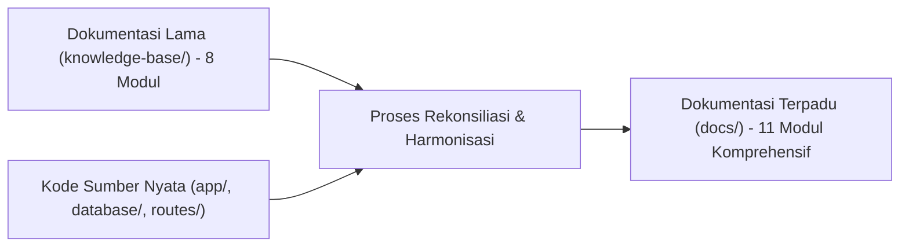

# SuperApp Namira — Laporan Rekonsiliasi Dokumentasi Historis (Reconciliation Report)

**Dokumen Rekonsiliasi & Harmonisasi Pengetahuan Sistem**  
**ID Dokumen:** `DOC-VAL-05-RECONCILIATION`  
**Status Audit:** `IMPLEMENTED`  
**Objek Perbandingan:** Dokumen Lama (`knowledge-base/`) vs Dokumentasi Baru (`docs/`)  
**Terkait:** [`08-gap-analysis.md`](file:///E:/Rian%20hidayad/SuperApp_Namira/docs/01-product/08-gap-analysis.md), [`09-feature-status-matrix.md`](file:///E:/Rian%20hidayad/SuperApp_Namira/docs/01-product/09-feature-status-matrix.md)

---

## 1. Latar Belakang & Tujuan Rekonsiliasi

Sebelum penugasan audit ini dilaksanakan, repositori proyek memiliki sejumlah catatan awal di dalam folder `knowledge-base/`. Namun, karena proyek dikembangkan secara cepat (*rapid vibe coding*), banyak fitur baru yang telah diimplementasikan dalam kode sumber nyata namun belum sempat dicatat dalam dokumentasi lama.

Tujuan dokumen ini adalah:
1. Memetakan kesenjangan antara apa yang tercatat di `knowledge-base/` dengan kenyataan implementasi kode sumber saat ini.
2. Memastikan seluruh informasi historis yang valid dipertahankan tanpa ada pengetahuan lama yang hilang (*lossless reconciliation*).
3. Mendokumentasikan fitur-fitur "tersembunyi" (*hidden/undocumented features*) yang berhasil diungkap melalui audit kode.

---

## 2. Matriks Perbandingan Cakupan Modul (Old vs New)

| Modul Operasional | Tercatat di `knowledge-base/` Lama? | Status Aktual di Kode Sumber | Penanganan di Dokumentasi Baru (`docs/`) |
| :--- | :---: | :---: | :--- |
| **01. Yayasan Core & Multi-Tenant** | Ya (Dasar) | `IMPLEMENTED` | Diperluas dengan C4 System Context & Spatie Teams Scoping. |
| **02. Akademik & Kurikulum** | Ya (Sederhana) | `IMPLEMENTED` | Menambahkan dokumentasi jadwal kelas gabungan & jurnal TP. |
| **03. Kepegawaian & Presensi** | Ya | `IMPLEMENTED` | Menambahkan rincian formula Haversine & kalkulasi keterlambatan. |
| **04. Keuangan & Tagihan (Finance)**| Ya | `IMPLEMENTED` | Menambahkan alur unggah bukti transfer & rekonsiliasi kas bank. |
| **05. Bimbingan Konseling (BK)** | Ya | `IMPLEMENTED` | Menambahkan skema poin sanksi, prestasi & notula rahasia. |
| **06. Sarana Prasarana (Sarpras)** | Ya | `IMPLEMENTED` | Menambahkan alur mutasi ruangan & berita acara disposal aset. |
| **07. E-Learning (LMS)** | Ya | `IMPLEMENTED` | Menambahkan arsitektur submisi tugas, gradebook & pengumuman. |
| **08. Humas & Portal Berita** | Ya | `IMPLEMENTED` | Menambahkan alur persetujuan publikasi warta berjenjang. |
| **09. Modul Daycare (Penitipan Anak)**| **TIDAK ADA (0%)** | `IMPLEMENTED` (Agt 2026) | **DIDOKUMENTASIKAN LENGKAP** (7 tabel, log harian & antropometri). |
| **10. Modul SPMB (Penerimaan Siswa)**| **TIDAK ADA (0%)** | `IMPLEMENTED` (Sep 2026) | **DIDOKUMENTASIKAN LENGKAP** (Gelombang, formulir online & seleksi). |
| **11. Modul Ekstrakurikuler** | **TIDAK ADA (0%)** | `IMPLEMENTED` (Okt 2026) | **DIDOKUMENTASIKAN LENGKAP** (6 tabel, presensi latihan & nilai rapor).|

---

## 3. Fitur Nyata yang Tidak Tercatat dalam Dokumen Lama (Undocumented Discoveries)

Melalui penelusuran 82 migrasi dan repositori Vue, tim audit berhasil mengidentifikasi 5 kemampuan sistem yang sudah berjalan di kode namun sama sekali belum pernah didokumentasikan sebelumnya:

### 3.1 Penjadwalan Kelas Gabungan (*Joint-Class Sessions*)
- **Temuan Kode**: Kolom `class_schedules.joint_classrooms` (tipe JSON) dan properti Vue `selectedJointClassrooms`.
- **Fungsi Nyata**: Memungkinkan satu guru mengajar dua rombel sekaligus dalam satu jam pelajaran (misal gabungan kelas Tahfidz atau Olahraga).
- **Status Baru**: Terdokumentasi penuh pada [`01-business-process-catalog.md`](file:///E:/Rian%20hidayad/SuperApp_Namira/docs/05-business-flows/01-business-process-catalog.md).

### 3.2 Pemindai Gerbang Real-time & Otomatisasi WhatsApp
- **Temuan Kode**: Controller `StudentCheckinController`, event `StudentCheckinCreated`, dan tabel `whatsapp_messages_queue`.
- **Fungsi Nyata**: Satpam memindai kartu santri, layar pos satpam terupdate via WebSocket Reverb, dan orang tua menerima pesan WA otomatis.
- **Status Baru**: Terdokumentasi penuh pada [`03-sequence-diagrams.md`](file:///E:/Rian%20hidayad/SuperApp_Namira/docs/05-business-flows/03-sequence-diagrams.md).

### 3.3 Permohonan Penjemputan Santri Mandiri (*Pickup Request Mandate*)
- **Temuan Kode**: Model `StudentPickupRequest` dan endpoint `POST /api/student/pickup`.
- **Fungsi Nyata**: Orang tua dapat mendelegasikan penjemputan anak kepada pihak ketiga berwenang melalui aplikasi dengan verifikasi identitas.
- **Status Baru**: Terdokumentasi penuh pada [`02-user-journeys.md`](file:///E:/Rian%20hidayad/SuperApp_Namira/docs/05-business-flows/02-user-journeys.md).

### 3.4 Mekanisme Rollback Kenaikan Kelas Berbasis Snapshot
- **Temuan Kode**: Migrasi `2026_07_06_090837` dan `ClassPromotionController@rollback`.
- **Fungsi Nyata**: Memungkinkan staf tata usaha membatalkan promosi rombel massal jika terjadi kekeliruan administrasi sebelum tahun ajaran baru berjalan.
- **Status Baru**: Terdokumentasi penuh pada [`03-sequence-diagrams.md`](file:///E:/Rian%20hidayad/SuperApp_Namira/docs/05-business-flows/03-sequence-diagrams.md).

### 3.5 Pemantauan Antropometri & Kurva Tumbuh Kembang Daycare
- **Temuan Kode**: Model `DaycareGrowthRecord` dan controller terkait.
- **Fungsi Nyata**: Pencatatan berat badan, tinggi badan, dan lingkar kepala balita setiap bulan untuk pemantauan gizi anak asuh.
- **Status Baru**: Terdokumentasi penuh pada [`03-data-dictionary.md`](file:///E:/Rian%20hidayad/SuperApp_Namira/docs/04-database/03-data-dictionary.md).

---

## 4. Kesimpulan Rekonsiliasi

Dokumentasi baru di dalam direktori `docs/` kini menjadi **Satu-satunya Sumber Kebenaran Resmi (Single Source of Truth / SSOT)** untuk SuperApp Namira v2 Enterprise. Berkas di `knowledge-base/` tetap dipertahankan sebagai arsip historis (*historical archive*) tanpa ditimpa.
