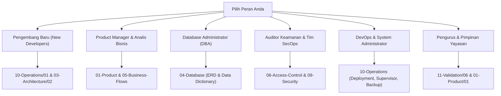

# SuperApp Namira — Indeks Dokumentasi Arsitektur & Operasional (Master Documentation Index)

Selamat datang di repositori dokumentasi teknis resmi **SuperApp Namira (v2 Enterprise)** — Sistem Informasi Terpadu Multi-Tenancy Pendidikan & Pengasuhan Anak di bawah naungan Yayasan Pendidikan Fajar Diinul Islam.

Dokumentasi ini disusun melalui proses audit rekayasa balik (*reverse engineering*) menyeluruh berbasis bukti kode nyata (*evidence-backed*), mencakup 71 dokumen spesifikasi teknis di `docs/` (+ 1 Berkas Induk `README.md` = 72 berkas) tanpa berkas kosong (*zero placeholders*).

---

## 1. Panduan Membaca Berdasarkan Peran Pemangku Kepentingan (Role-Based Reading Guide)

Pilihlah jalur membaca yang paling relevan dengan peran Anda:

- **Pengembang Baru (Fullstack Developers)**: Mulai dari [`10-operations/01-prerequisites-and-setup.md`](file:///E:/Rian%20hidayad/SuperApp_Namira/docs/10-operations/01-prerequisites-and-setup.md), lalu pelajari [`03-architecture/02-component-architecture.md`](file:///E:/Rian%20hidayad/SuperApp_Namira/docs/03-architecture/02-component-architecture.md) dan [`07-api/02-request-response-contracts.md`](file:///E:/Rian%20hidayad/SuperApp_Namira/docs/07-api/02-request-response-contracts.md).
- **Product Manager & Business Analyst**: Buka [`01-product/01-prd-as-is.md`](file:///E:/Rian%20hidayad/SuperApp_Namira/docs/01-product/01-prd-as-is.md), [`01-product/04-user-stories.md`](file:///E:/Rian%20hidayad/SuperApp_Namira/docs/01-product/04-user-stories.md), dan [`05-business-flows/01-business-process-catalog.md`](file:///E:/Rian%20hidayad/SuperApp_Namira/docs/05-business-flows/01-business-process-catalog.md).
- **Database Administrator (DBA)**: Buka [`04-database/02-er-diagram.md`](file:///E:/Rian%20hidayad/SuperApp_Namira/docs/04-database/02-er-diagram.md), [`04-database/03-data-dictionary.md`](file:///E:/Rian%20hidayad/SuperApp_Namira/docs/04-database/03-data-dictionary.md), dan [`10-operations/05-database-operations.md`](file:///E:/Rian%20hidayad/SuperApp_Namira/docs/10-operations/05-database-operations.md).
- **Auditor Keamanan & Tim SecOps**: Buka [`06-access-control/01-role-permission-matrix.md`](file:///E:/Rian%20hidayad/SuperApp_Namira/docs/06-access-control/01-role-permission-matrix.md), [`09-security/01-threat-model.md`](file:///E:/Rian%20hidayad/SuperApp_Namira/docs/09-security/01-threat-model.md), dan [`09-security/03-vulnerability-assessment.md`](file:///E:/Rian%20hidayad/SuperApp_Namira/docs/09-security/03-vulnerability-assessment.md).
- **DevOps & SysAdmin**: Buka [`10-operations/03-deployment-guide.md`](file:///E:/Rian%20hidayad/SuperApp_Namira/docs/10-operations/03-deployment-guide.md), [`10-operations/06-queue-and-worker-management.md`](file:///E:/Rian%20hidayad/SuperApp_Namira/docs/10-operations/06-queue-and-worker-management.md), dan [`10-operations/07-backup-and-recovery.md`](file:///E:/Rian%20hidayad/SuperApp_Namira/docs/10-operations/07-backup-and-recovery.md).
- **Pimpinan Yayasan**: Buka [`11-validation/06-final-audit-report.md`](file:///E:/Rian%20hidayad/SuperApp_Namira/docs/11-validation/06-final-audit-report.md) untuk melihat kartu skor kesehatan sistem dan rekomendasi masa depan.

---

## 2. Daftar Isi Induk Dokumentasi (Master Table of Contents)

### 00. Tata Kelola Dokumentasi & Standar Audit (`docs/00-governance/`)
- [`00-governance/audit-scope.md`](file:///E:/Rian%20hidayad/SuperApp_Namira/docs/00-governance/audit-scope.md) — Ruang lingkup audit, batasan sistem, dan metodologi verifikasi.
- [`00-governance/evidence-register.md`](file:///E:/Rian%20hidayad/SuperApp_Namira/docs/00-governance/evidence-register.md) — Register bukti teknis (`EV-CORE`, `EV-ACAD`, `EV-EMP`, `EV-FIN`, dll).
- [`00-governance/audit-progress.md`](file:///E:/Rian%20hidayad/SuperApp_Namira/docs/00-governance/audit-progress.md) — Pelacak kemajuan eksekusi seluruh deliverable dokumentasi.
- [`00-governance/documentation-standards.md`](file:///E:/Rian%20hidayad/SuperApp_Namira/docs/00-governance/documentation-standards.md) — Standar tipografi GFM, diagram Mermaid, dan KaTeX math.

### 01. Persyaratan Produk & Analisis Bisnis (`docs/01-product/`)
- [`01-product/01-prd-as-is.md`](file:///E:/Rian%20hidayad/SuperApp_Namira/docs/01-product/01-prd-as-is.md) — PRD Kondisi Aktual (*As-Is*) yang telah terimplementasi.
- [`01-product/02-prd-to-be.md`](file:///E:/Rian%20hidayad/SuperApp_Namira/docs/01-product/02-prd-to-be.md) — PRD Masa Depan (*To-Be*), peta jalan otomatisasi & offline sync.
- [`01-product/03-user-personas-and-roles.md`](file:///E:/Rian%20hidayad/SuperApp_Namira/docs/01-product/03-user-personas-and-roles.md) — 4 Persona pengguna kunci & 20 peran Spatie RBAC.
- [`01-product/04-user-stories.md`](file:///E:/Rian%20hidayad/SuperApp_Namira/docs/01-product/04-user-stories.md) — Rangkaian User Stories Agile lintas 11 modul operasional.
- [`01-product/05-functional-requirements.md`](file:///E:/Rian%20hidayad/SuperApp_Namira/docs/01-product/05-functional-requirements.md) — 44 Kebutuhan Fungsional terperinci (`FR-*`).
- [`01-product/06-non-functional-requirements.md`](file:///E:/Rian%20hidayad/SuperApp_Namira/docs/01-product/06-non-functional-requirements.md) — Standar NFR (Kinerja CWV, Keamanan, Ketersediaan 99.5%).
- [`01-product/07-acceptance-criteria.md`](file:///E:/Rian%20hidayad/SuperApp_Namira/docs/01-product/07-acceptance-criteria.md) — Kriteria penerimaan formal format Given-When-Then.
- [`01-product/08-gap-analysis.md`](file:///E:/Rian%20hidayad/SuperApp_Namira/docs/01-product/08-gap-analysis.md) — Rekonsiliasi kesenjangan terhadap dokumentasi lama.
- [`01-product/09-feature-status-matrix.md`](file:///E:/Rian%20hidayad/SuperApp_Namira/docs/01-product/09-feature-status-matrix.md) — Matriks status 60 fitur inti (`IMPLEMENTED`/`PARTIAL`).

### 02. Inventaris Proyek & Komponen Teknis (`docs/02-inventory/`)
- [`02-inventory/project-inventory.md`](file:///E:/Rian%20hidayad/SuperApp_Namira/docs/02-inventory/project-inventory.md) — Profil tumpukan teknologi (Laravel 12, Vue 3.5, Tailwind 4, Vite 8).
- [`02-inventory/module-inventory.md`](file:///E:/Rian%20hidayad/SuperApp_Namira/docs/02-inventory/module-inventory.md) — Taksonomi lengkap 11 modul bisnis terintegrasi.
- [`02-inventory/feature-inventory.md`](file:///E:/Rian%20hidayad/SuperApp_Namira/docs/02-inventory/feature-inventory.md) — Katalog fitur bernomor `FEAT-*`.
- [`02-inventory/route-inventory.md`](file:///E:/Rian%20hidayad/SuperApp_Namira/docs/02-inventory/route-inventory.md) — Analisis arsitektur 481 rute modular web dan API.
- [`02-inventory/code-component-inventory.md`](file:///E:/Rian%20hidayad/SuperApp_Namira/docs/02-inventory/code-component-inventory.md) — Inventaris 75 Model, 95 Controller, dan 160 Komponen Vue.
- [`02-inventory/integration-inventory.md`](file:///E:/Rian%20hidayad/SuperApp_Namira/docs/02-inventory/integration-inventory.md) — Rincian 8 integrasi (Reverb, FCM, WA, Leaflet, DomPDF, dll).

### 03. Arsitektur Sistem Komprehensif (`docs/03-architecture/`)
- [`03-architecture/01-system-context.md`](file:///E:/Rian%20hidayad/SuperApp_Namira/docs/03-architecture/01-system-context.md) — Diagram C4 Level 1 (Konteks Sistem & Aktor Eksternal).
- [`03-architecture/02-component-architecture.md`](file:///E:/Rian%20hidayad/SuperApp_Namira/docs/03-architecture/02-component-architecture.md) — Diagram C4 Level 2/3 (Lapisan Kontainer & Pipeline Middleware).
- [`03-architecture/03-module-dependencies.md`](file:///E:/Rian%20hidayad/SuperApp_Namira/docs/03-architecture/03-module-dependencies.md) — Graf ketergantungan modul & verifikasi zero circular dependency.
- [`03-architecture/04-frontend-architecture.md`](file:///E:/Rian%20hidayad/SuperApp_Namira/docs/03-architecture/04-frontend-architecture.md) — Arsitektur Dual-Shell (`MobileAppShell` vs `AuthenticatedLayout`).
- [`03-architecture/05-backend-architecture.md`](file:///E:/Rian%20hidayad/SuperApp_Namira/docs/03-architecture/05-backend-architecture.md) — Arsitektur Modular Monolith, Service Layer, dan Events.
- [`03-architecture/06-runtime-architecture.md`](file:///E:/Rian%20hidayad/SuperApp_Namira/docs/03-architecture/06-runtime-architecture.md) — Siklus hidup permintaan HTTP, session driver, dan koneksi Reverb.
- [`03-architecture/07-integrations-and-background-jobs.md`](file:///E:/Rian%20hidayad/SuperApp_Namira/docs/03-architecture/07-integrations-and-background-jobs.md) — Antrean pemrosesan asinkron, retry backoff & task scheduler.

### 04. Arsitektur Basis Data (`docs/04-database/`)
- [`04-database/01-database-overview.md`](file:///E:/Rian%20hidayad/SuperApp_Namira/docs/04-database/01-database-overview.md) — Desain skema multi-tenancy, normalisasi, dan 10 klaster tabel.
- [`04-database/02-er-diagram.md`](file:///E:/Rian%20hidayad/SuperApp_Namira/docs/04-database/02-er-diagram.md) — 11 Diagram ER domain spesifik dan diagram relasi komposit.
- [`04-database/03-data-dictionary.md`](file:///E:/Rian%20hidayad/SuperApp_Namira/docs/04-database/03-data-dictionary.md) — Kamus data komprehensif seluruh 74 tabel fisik MySQL.
- [`04-database/04-relationship-catalog.md`](file:///E:/Rian%20hidayad/SuperApp_Namira/docs/04-database/04-relationship-catalog.md) — Pemetaan kunci asing fisik vs relasi Eloquent ORM.
- [`04-database/05-migration-history.md`](file:///E:/Rian%20hidayad/SuperApp_Namira/docs/04-database/05-migration-history.md) — Kronologi 82 berkas migrasi dalam 5 gelombang rilis.
- [`04-database/06-indexes-and-constraints.md`](file:///E:/Rian%20hidayad/SuperApp_Namira/docs/04-database/06-indexes-and-constraints.md) — Batasan unik, indeks komposit kueri harian & soft deletes.
- [`04-database/07-data-integrity-review.md`](file:///E:/Rian%20hidayad/SuperApp_Namira/docs/04-database/07-data-integrity-review.md) — Analisis kebijakan Cascade vs Restrict & risiko data yatim.
- [`04-database/08-schema-drift.md`](file:///E:/Rian%20hidayad/SuperApp_Namira/docs/04-database/08-schema-drift.md) — Verifikasi keselarasan skema DDL dengan `$fillable` dan `$casts`.

### 05. Alur Bisnis & Proses Operasional (`docs/05-business-flows/`)
- [`05-business-flows/01-business-process-catalog.md`](file:///E:/Rian%20hidayad/SuperApp_Namira/docs/05-business-flows/01-business-process-catalog.md) — Katalog 12 Proses Bisnis Inti (`BP-01` s/d `BP-12`).
- [`05-business-flows/02-user-journeys.md`](file:///E:/Rian%20hidayad/SuperApp_Namira/docs/05-business-flows/02-user-journeys.md) — Perjalanan harian 4 persona (Guru, Ortu, Admin TU, Yayasan).
- [`05-business-flows/03-sequence-diagrams.md`](file:///E:/Rian%20hidayad/SuperApp_Namira/docs/05-business-flows/03-sequence-diagrams.md) — Diagram urutan alur presensi, gerbang, tagihan, KBM & rollback.
- [`05-business-flows/04-data-lifecycle.md`](file:///E:/Rian%20hidayad/SuperApp_Namira/docs/05-business-flows/04-data-lifecycle.md) — Siklus hidup & mesin status (Santri, Tagihan, Aset, SPMB).
- [`05-business-flows/05-error-and-exception-flows.md`](file:///E:/Rian%20hidayad/SuperApp_Namira/docs/05-business-flows/05-error-and-exception-flows.md) — Penanganan galat GPS, barcode gerbang, konflik jadwal & IDOR.

### 06. Kontrol Akses & Keamanan Multi-Tenant (`docs/06-access-control/`)
- [`06-access-control/01-role-permission-matrix.md`](file:///E:/Rian%20hidayad/SuperApp_Namira/docs/06-access-control/01-role-permission-matrix.md) — Matriks CRUD 20 Peran Spatie RBAC x 11 Modul.
- [`06-access-control/02-authorization-flow.md`](file:///E:/Rian%20hidayad/SuperApp_Namira/docs/06-access-control/02-authorization-flow.md) — Pipeline otorisasi guard `web`/`sanctum`, middleware & policies.
- [`06-access-control/03-unit-and-tenant-isolation.md`](file:///E:/Rian%20hidayad/SuperApp_Namira/docs/06-access-control/03-unit-and-tenant-isolation.md) — Isolasi multi-tenant Spatie Teams `team_id` & pencegahan IDOR.

### 07. Dokumentasi REST API (`docs/07-api/`)
- [`07-api/01-endpoint-catalog.md`](file:///E:/Rian%20hidayad/SuperApp_Namira/docs/07-api/01-endpoint-catalog.md) — Katalog 72 endpoint REST API Laravel Sanctum.
- [`07-api/02-request-response-contracts.md`](file:///E:/Rian%20hidayad/SuperApp_Namira/docs/07-api/02-request-response-contracts.md) — Kontrak JSON Envelope, skema request/response & payload.
- [`07-api/03-authentication-and-errors.md`](file:///E:/Rian%20hidayad/SuperApp_Namira/docs/07-api/03-authentication-and-errors.md) — Siklus hidup token Sanctum & format kode status HTTP error.
- [`07-api/04-api-validation-gaps.md`](file:///E:/Rian%20hidayad/SuperApp_Namira/docs/07-api/04-api-validation-gaps.md) — Analisis kesenjangan validasi inline vs FormRequests & XSS.

### 08. Jaminan Kualitas & Pengujian (`docs/08-quality/`)
- [`08-quality/01-test-inventory.md`](file:///E:/Rian%20hidayad/SuperApp_Namira/docs/08-quality/01-test-inventory.md) — Inventaris 21 berkas uji Pest PHP, Unit, Feature & Security.
- [`08-quality/02-test-coverage-analysis.md`](file:///E:/Rian%20hidayad/SuperApp_Namira/docs/08-quality/02-test-coverage-analysis.md) — Analisis persentase cakupan uji per modul & peta jalan QA.
- [`08-quality/03-code-quality-assessment.md`](file:///E:/Rian%20hidayad/SuperApp_Namira/docs/08-quality/03-code-quality-assessment.md) — Penilaian kepatuhan PSR-12, Vue 3 `<script setup>` & clean code.
- [`08-quality/04-performance-and-scalability.md`](file:///E:/Rian%20hidayad/SuperApp_Namira/docs/08-quality/04-performance-and-scalability.md) — Kinerja Core Web Vitals, Vite PWA pre-cache & proyeksi skala.
- [`08-quality/05-requirement-test-traceability.md`](file:///E:/Rian%20hidayad/SuperApp_Namira/docs/08-quality/05-requirement-test-traceability.md) — Matriks ketertelusuran 44 FR terhadap file implementasi & uji.

### 09. Keamanan Informasi & Audit Kerentanan (`docs/09-security/`)
- [`09-security/01-threat-model.md`](file:///E:/Rian%20hidayad/SuperApp_Namira/docs/09-security/01-threat-model.md) — Pemodelan ancaman STRIDE melintasi 5 zona batas kepercayaan.
- [`09-security/02-security-architecture.md`](file:///E:/Rian%20hidayad/SuperApp_Namira/docs/09-security/02-security-architecture.md) — Arsitektur pertahanan berlapis (*Defense-in-Depth*).
- [`09-security/03-vulnerability-assessment.md`](file:///E:/Rian%20hidayad/SuperApp_Namira/docs/09-security/03-vulnerability-assessment.md) — Evaluasi OWASP Top 10 & bukti lolos pentest IDOR wave 3.
- [`09-security/04-security-recommendations.md`](file:///E:/Rian%20hidayad/SuperApp_Namira/docs/09-security/04-security-recommendations.md) — SOP pengerasan konfigurasi `.env`, Nginx headers, 2FA & enkripsi.

### 10. Operasional, Deployment & Runbook (`docs/10-operations/`)
- [`10-operations/01-prerequisites-and-setup.md`](file:///E:/Rian%20hidayad/SuperApp_Namira/docs/10-operations/01-prerequisites-and-setup.md) — Prasyarat PHP 8.2, Node.js 20 & panduan instalasi lokal.
- [`10-operations/02-configuration-guide.md`](file:///E:/Rian%20hidayad/SuperApp_Namira/docs/10-operations/02-configuration-guide.md) — Kamus lengkap variabel lingkungan `.env` (Reverb, WA, DB).
- [`10-operations/03-deployment-guide.md`](file:///E:/Rian%20hidayad/SuperApp_Namira/docs/10-operations/03-deployment-guide.md) — SOP deployment peladen Linux VPS Ubuntu + Nginx + Certbot.
- [`10-operations/04-cpanel-deployment-guide.md`](file:///E:/Rian%20hidayad/SuperApp_Namira/docs/10-operations/04-cpanel-deployment-guide.md) — SOP deployment cPanel Shared Hosting (LiteSpeed/Apache).
- [`10-operations/05-database-operations.md`](file:///E:/Rian%20hidayad/SuperApp_Namira/docs/10-operations/05-database-operations.md) — SOP DBA: migrasi aman, pemeliharaan tabel besar & deadlock.
- [`10-operations/06-queue-and-worker-management.md`](file:///E:/Rian%20hidayad/SuperApp_Namira/docs/10-operations/06-queue-and-worker-management.md) — Pengelolaan daemon Supervisor untuk Queue Worker & Reverb.
- [`10-operations/07-backup-and-recovery.md`](file:///E:/Rian%20hidayad/SuperApp_Namira/docs/10-operations/07-backup-and-recovery.md) — SOP pencadangan terenkripsi GPG & pemulihan bencana (RPO/RTO).
- [`10-operations/08-monitoring-and-observability.md`](file:///E:/Rian%20hidayad/SuperApp_Namira/docs/10-operations/08-monitoring-and-observability.md) — Pemantauan Laravel Pulse, rotasi log harian & `/up` health check.
- [`10-operations/09-release-and-rollback.md`](file:///E:/Rian%20hidayad/SuperApp_Namira/docs/10-operations/09-release-and-rollback.md) — SOP rilis aplikasi, smoke test & prosedur pembatalan darurat.

### 11. Validasi & Berita Acara Final (`docs/11-validation/`)
- [`11-validation/01-documentation-coverage.md`](file:///E:/Rian%20hidayad/SuperApp_Namira/docs/11-validation/01-documentation-coverage.md) — Verifikasi cakupan 100% tanpa berkas placeholder.
- [`11-validation/02-evidence-traceability.md`](file:///E:/Rian%20hidayad/SuperApp_Namira/docs/11-validation/02-evidence-traceability.md) — Verifikasi 45 tag bukti `EV-*` terhadap kode sumber nyata.
- [`11-validation/03-diagram-audit.md`](file:///E:/Rian%20hidayad/SuperApp_Namira/docs/11-validation/03-diagram-audit.md) — Audit sintaks & keterbacaan 80 diagram Mermaid.
- [`11-validation/04-safety-and-compliance-audit.md`](file:///E:/Rian%20hidayad/SuperApp_Namira/docs/11-validation/04-safety-and-compliance-audit.md) — Kepatuhan terhadap 12 Aturan Keselamatan Non-Negosiasi.
- [`11-validation/05-reconciliation-report.md`](file:///E:/Rian%20hidayad/SuperApp_Namira/docs/11-validation/05-reconciliation-report.md) — Harmonisasi dokumentasi historis `knowledge-base/` lama.
- [`11-validation/06-final-audit-report.md`](file:///E:/Rian%20hidayad/SuperApp_Namira/docs/11-validation/06-final-audit-report.md) — Berita acara serah terima resmi & kartu skor kesehatan sistem.
